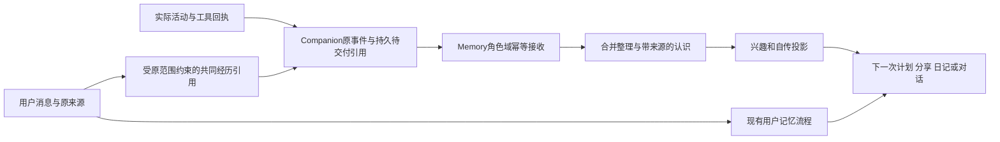

# 天枢角色自身记忆存储与应用设计

2026-10-28归档说明：下文保留10月23日研究截面及建议，不代表当前仍未实施。现有actor域及阅读/旁听闭环已部署R15；AL13已本地集成。本轮按[核心完善执行卡](../development/autonomous-life-core-completion-2026-10-28.md)补齐生命周期等缺口，AL14/15用户延后。当前完成状态以[队列](../development/autonomous-life-development-queue-2026-10-23.md)及正式交付为准。

日期：2026 年 10 月 23 日。状态：研究与设计建议，尚未实施或发布合同。配套[完整开发队列](../development/autonomous-life-development-queue-2026-10-23.md)。

**建议将用户对话记忆与角色自身长期记忆分成两个领域：同属 Memory 产品，复用既有存储、检索与来源能力，但采用独立逻辑存储、表、索引、版本和后台任务。共同经历通过来源引用连接，使用时按场景分别召回。** 当前计划、活动进度和待执行承诺继续由 Companion 管理，原文与媒体覆盖继续由 Knowledge 管理。

目标是可验证的零串写、零跨域误召回、故障可隔离和后台争用有界。共用 PG、CPU、磁盘、网络及模型供应商时，不能承诺物理资源绝对零影响；应通过隔离负载对照验证是否出现实质回归。

## 1 本次核对与前次方案的关系

本设计细化[10 月 21 日研究](../research/autonomous-companion-gap-analysis-2026-10-21.md)，不重新开发 DQ06–08 已完成的独立日常功能，不改写当前用户记忆，也不操作真实账号或生产数据库。

| 对象 | 本次核对依据 |
| --- | --- |
| Memory 协调源码 | `a3abf61ab15623803fd4043a1dd16d7b5b9e9f5c`，检出干净 |
| Companion 协调源码 | `a188a3b438ed100491198a1be49ab402e26b6fe5`，检出干净；Life 相关主要文件相对前次审计没有变化 |
| 当前部署拓扑 | 据 [CURRENT](../development/CURRENT.md) 和[迁移记录](../development/host230-deployment-2026-10-23.md)：计算主机为 `.230`，PG/Redis 仍在 `.210`；本次没有重新实机验收 |
| 正在迭代的记忆批次 | [Q20](../development/memory-quality20-plan-2026-10-23.md)；任务板已扩展至 TS-305，部分 done 仅表示本地候选，TS-300 仍负责联合验证 |
| 实施起点 | 使用开工时 Q20 最终验收且已集成的产品提交，包含已接受的返修；不固定从 TS-298 初版或旧 Q15 起步 |

前次研究把“当前兴趣版本”建议放在 Companion。本次进一步确定：**学习形成的长期兴趣与观点由 Memory 角色域唯一写入；Companion 的当日兴趣、活动偏好和关注点是运行态或带版本的投影。** 静态人格仍归 Companion。两边不能独立改写同一份长期爱好。

## 2 研究得到的关键依据

| 一手资料 | 可采用机制 | 不应外推的部分 |
| --- | --- | --- |
| [CoALA，TMLR 2024](https://arxiv.org/html/2309.02427v3) | 工作状态、情景经历、语义认识与程序知识分工；自传可由以角色为主语的经历及摘要构成 | 是架构分类，不是隔离存储就能得到稳定人格的实验证明 |
| [Hindsight 原论文](https://arxiv.org/html/2512.12818v1)、[当前 observations 文档](https://hindsight.vectorize.io/developer/observations) | 分清外部事实、亲历与观点，反思依赖来源，来源删除后处理派生观察 | 原论文四类网络与当前 API 类型不同；长对话问答结果不证明自主生活长期可靠 |
| [Graphiti 时间字段源码](https://github.com/getzep/graphiti/blob/345e73161a61b0a4400f80c64e5bba6a584acb7b/graphiti_core/edges.py)、[Zep 论文](https://arxiv.org/abs/2501.13956) | 区分事件/事实有效时间与系统记录时间；保留来源和新旧认识关系 | 来源不等于正确性，分区参数不等于权限；不必为借鉴这些字段引入图数据库 |
| [Generative Agents 反思代码](https://github.com/joonspk-research/generative_agents/blob/main/reverie/backend_server/persona/cognitive_modules/reflect.py) | 反思与支持它的经历相连，重要事件积累后再整理 | 派生想法不能当成额外亲历，更不能用日记反复证明自己 |
| [Letta V1 记忆块文档](https://docs.letta.com/v1-sdk/memory/memory-blocks) | persona 与 human 分栏；稳定配置与可学习内容采用不同写入路径 | 该页为 legacy 文档；提示词分块本身不提供存储或权限隔离，整块替换还有并发覆盖问题 |
| [LangGraph 记忆文档](https://docs.langchain.com/oss/python/concepts/memory) | 长期记忆采用显式 namespace；热路径写入与后台整理各有取舍 | 会话 ID 不应成为所有长期知识的唯一归属，命名空间仍需由服务端核验 |
| [A-MEM 论文](https://arxiv.org/abs/2502.12110)、[作者源码](https://github.com/agiresearch/A-mem/blob/ceffb860f0712bbae97b184d440df62bc910ca8d/agentic_memory/memory_system.py) | 记忆间可建立主题联想，帮助从游戏延伸到配乐等兴趣 | 相似关系不是证据关系；不能直接假定研究代码已有天枢所需的权限、撤回传播和审计语义 |
| [PM-Bench，2026](https://arxiv.org/html/2607.12385v1) | 未来意图必须在时间或事件线索出现时正确执行，并能取消、改期 | 合成场景不等于真实长期陪伴；单纯增加 heartbeat 并不自动改善执行 |

结合这些研究和本地代码，推荐“分域存储、证据相连、按需共同使用”。这是本项目的设计推导，不是采用某个第三方框架的决定。

## 3 为什么不能直接把她的记忆塞进用户记忆

现有用户记忆并非不区分主体的通用文本库。

- [common.json](../../contracts/text-dialogue/v1/schemas/common.json) 第 151 行定义的 scope 绑定 actor、person、audience、conversation。`self_private` 表示用户与角色的私聊，不表示角色自己的私有记忆。
- [service.py](../../projects/tianshu-memory/src/tianshu_memory/service.py) 第 109 行核验账号与 person；[recall_index.py](../../projects/tianshu-memory/src/tianshu_memory/recall_index.py) 第 211 行要求语义组主体与 scope 对应。
- [memory_learning.py](../../projects/tianshu-companion/src/tianshu_companion/memory_learning.py) 第 17、454 行围绕真实消息作者、轮次和来源抽取事实。给 bot 造一个 person_id 会混淆 Q20 正在收敛的人物归属。
- 用户自动事实、来源血缘、候选任务和索引有自己的迁移及撤回规则，不能把日记或模型自述直接写进去。

例如“用户不喜欢恐怖游戏”和“她喜欢恐怖游戏的解谜部分”必须同时成立。模型输入中只有一句无主语的“喜欢解谜，不喜欢恐怖游戏”，很容易把双方偏好合并。

现有 [knowledge_content.py](../../projects/tianshu-memory/src/tianshu_memory/knowledge_content.py) 第 30 行已经支持 `owner={kind:actor, actor_id}`，可复用角色原件所有权。它解决的是“这份资料属于谁”，并没有完整解决“她从中经历、学到、喜欢了什么”。其第 117 行的跨 owner 读取限制也不能为自主生活而放宽。

## 4 物理存储选择

| 方案 | 优点 | 对现有记忆的影响 | 本次选择 |
| --- | --- | --- | --- |
| 用户 records 表加类别字段 | 代码表面变化少 | 查询、索引、迁移和抽取都要辨别新类型，漏过滤就会污染 | 不采用 |
| 同 schema 新增角色表 | 内容可分开 | 仍可能共用事务锁、guard、请求准入与任务容量 | 不作为最终隔离方案 |
| 同 PG 实例内独立角色逻辑源/schema | 可独立迁移、索引、锁、队列和恢复，复用基础设施 | 仍共享服务器资源，但不必改用户业务表 | 推荐 |
| 新 PG 实例或新主机 | 更强资源与故障隔离 | 运维和部署复杂度增加 | 只有测得前述隔离不足时再考虑 |

这个选择有具体源码依据：[store.py](../../projects/tianshu-memory/src/tianshu_memory/store.py) 第 401 行的 PG 事务仍进入 `BEGIN IMMEDIATE` 适配；[postgres.py](../../projects/tianshu-memory/src/tianshu_memory/postgres.py) 第 87 行取得按当前 schema 计算的 `memory-authority` advisory lock。只换表名不能消除这条锁争用。PG advisory lock 本身由应用定义其含义，正确隔离需要独立锁身份。[PostgreSQL 锁文档](https://www.postgresql.org/docs/17/explicit-locking.html)

建议在 Memory 产品内新增 `actor_memory/` 领域，以现有 `StorageRuntime` 注册独立存储身份及逻辑库。可用 `actor-memory` 作为候选存储身份，最终 schema 名继续由现有 `schema_name()` 生成，不能在配置和代码中各算一遍。它是存储标识，不意味着增加一个网络微服务。

每个域有独立的小型 DDL/prepare、安装版本、索引、恢复状态目录、guard、连接容量及请求/任务配额。复用 [tianshu_storage](../../packages/tianshu-storage/src/tianshu_storage/runtime.py)；不要直接创建一个新 service 名的完整旧 Store，因为旧 prepare 会装载整套用户 Memory 表。SQLite 新安装兼容时使用独立本地文件，不迁入当前用户文件；当前生产以 PG 验证为主。

schema 是命名空间，并不是自动的访问防护。角色写入路径固定到自己的存储句柄与白名单操作，连接设置固定 search_path；需要强制数据库权限边界时，给角色运行连接分配仅限新 schema 的权限，迁移职责另走现有安装流程。不能仅依靠模型传入的 domain。无需改变现有用户连接的权限，也不对整台 PG 做无关加固。[PostgreSQL schema 与权限](https://www.postgresql.org/docs/17/ddl-schemas.html)

角色域不可用时，仅其端口和后台整理报告不可用；已有用户记忆继续服务。不得把新域初始化失败、队列满或 guard 异常升级成无关用户记忆的全局不可用，也不得伪报角色域正常。共享日志盘、PG 服务整体故障等既有共因仍属于整体运行边界。

## 5 数据种类与唯一归属

| 内容 | 唯一权威 | 角色域如何使用 |
| --- | --- | --- |
| 用户事实、偏好、原话归属 | Memory 现有用户领域 | 按原 scope 读取，引用而不搬运用户画像 |
| 角色与人物的关系类型、好感及冻结 | Memory 现有 relationships 领域 | 引用原配对账本，不建立第二套亲密值；反思不能绕过冻结，短期情绪仍按原规则独立 |
| 稳定人格、背景设定与正式修订 | Companion Personas | 作为身份种子；不能冒充实际亲历 |
| 活动进度、承诺、待办、暂停恢复 | Companion Activities/Concerns | 保存历史投影；“现在是否完成”仍查询执行 owner |
| 短期情绪、当日关注 | Companion Life/Affect | 可用于选择行为，不直接等于永久偏好 |
| 长期自身经历、后天兴趣与观点 | Memory actor_memory | 唯一长期账本及修订链 |
| 自传摘要与兴趣概况 | 角色长期记录的可重建投影 | 带版本、依据和范围，不成为第二份权威 |
| 日记与作品正文 | Companion 原写作模块 | 只索引可见版本和出处，不另存权威正文 |
| 网页、字幕、视频帧与正文覆盖 | Knowledge/对应内容 owner | 保存内容引用、实际覆盖和阅读后的理解 |
| 账号动作与送达结果 | Platform/对应渠道 | 只有真实回执支持“已经收藏/发出” |

角色自传建议覆盖三种长期内容：情景经历、语义认识与偏好、跨事件反思。未来意图继续落原 concern/activity，不能只埋在向量库中等它偶然被想起。已验证的操作经验可以作为认识的一种，但本轮不扩展成模型自动改代码、改权限或改工具定义。

## 6 角色记忆的最小数据模型

建议先使用少量关系表和独立检索投影，不要求引入 Neo4j、新向量库或另一套 Agent 框架。以下名称是候选设计，不是已发布 schema。

| 候选对象 | 保存内容 |
| --- | --- |
| `actor_episodes` | 某角色实际发生或获知的一段经历，来源事件身份、时间、参与者、结果、内容覆盖 |
| `actor_claims` | 对世界的认识、自我偏好、暂时判断和反思；类型、有效期、修订关系及支持来源 |
| `actor_dependencies` | 来源引用与派生关系，支持、反证、替代、撤回依赖；主题相似边不混作证据边 |
| 角色检索与概况投影 | 独立索引、当前兴趣概况、近期自传摘要，可由权威记录重建 |
| 角色任务与回执 | 幂等键、提交摘要、任务状态、版本、待整理游标；与用户 jobs/write_ledger 分开 |

每条记录至少能回答：

1. **属于谁**：稳定 `actor_id`；由可信角色登记及调用身份核验。
2. **关于谁或什么**：subject/participant/reference，与 owner 分开。
3. **谁做了或说了**：行动者、发言者、观察者，不能统一成“我”。
4. **是什么性质**：亲历、观察、他人转述、主观看法、推断、虚构设定/剧情；执行成功失败另有字段。
5. **何时发生、何时知道**：occurred_at、learned_at/recorded_at；观点再有 valid_from/valid_until。
6. **依据何在**：producer、对象/事件 ID、version/hash、片段或覆盖、回执。
7. **在哪里能使用**：来源受众、世界、会话/人物限制、当前有效性和披露范围。
8. **后来是否改变**：revision、supersedes、withdrawn 等状态，不用覆盖正文抹掉变化过程。

模型可以提议理解和感受，但不能指定自己拥有的 actor、来源权限或执行成功状态。置信字段只表示当前确定程度，不应显示成“真实概率 97%”之类未经校准的测量。

一个合成例子：角色读了视频 120–150 秒的字幕并看了部分帧。episode 记录这些实际覆盖及 gaps；claim 记录“我喜欢这一段的弦乐安排”，引用该 episode；另一个 concern 记录“想找作曲家访谈”。三个记录承担不同职责，不能把最后一项当成已经完成。

## 7 共同经历如何连接两个域

“她自己的记忆”并不表示所有内容都关于她，也不表示可以在任何群里讲。

例如用户在私聊中说自己不喜欢恐怖游戏，而她后来实际看了一个游戏片段：

| 记录 | 归属和来源 |
| --- | --- |
| 用户不喜欢恐怖游戏 | 原用户记忆，引用那条私聊消息 |
| 她曾与用户聊过该题材 | 角色经历投影，引用同一对话来源并保留原范围 |
| 她看过视频某片段 | 独立真实数字经历，引用阅读回执和覆盖 |
| 她喜欢谜题但不喜欢突发惊吓 | 角色主观观点，引用自己的观看经历 |
| 以后给该用户分享非恐怖解谜作品 | 现有事项/参与决策，依据用户偏好和角色经历分别读取 |

原始事实源只在其 owner 处维护一次，各域可以保存必要的语义投影和引用；禁止将同一来源复制后当成多份独立证据。角色亲历不覆盖用户偏好，用户偏好也不自动改写她的人格。

从私聊产生的经历、摘要、反思和联想都继承来源限制。某一结论依赖多项来源时，可使用范围不能超过仍有效依赖的共同范围。若以后取得独立公开依据，可以基于公开依据重新形成不依赖私聊的结论，而不是简单删掉私聊标签来扩大可见范围。会话 ID 是来源定位的一部分，不必把它作为所有角色长期知识的永久分区。

用户撤回或要求遗忘后，不能再从角色日记、兴趣摘要或旧缓存把同一私人事实学回来。角色撤回自己的观点或日记也不能反向删除用户真实聊天。依赖关系有方向，不使用无差别跨库级联删除。

## 8 从发生到记住的写入流程

动作发生时先保存执行事实与待交付引用，不调用模型。使用原事务与持久任务机制实现 outbox 语义；不是新增消息中间件。角色域以 actor、源事件身份/版本和视角为去重依据，同键不同内容拒绝。ACK 丢失时查询或重放同一幂等提交，不能增加独立证据次数。

普通群旁听也可以产生经历：她在既有观察授权范围内看到有趣话题，即使最终静默，也能留下带原群范围的观察、形成自己的问题，随后自主探索。它不依赖一次实际回复，也不送进用户事实抽取器；“我旁听到”与“我参与讨论过”保留区别。撤回原观察来源后，相关派生项同样失效。

不在跨服务调用或模型生成期间持有 PG 事务，也不假装能做跨产品原子事务。Companion 原事件已提交但长期整理未完成时，页面可显示“经历已发生，整理待完成”；近期对话仍可读取真实当前状态，不能误报没有发生。

阅读步骤本来已调用模型时，可以顺带输出有来源的简短理解和感受，避免再调用模型复述。同一活动结束、出现重要反例或积累实质新内容时再做跨事件整理。空 tick、重复索引、只是打开页面都不触发新反思。

新领域最初不迁移用户记忆。已有角色历史仅按可核验来源有界导入；旧 `fictional=true` 日记和生成剧情保持虚构性质，不能批量当作真实数字经历。人格种子可以初始化偏好，但不制造“过去做过”的历史。

## 9 召回怎样服务自主生活又保留用户记忆

用户记忆现有接口、请求语义、主体选择、排序和上下文槽位保持。角色域提供单独的有版本接口；不向现有闭集 schema 偷加字段。Companion 用一个窄上下文组合器按需要读取两个端口，不改变用户抽取器。

| 场景 | 主要材料 | 调用方式 |
| --- | --- | --- |
| 用户问自己的历史事实 | 原用户记忆 | 保留原路径，不强制调用角色记忆 |
| 用户问“你这几天在做什么” | 角色近期经历、未完事项 | 查角色域与当前活动；保留真实覆盖 |
| 普通闲聊 | 当前人格、活动及相关少量材料 | 使用已更新的短投影；没有需要不查询完整自传 |
| 新一轮自主计划 | 长期兴趣、未完事项、近期成功失败 | 角色域检索加现有执行状态，产生新 activity |
| 群聊出现相关话题 | 当前群可见材料、她的相关经历 | 两域分别按受众过滤，再判断参与 |
| 日记/反思 | 当日真实经历、观点变化、明确虚构素材 | 后台分批读取，不影响当前回复热路径 |

需要两域时可并行取得结果，最终分成“关于对方”“我的经历与看法”“当前执行状态”“外部原文”几栏，保持主体、来源和版本。用户记忆预算不被角色回忆挤占；先减少非必要的角色材料，不能因新域返回很多相似内容就截断原用户证据。简单场景不新增“是否召回”的模型步骤，仍由原一次回复模型表达。

过滤在检索与相似邻居扩展之前执行：actor、来源受众、有效状态、世界、实际获知关系。不同域的原始相似度分数不必直接横比，先分别选择与去重，再按当前问题组合。某条角色观点被检索多次不能自动提高其证据强度。

角色域迟到或不可用时，普通用户记忆回答继续；如果问题正是问她的过去，则如实说明当前无法取得，不能用用户记忆或人格设定补写。自主规划可以延后相关活动，或者选择不依赖故障来源的活动。

## 10 更新 遗忘与独立恢复

| 动作 | 含义与处理 |
| --- | --- |
| 淡出 | 降低普通细节默认检索优先级，仍可按事件/时间追查 |
| 压缩归档 | 保留一段经历的必要因果和来源；不是把摘要当新经历 |
| 兴趣变化 | 新版本替代当前观点，保留以前为何喜欢、后来为何改变 |
| 事实更正 | 更新当前有效认识，原错误保留历史标签，不继续默认使用 |
| 撤回/删除 | 清理或抑制相应正文、索引与缓存，依赖它的派生项失效或重算 |

来源撤回通知沿现有事件/回执机制传播，但异步通知不是唯一保护。写入、读取以及实际发送前，对有关来源做有界批量有效性检查；晚到整理不能复活已撤回版本。来源服务不可用时，依赖它的候选不可用于表达，其他无关记忆照常可用。

角色库独立恢复时，要重新核对外部来源版本、撤回状态和当前角色登记。不能通过恢复旧角色备份绕过用户库后来发生的遗忘，也不能把用户库一起回滚到旧代次。恢复 checkpoint 不等于恢复外站账号动作，未知评论/收藏仍按原动作回执核对。

自传和日记不是事实账本：同一次经历写入日记、周总结和反思三次，仍只有一份原始依据。兴趣应主要随不同时间的真实接触与行动选择变化，不随自己的复述次数自动强化。

## 11 运行资源与当前迭代隔离

代码中已有前后台调度，优先正确接入而不是新造队列框架。

- Companion [ModelSlots](../../projects/tianshu-companion/src/tianshu_companion/model_slots.py) 第 8 行已有前台优先和后台公平性；但 [runtime_execution.py](../../projects/tianshu-companion/src/tianshu_companion/runtime_execution.py) 第 324、535 行的活动和主动表达目前仍取得前台槽。自主工作需改接后台入口，保持总容量约束。
- [Life.work](../../projects/tianshu-companion/src/tianshu_companion/life.py) 第 701 行在一把锁中串行等待多个步骤。应沿原循环做有界 pump，慢阅读不阻塞全部角色；不把正在运行的 Store 随意移到线程。
- Memory 当前 `jobs` 容量、[Requests](../../projects/tianshu-memory/src/tianshu_memory/app.py) 第 87 行及 [执行池](../../projects/tianshu-memory/src/tianshu_memory/chat_requests.py) 第 31 行存在共享准入。新角色端口需独立有界容量，不能仅分库却占满用户请求槽。
- Gateway [scheduler.py](../../projects/tianshu-model-gateway/src/tianshu_gateway/scheduler.py) 已有 interactive reserve。工作类别来自受保护部署配置，不能只传一个 `background` 请求字段就声称隔离完成。按现有绑定配置核验实际类别，保留上游调用不可抢占的事实。
- 连接池、模型、检索嵌入、视觉/转录和抓取都有共享资源。先限定角色后台并发与待处理数量，前台繁忙时延后；不通过加大总槽位或超时掩盖退步。

新域的 routine bookkeeping 不推进用户 source_revision，也不让每次兴趣更新使所有聊天快照失效。共享来源发生真实撤回时，只使确实依赖它的记录失效。

Q20 的接口与热点模块继续由其现有写者收口。新领域独立设计和合同准备可以进行；产品装配、共享入口及迁移在该产品最终写权释放后串行接入。不要为自主记忆把 Q20 用户领域重构为“万能主体记忆引擎”。

## 12 如何验证不污染和少干扰

本设计没有执行下列测试；它们是开发队列的针对性验收内容。

1. 同题材相反偏好：用户喜欢 A、角色喜欢 B、另一角色喜欢 C，旧用户 API 的结果不混入 B/C；自我回答不把 A 当自己的偏好。
2. 合成用户库前后对照：仅运行角色导入、反思、删除和重建时，用户业务表、索引、候选任务和语义版本不变；必要只读访问或运维计数另列。
3. 真实来源和虚构区分：仅计划、只读标题、抽样视频、他人转述与实际完成分别表达；旧虚构日记不升级成真实经历。
4. 私聊共同经历：归纳为角色记忆后仍不能在无关群使用；多角色共处也不自动变成全知；自我反思不能绕过关系账本冻结或授予权限。
5. 并发撤回：来源撤回与整理/发送竞态下，无晚到复活，无从日记重新学回；角色删除不反向删除用户事实。
6. 独立故障恢复：角色 schema 迁移失败、队列满、guard错误、索引重建或备份恢复，不修改用户域或要求其回滚。
7. 热路径：对比相同配置的无自主负载、有限自主负载、暂停自主负载；记录用户首段/完整/抽取耗时、准入等待、PG锁等待和任务积压，区分供应商波动。
8. 长期使用：跨日兴趣持续，观点改变有证据，暂停活动能继续，取消事项不复活，日记和分享一致。

复用开工时仍适用的 Q20 成功证据，只补新影响范围和必要的真实 PG 联合验证。共享事务/迁移/认证入口确有修改时执行产品已有必需检查，不另设覆盖率门槛或默认反复全量。实际模型验证只在合同与功能稳定后集中进行，使用隔离合成资料和既有预算记录。

**最终应达到的行为是：她越来越了解自己的经历和偏好，同时仍准确记得用户是谁、用户说过什么；两个视角在交流时可以相遇，但彼此不会改写对方的事实。**
