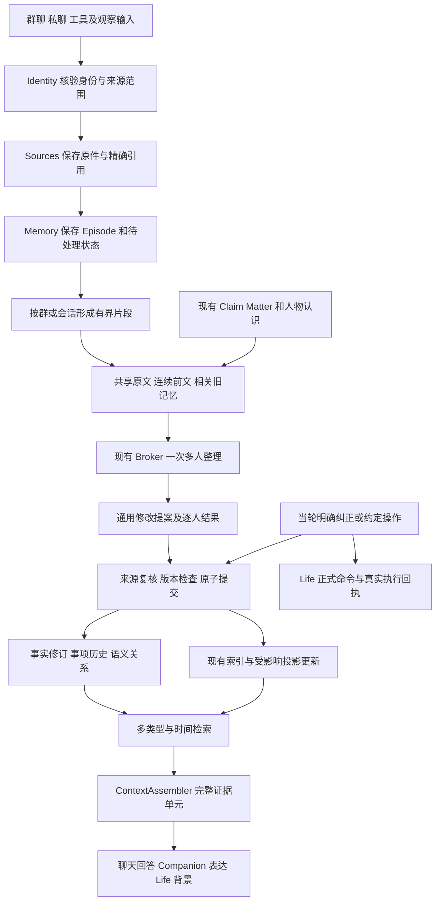
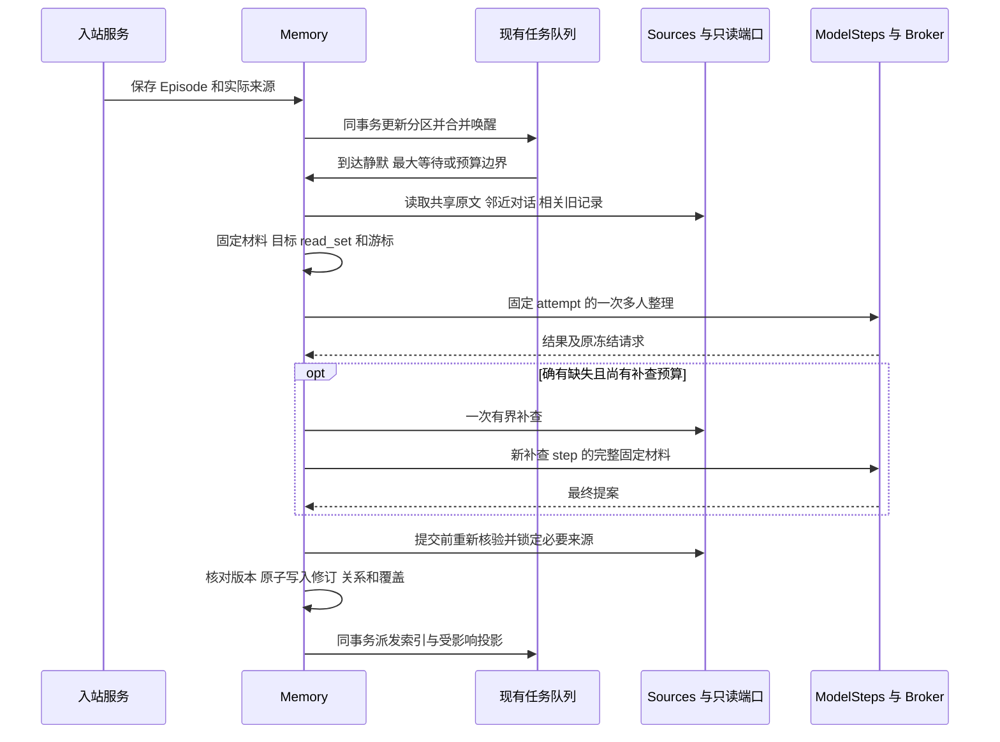
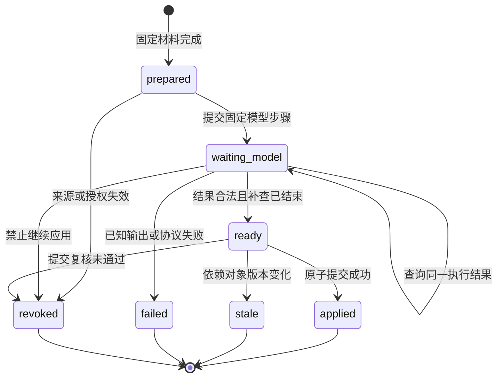

# 天枢记忆系统落地实施图纸

版本：实施跟踪 v2。日期：2026-11-01。面向 Memory、Conversation、Companion、Life、前端开发者及集成人。

本图纸确定一次完整交付的实现目标：在现有统一架构内，恢复群聊共享片段一次多人整理，补齐旧记忆对照、事实修订、事项历史、多类型检索、人物认识及实际回答消费。所有能力完整装配和验证后一次切换上线。

**改造规模为 Memory 内部的中等规模演进。** PostgreSQL、Sources、Identity、模型 Broker、Procrastinate 和现有产品边界继续复用，已有原件和记忆不重新初始化。A/B/C/D/F 产品代码已于本日合入，评测和发布工具正在准备；集中验收与生产切换尚未执行。实际提交、状态和验证记录以[实施队列](../development/memory-closure-status-2026-11-01.json)及[实施说明](../development/memory-closure-execution-2026-11-01.md)为准。

设计时核对的源码基准为 `7aac7746ed0a4d12cd8b596de156b6f3a745f8ad`，所在工作树：`C:/Users/Administrator/.codex/worktrees/tianshu-unified-refactor/tianshu-peiban-bot`。下文已有基础与差距表描述该设计基线；实际生产成本对照使用 `dcdf729b5d22f451093e3658d131fd6757a00dde`，不把设计差距当成本日集成代码的当前状态。

## 阅读顺序

- 产品行为及改动边界：第 1 至 4 节。
- 数据结构、协议和群聊算法：第 5 至 8 节。
- 事务、时间查询、画像和接口：第 9 至 12 节。
- 存量切换、验收和完整交付：第 13 至 15 节。
- 代码证据和研究附件：第 16 节。

本图纸是本次开发入口。此前研究、实施草案和算法细案作为依据与解释附件；同一技术细节不在多份文档中独立修改。代码实现形成的新决定应回写本文对应章节，不能仅留在聊天或任务交接中。

## 1 完整交付范围

| 能力 | 用户可观察的完成行为 |
|---|---|
| 私聊持续理解 | 能结合上下文识别省略、改口和条件，不把每次表达都新增成孤立事实 |
| 群聊多人整理 | 同一群片段共享输入一次，模型一次返回不同人物和共同事项的变化 |
| 作者与对象区分 | A 转述 B 的话保留为转述；提问、引用、BOT 建议不会自动变成本人确认 |
| 事实修订 | 区分原来记错与后来发生变化，纠正后后续回答更新 |
| 持续事项 | 同一事项改期、取消、进展能接续；相似标题不强制合并 |
| 时间记忆 | 支持当前状态、过去某时事实、当时已知三种读取方式 |
| 多类型检索 | 事实、事项、经历、人物认识和相关反思共同参与预算内选材 |
| 人物认识 | 带条件的习惯和相处认识可根据反例收窄或撤回 |
| 原文追查 | 缺少关键依据时有界补查原文，保留覆盖缺项 |
| 恢复与管理 | 来源撤回、并发纠正、模型未知结果、旧任务转换和页面恢复保持一致 |

这次交付包含全部上述行为。下文工作包是内部开发依赖，不是分批上线方案。模型训练、全员社交图和更换外部记忆服务不是实现这些目标的前提。

## 2 已有基础与待补差距

| 机制 | 当前情况 | 本次决定 |
|---|---|---|
| PG、事实修订、来源支持组、持久任务 | 已有正式实现 | 复用，增加所需字段和调用能力 |
| 模型抽取 | 按单个 Episode 及原件分页调用 | 改为同权限域会话片段的增量整理 |
| 多人物输出 | `claims[].subject_id` 可指向不同人物 | 补共享片段、冻结目标、逐人结果及覆盖回执 |
| 历史群聊分段 | 旧版 2026-10-26 发布过 schema 6 多人整理 | 恢复有效行为，适配当前统一架构；不恢复旧多服务依赖 |
| 旧事实对照 | 当前抽取输入没有相关旧 Claim；事项主要取当前人前 20 项 | 使用相关人物、事项和明确引用的候选并集 |
| 自动修订 | 当前自动写入不允许旧 Claim 改值 | 增加明确领域操作，与手动纠正复用写入原语 |
| 冲突 | 当前将同主体同属性的不同值列为冲突 | 使用模型提出且有依据的关系，移除该语义捷径 |
| 历史查询 | 当前主要读当前 revision、按现在有效期过滤 | 增加记录时间、事项历史和时间查询协议 |
| 回答材料 | 普通召回主要使用 `content` 文本 | 统一传递主体、作者、条件、时间、关系及来源 |
| 人物投影 | 主要组合现有列表，另有经历反思 | 增加可修订认识并接入真实消费者 |

当前源码并没有“为每个人重读整段”的模型循环。成本对照不得把该假想低效实现当成当前生产基线。

## 3 系统装配图



Life 背景读取与实际执行分开：Memory 可以知道用户说某事取消了，但不能绕过正式命令自行撤销外部任务。对话继续及时回复，普通记忆整理在后台运行。

### 3.1 模块归属

| 所属位置 | 职责和改动 |
|---|---|
| `memory/service.py` | Episode 接收、分区脏标记、查询投影与领域入口；不在这里执行模型提示细节 |
| `memory/consolidation.py` 新增 | 增量作业生命周期、冻结材料、调用已有模型步骤、提交提案 |
| `memory/materials.py` 新增 | 共享材料池、分段选材、候选并集和输入预算；通过端口读取 Conversation |
| `memory/extraction_contract.py` | 整理输入输出的正式类型、schema、稳定提示及示例 |
| `memory/claims.py` | 对外事实和事项用例、权限检查与现有读取接口 |
| `memory/revisions.py` 新增 | 从现有写入逻辑抽出修订及关系应用；手动命令和后台整理共用 |
| `memory/retrieval.py`、`embedding.py` | 复用词法、向量、RRF、MMR，增加主体、类型及时间约束 |
| `memory/types.py`、`codec.py` | 正式数据类型及完整证据单元的统一构造 |
| `memory/workers.py`、`steps.py` | 薄任务入口、索引、恢复；保持固定模型请求与执行身份 |
| `identity/service.py` | 按实际相关 ID 批量解析人物，消除整目录重复与前 256 项截断 |
| `conversation/service.py` | 提供当前授权下、有消息截止位置的邻近对话读取端口 |
| `conversation/context/assembly.py` | 使用完整记忆证据，复用预算与整单元裁剪 |
| `companion/growth.py`、Memory 投影 | 共享变化材料；主观反思与事实整理不重复抽取两套事实 |
| `memory/module.py`、`runtime/product.py` | 任务、路由、依赖端口及来源失效回调的薄装配 |
| `runtime/migrations.py` | 唯一产品迁移注册入口，追加命名迁移 |
| `web/src/features/memory/` | 现有页面中显示时间、修订、分歧、覆盖和真实恢复动作 |

新增文件按上述变化原因拆分，不为每个小函数建立模块。Memory 不直接查询 Conversation 或 Life 的私有表，也不反向调用整个 Core。

## 4 统一领域语义

### 4.1 身份和内容角色

| 概念 | 意义 |
|---|---|
| `principal_id` | 当前执行权限的主体；渠道入站通常来自连接授权，不等于每位发言人 |
| `actor_id` | 形成这份记忆的角色 |
| `speaker_id` | 原话实际作者，来自准入与 Sources |
| `subject_id` | 这条事实关于谁，可以不同于作者 |
| `conversation_id` | 发生交流的具体私聊或群 |
| `scope_ids` | 服务器核验的真实来源范围，不由模型决定 |
| 目标人物 | 本次有新增材料需要处理，或有明确依据需要修订的合法主体 |
| 群主体 | 群共同事项或约定的主体，不等于任意群成员的个人事实 |

模型可以解释开放语义，不能自造身份、来源、权限、当前数据库版本或执行成功回执。

### 4.2 记忆对象

- **Episode** 保存已发生输入或经历的身份、原件关联、结果与覆盖；不因没有抽出事实而丢弃。
- **ClaimRevision** 保存有依据的命题及其修订；明确事实与推断认识使用不同类型和 assertion。
- **Matter** 表示持续事项；稳定 ID 不由标题决定。
- **SemanticLink** 表示有来源、范围和版本约束的关联，不是无依据的人际关系图。
- **Reflection** 表达角色对经历的主观理解；不能反过来成为同一事件的新独立证据。
- **Portrait** 是按人物与范围组织的派生视图，复用推断 Claim；不新建另一份人物事实账本。

### 4.3 纠正与变化

| 情况 | 写入行为 | 历史含义 |
|---|---|---|
| 原抽取把“不吃香菜”记成“爱吃香菜” | 同一 Claim 追加纠正版本 | 旧版本是当时的错误认识，不代表用户过去真的爱吃 |
| 原来喝咖啡，现在明确停喝 | 保留旧事实，记录新事实与变化关系；有依据时关闭旧有效区间 | 过去成立、后来变化 |
| 喜欢苹果，也喜欢香蕉 | 保存可并存的事实 | 不因值不同制造冲突 |
| 工作日不喝，周末喝 | 保留各自条件 | 不合并成无条件结论 |
| 不同人对同一件事说法相反 | 保留主张及作者，关联分歧 | 不擅自把其中一人的说法当作全部人的确认 |

程序执行对象归属、来源、版本、时间格式和操作约束；开放语义由模型结合证据决定。不建立不断扩张的关键词分支或自然语言谓词单双值词典。

## 5 数据结构与唯一权威

使用四张新增内部表和现有表的必要扩展。所有正文事实仍归现有 Memory；模型完整输入继续归 `memory.model_steps`，不在多张表复制。

### 5.1 现有表扩展

| 对象 | 新增或调整字段 | 规则 |
|---|---|---|
| `claim_revisions` | `recorded_at timestamptz NULL` | 服务器实际写入时间；存量无法还原时为 NULL，不填迁移时间冒充最初得知时间 |
| `claim_revisions` | `change_kind text` | `create`、`reinforce`、`correct`、`transition`、`retract`、`legacy` |
| `claim_revisions` | `memory_kind text` | `fact` 或 `hypothesis`；画像认识仍是一种有来源 Claim |
| `claim_revisions` | `current_status text` | `current`、`history_only`、`retracted`；与现有来源有效性 `state` 分开 |
| `claim_revisions` | `semantic_fingerprint text` | 对主体、作者、命题、assertion、条件、时间和类型等规范化字段做精确摘要；补证不改变含义时保持相同 |
| `claim_revisions` | `derivation_refs jsonb` | 对推导有必要作用的上下文；`source_refs` 保留全部依赖的可索引并集 |
| `claim_revisions` | 时间与支持组 | 保留 `observed_at`、`valid_from/until` 原含义；明确自述和推断不混同 |
| `episodes`、`matters`、`reflections` | 可重建词法/向量字段、profile 与内容指纹 | 使用现有 embedding profile；只对内容变化建立新索引 |
| `matters` | 当前修订与完成依据 | 当前投影继续保留；报告完成与实际执行回执分开 |
| `supersedes/contradictions` | 对外兼容表达 | 从合法语义关系派生，不继续独立进行“值不同”写入 |

`current_status` 描述是否用于当前认识，`state` 描述依据是否仍可使用。过期事实可以有合法来源；来源失效的事实即使曾经真实也不能借历史查询重新暴露。

### 5.2 整理分区状态

`memory.consolidation_state`：一行对应一个可共同整理的会话权限域。

| 字段 | 类型或约束 | 用途 |
|---|---|---|
| `partition_id` | text PK | 对规范化分区身份生成稳定值 |
| `actor_id/principal_id/conversation_id` | text | 固定角色、原执行身份与会话 |
| `scope_key/authority_bound` | text / jsonb | 原写入范围及授权上界；不因刷新身份扩大范围 |
| `dirty_generation` | bigint | 新事件或相关变化计数，不能代替实际处理清单 |
| `first_pending_at/last_activity_at/wake_due_at` | timestamptz | 最长等待、静默与合并唤醒 |
| `active_batch_id` | text NULL | 指向唯一未结束的整理作业 |
| `lease_owner/lease_until` | text / timestamptz | 短期执行占有；过期不意味着可重发模型 |
| `last_error/updated_at` | text / timestamptz | 状态与诊断 |
| `budget_failure` | jsonb NULL | 实际失败时的输入预算配置与所需 token；配置变化后允许从原未推进材料显式继续，未变化时不空转 |

分区键不含群内发言人的 `person_id`，也不含会频繁变化的全局 sequence。不同权限域不自动合并；不同群或角色不能因人物相同而拼成一份原文池。

### 5.3 固定整理作业

`memory.consolidation_batches`：一行描述一份固定材料及其原子应用结果。

| 字段 | 类型或约束 | 用途 |
|---|---|---|
| `batch_id` | text PK | 固定作业身份 |
| `partition_id/schema_version` | text | 分区与解释协议 |
| `status` | text | `prepared`、`waiting_model`、`ready`、`applied`、`stale`、`failed`、`revoked` |
| `manifest` | jsonb | Episode ID/revision/sequence、片段游标、消息截止位置、局部 ID 映射和目标清单 |
| `read_set` | jsonb | 本次实际使用的旧对象与版本，不是整个角色的全部记忆 |
| `dependency_refs` | jsonb | 完整实际模型输入依赖，用于失效匹配 |
| `context_fingerprint` | text | 原身份与范围快照指纹 |
| `step_ids` | text[] | 正常整理和至多一次补查的固定 ModelSteps |
| `proposal_digest` | text NULL | 绑定原返回内容；不另复制全文结果 |
| `commit_refs` | jsonb | 本地新 ID 到正式 ID/revision 的映射及实际覆盖身份 |
| `started_at/committed_at/error_code` | 时间与文本 | 完成及失败记录 |

对 `prepared/waiting_model/ready` 建分区内唯一活动作业约束，配合短事务占有；不以数据库事务跨越整个模型请求。最终游标推进、业务修订和 `applied` 必须同事务提交。

需要补查时仅向 manifest 追加一个独立、固定的补查步骤映射，并绑定其 step_id；原步骤映射不改写。每个返回结果只按对应步骤的真实映射解析，不能用最新材料顺序解释较早结果。

### 5.4 有依据的关系

`memory.semantic_links` 字段：`link_id`、`actor_id`、`principal_id`、`from_kind/id/revision`、`to_kind/id/revision`、`relation_kind`、`valid_from/until`、`recorded_at`、`support_groups`、`derivation_refs`、`source_refs`、`scope_ids`、`state`。

关系类型限定为本次确有消费者的 `about_matter`、`same_event`、`supersedes`、`contradicts`、`supports`、`counterexample`。双方必须是本次材料已有对象或提案中新建对象；服务器解析类型和正式 ID，不能根据模型字符串任意跨表访问。

关系本身也有来源和范围。两个端点都公开，不代表它们之间的私人关系可以公开。读取同时检查端点和关系依据。替代关系不可成环；判断超出预算时保留未决，不能忽略循环检查直接合并。

关系保留所依据的端点 revision。`about_matter/same_event` 延续稳定事件身份，不因标题或到期时间更新自动拆散；`contradicts/supersedes/supports/counterexample` 依赖具体命题。命题发生变化时，旧关系保留为历史并让受影响认识重新整理。纯补证可在精确语义指纹相同且原关系依据仍可用时延续关系；不能用向量相似度代替这个检查。全局当前 head 的变化与历史关系的真实性分别处理。

`about_matter` 关系是事实与事项关联的权威，现有 `matter_claims` 成为可重建的当前关系索引，`ClaimRevision.matter_id` 为主事项投影。二者不接受独立业务写入；读取不能绕过关系自身权限。

### 5.5 事项历史

`memory.matter_revisions` 使用 `(matter_id, revision)` 主键，保存当前 Matter 的完整业务字段以及 `recorded_at`、`change_kind`、`completion_basis`、来源与必要推导依赖。`memory.matters` 是最新版本的当前投影，同事务更新。

`completion_basis` 可表示用户原文报告或真实 Action/Receipt 引用。模型不能制造后者；用户报告完成不会伪装成天枢执行成功。

### 5.6 索引与清理

新增表至少具备分区/状态、端点及来源反向查询所需索引；来源 JSONB 索引复用当前匹配方式。时间查询为对象加 `recorded_at/revision` 索引，多类型全文与向量沿用现有 PG 能力。

不复制一套 Claim 向量库。所有新增内容、历史版本、关系、材料清单与派生索引接入现有来源失效回调。当前 Claim 清理按来源检查各个 active 修订，应保留这一行为，并补齐新增表与推导依赖；不能改成只清理 head 或 `current_status=current` 的记录。必要依赖失效后不自动把更老的版本恢复成当前事实。

## 6 模型输入输出协议

协议名建议为 `memory.consolidation.v1`，继续使用现有 `memory.extract` 模型功能路线。schema、类型与提示示例由同一规范维护；下列是设计合同，不是已经发布的跨产品合同包。

### 6.1 服务端固定材料与模型材料分开

服务端 `FrozenBatch` 保存真实 SourceRef、原授权、完整 read_set、局部 ID 映射及游标。模型只得到它需要的来源标签、内容、主体和候选，不生成权限字段。

局部材料 ID 如 `m1` 是固定来源片段的别名；旧记录 ID 如 `r0` 映射到正式对象与 revision；新对象如 `n1` 仅在本次提案内有效。原文内容只出现一次，各用途视图引用这些 ID。

| 输入字段 | 内容 |
|---|---|
| `schema_version/batch_id` | 固定协议及作业身份 |
| `context` | 角色、会话、时区和材料截止位置 |
| `subjects` | 实际相关、已核验人物及群主体的 ID/名字/必要别名 |
| `materials` | 原文、作者、来源类型、发生时间、回复引用和 local ID |
| `targets` | 目标主体及本次必须处理的新材料 ID |
| `existing_records` | 合法相关 Claim/Matter/认识的完整必要字段与版本 |
| `budget` | 输出与补查的资源上界；不要求每人产生固定数量事实 |

### 6.2 完整群聊输入示例

以下是合成示例。`m0` 是解释上下文，`m1/m2/m3` 是本次新材料；真实 SourceRef 保存在服务端固定映射中。

```json
{
  "schema_version": "memory.consolidation.v1",
  "batch_id": "batch_demo_001",
  "context": {
    "actor_id": "actor_demo",
    "conversation_id": "group_demo",
    "time_zone": "Asia/Shanghai",
    "cutoff_at": "2026-11-01T08:03:00+08:00"
  },
  "subjects": [
    {"subject_id": "person_a", "name": "小林", "kind": "person"},
    {"subject_id": "person_b", "name": "小周", "kind": "person"},
    {"subject_id": "person_c", "name": "小陈", "kind": "person"}
  ],
  "materials": [
    {"id": "m0", "role": "context", "speaker_id": "person_a", "origin_kind": "human", "occurred_at": "2026-10-30T10:00:00+08:00", "reply_to": [], "text": "我的考试是11月6日上午九点。"},
    {"id": "m1", "role": "new", "speaker_id": "person_a", "origin_kind": "human", "occurred_at": "2026-11-01T08:00:00+08:00", "reply_to": ["m0"], "text": "考试改到11月7日了，还是上午九点。"},
    {"id": "m2", "role": "new", "speaker_id": "person_b", "origin_kind": "human", "occurred_at": "2026-11-01T08:01:00+08:00", "reply_to": [], "text": "我11月7日下午两点去看展。"},
    {"id": "m3", "role": "new", "speaker_id": "person_c", "origin_kind": "human", "occurred_at": "2026-11-01T08:02:00+08:00", "reply_to": ["m1"], "text": "明白，你的考试改期了。"}
  ],
  "targets": [
    {"subject_id": "person_a", "new_material_ids": ["m1"]},
    {"subject_id": "person_b", "new_material_ids": ["m2"]},
    {"subject_id": "person_c", "new_material_ids": ["m3"]}
  ],
  "existing_records": [
    {"ref": "r0", "kind": "matter", "revision": 3, "subject_id": "person_a", "title": "小林的考试", "state": "planned", "due_at": "2026-11-06T09:00:00+08:00", "evidence_refs": ["m0"]}
  ],
  "budget": {"max_output_tokens": 3072, "max_context_rounds": 1}
}
```

### 6.3 通用操作

| `kind` | 目标与 payload | 提交语义 |
|---|---|---|
| `add_claim` | 新局部 ID、命题、assertion、条件及时间 | 新建有来源事实；不把正文哈希当作事件身份 |
| `add_support` | 已有 ref+revision、新支持组 | 命题不变，增加合格独立支持；同源重放不增信 |
| `revise_claim` | 已有 ref+revision、`revision_mode` 与修改字段 | `correction` 修正原认识；`transition` 表示真实变化；`retract` 撤回无依据认识 |
| `upsert_matter` | 新局部 ID 或已有 ref+revision、完整事项字段 | 保存新事项或追加同一事项版本 |
| `link` | 合法双方、关系类型与依据 | 建立有版本、范围和来源的关系 |
| `revise_hypothesis` | 已有或新认识、条件、支持与反例 | 在 ClaimRevision 中更新人物认识 |

所有操作必须有 `op_id`、主体、目标、payload、`support_groups`、`context_refs`、`reads` 和简短变更理由。`target` 只能二选一：`{"create":"n1"}` 或 `{"ref":"r0","expected_revision":3}`。对象版本来自固定输入，不能在写入时读取最新值后替模型填上。

Claim 的发言者和 assertion 要与真实原件核对；需要多人的上下文不代表这些人都确认了命题。多组替代支持按 OR 组合，每组必要片段按 AND 组合；必要解释上下文也要进入推导依赖。

### 6.4 对应输出示例

```json
{
  "schema_version": "memory.consolidation.v1",
  "batch_id": "batch_demo_001",
  "target_results": [
    {"subject_id": "person_a", "status": "changed", "processed_material_ids": ["m1"], "operation_ids": ["op1"]},
    {"subject_id": "person_b", "status": "changed", "processed_material_ids": ["m2"], "operation_ids": ["op2"]},
    {"subject_id": "person_c", "status": "no_change", "processed_material_ids": ["m3"], "operation_ids": []}
  ],
  "operations": [
    {
      "op_id": "op1", "kind": "upsert_matter", "subject_id": "person_a",
      "target": {"ref": "r0", "expected_revision": 3},
      "payload": {"title": "小林的考试", "state": "rescheduled", "due_at": "2026-11-07T09:00:00+08:00", "summary": "本人将考试改期到11月7日，时间仍为上午九点。", "conditions": {}, "completion_basis": null},
      "support_groups": [["m0", "m1"]], "context_refs": [], "reads": ["r0"],
      "reason": "本人明确更新同一考试的日期"
    },
    {
      "op_id": "op2", "kind": "upsert_matter", "subject_id": "person_b",
      "target": {"create": "n1"},
      "payload": {"title": "小周看展", "state": "planned", "due_at": "2026-11-07T14:00:00+08:00", "summary": "本人计划11月7日下午两点看展。", "conditions": {}, "completion_basis": null},
      "support_groups": [["m2"]], "context_refs": [], "reads": [],
      "reason": "新增本人明确表达的安排"
    }
  ],
  "unresolved": [],
  "needs_context": []
}
```

小陈明确无新增长期记忆，不能漏掉其结果；小林和小周同一天各有事项，也不能因此合并。来源合法和 JSON 合法只证明结构与引用成立，不能证明模型已经正确抽取全部含义。

### 6.5 未决和补查

`target_results.status` 只有 `changed/no_change/unresolved`。未决条目引用实际材料并说明缺少什么；模型可在 `needs_context` 中请求已有对象、引用或有界时间邻域。服务器只在原权限与剩余预算内补查一次，并冻结新的 step 身份和输入。

| 字段 | 条目结构 | 边界 |
|---|---|---|
| `target_results` | `subject_id/status/processed_material_ids/operation_ids` | 与该步骤冻结目标一一对应；覆盖归原作者，新材料不能因被别人引用而重复推进 |
| `unresolved` | `issue_id/subject_id/material_ids/reason/needed_refs` | 材料必须已提供；无明确对象时 subject_id 可为 NULL |
| `needs_context` | `request_id/kind/ref/start/end/query/reason`，按 kind 约束适用字段 | kind 为 material、record、conversation_range 或 identity；只接受已有对象、有界时间范围或授权身份候选查询 |

仅被提及而没有新发言的人也可成为合法更新目标，其 `new_material_ids` 可以为空；这不替代原作者的覆盖。A 转述 B 的信息可以形成 B 的 reported 认识，A 的结果仍可以是 no_change。未出现在当前身份候选中的人必须经受控补查加入新步骤，不能直接接受模型自造 ID。

第一步候选不提前提交。补查后仍不清楚的部分保留为未决，与其他有效操作在同一事务提交；“本段已处理”不等于“所有语义均确定”。没有新证据时不循环调用模型。

### 6.6 payload 字段与修改限制

| 类型 | 必需字段 | 特定约束 |
|---|---|---|
| Claim 内容 | `predicate`、`value`、`speaker_id`、`assertion`、`polarity`、`conditions`、`valid_from`、`valid_until` | predicate 沿当前正式语法；时间为带时区值或 NULL；speaker 只能来自真实作者或明确未知 |
| assertion | `self_confirmed/reported/quoted/inferred/observed` 之一 | 本人确认必须由相应本人原件支持；角色、网页或工具内容不能升级成本人确认 |
| Matter 内容 | `title/state/due_at/summary/conditions/completion_basis` | `due_at` 可为 NULL；completed 必须说明真人报告或真实回执依据 |
| `add_support` | `payload` 为空对象 | 只改支持，原命题从目标版本读取，不接受偷偷替换 value 或条件 |
| `revise_claim` 的 correction | `revision_mode`、完整新 Claim 内容 | 原 Claim 追加版本，不改变事实归属冒充另一人物 |
| `revise_claim` 的 transition | `revision_mode`、`successor_ref`、完整后继 Claim 内容、`effective_at` | successor_ref 是本批新局部 ID；effective_at 不确定可为 NULL |
| `revise_claim` 的 retract | `revision_mode` | 将当前认识追加为 retracted；依据在外层支持组与理由中，不物理删除原件 |
| `link` | `relation_kind/from_ref/to_ref/valid_from/valid_until` | 旧端点版本来自固定映射，新端点必须由本提案声明 |
| `revise_hypothesis` | 完整认识内容、支持及反例 ref | 写为 hypothesis；不更新稳定人格、关系冻结或实际权限 |

transition 在同一事务中新建后继命题、更新旧命题的当前适用状态并建立替代关系。有效变化时间明确时关闭旧区间；不明确时旧命题设为 history_only，保留时间未知，不填一个猜测的精确日期。

同范围内的逻辑纠正可以修改原对象；范围不同的新解释不能凭当前执行者拥有广泛读权限就改写公共对象 head。此时保存该范围内的新认识及关系，公共读取只看到其有权使用的版本和关系。

retract 表示撤回认识，不能替代用户要求删除或忘记原件的 Sources 路径。所有 `additionalProperties`、引用集合、字符串/数组及输出边界应在同源 schema 中明确，不能以模型返回 JSON 合法代替领域校验。

## 7 一次整理的完整时序



当前输出恢复必须使用原固定请求中的局部 ID 映射。不能拿重新读取的一组 source_indexes 去解释先前模型返回，尤其不能在恢复时换人、换来源顺序或换事项版本。

## 8 群聊算法和成本控制

### 8.1 共享输入和稀疏目标

一段材料只发送一份原文。群有 500 人、本段实质涉及 6 人时，只准备这 6 人与相关事项所需信息。人物候选来自真实作者、提及/引用、授权姓名别名和已有事项，不能按群目录前 256 项截断。

只按 Sources 的真实身份、修订和片段去重，不按文字相同去重。两个人说“我同意”或同一人在不同事项说“取消”都是不同事件。

### 8.2 分段和选材

1. 有界读取待处理新材料，固定此次截止位置。
2. 根据真实 reply/quote/@ 和事项引用建立稀疏关联，不枚举全群人物两两关系。
3. 为指令、必要前文、旧记忆和输出预留空间，选择能容纳的完整消息前缀。
4. 在靠近最大可用前缀的少量合法边界中，优先选择切断较少已知回复关系的位置；同等时选较长前缀。
5. 带入必要引用及连续邻近前文，覆盖无显式 reply 的省略表达；关联图不能证明其他话语语义无关。
6. 多主体旧记忆合并查询，明确目标和事项优先，再用现有词法/向量候选补足并集。
7. 必要材料仍超预算则缩小新材料前缀；超长原件继续片段游标，不能标尾部已覆盖。

人物覆盖只保障实际相关主体，不能给所有群成员固定分配无关槽位。少发言者可能提供关键纠正，候选和输出不能被刷屏者占满。

### 8.3 参数与复杂度

静默、最长等待、输入/输出预算、相关旧记录上限放入现有 Memory 配置。约 12k 输入、3k 输出及少量连续前文是待比较起点，不是最终质量保证；消息和人物数量由预算及实际质量结果共同决定。

分段遍历在已排序消息上按 O(M+E) 组织，M 为消息数、E 为实际引用关系数；候选检索和 MMR 保持有界。模型耗时仍取决于输入、输出、路线和排队，不能据此承诺端到端线性时间。

最大输出也参与分段。不能以“每人最多两条事实”制造低成本；预计超限提前拆段，确认输出截断后不提交部分人或推进完整游标。最多一次必要补查，不默认增加主题分类、逐人摘要或逐人裁判模型。

实施时将语义输出预算与推理预留分别配置，当前起始值为 4096 和 8192 token，合计请求上限 12288，并受实际路线能力约束。原生 stop reason/content completion 与物理请求结算分开：已完成计费但输出截断不会被标成完整业务结果；已知截断有界缩窗，最小窗仍不足时返回真实 configure_budget 动作，未知 attempt 只观察原身份。

### 8.4 成本比较

共享段输入约为 `H + T + D + R`，分别为指令、原文、人物/引用信息、旧记忆并集；按 P 人重复整段则仅共同部分就会变成 `P × (H + T + D)`。这解释重复输入的节省，不代表当前生产成本或实际收费。

当前 Episode 抽取缺少部分上下文，新方案补齐能力也可能增加输入。验收同时比较当前实现、保守共享窗口、优化共享窗口，记录实际输入/输出、可得推理与缓存计量、补查、失败、索引和等待。缺失 usage 保持未知，不能当作 0；不同供应商的计量字段不能重复相加。

参数选择目标是在归属、更新、覆盖和回答质量满足要求的配置中降低总成本，不能以少存内容或减少必要证明换取节省。

## 9 事务 状态与恢复

### 9.1 状态图



模型回执状态独立于作业应用状态。作业被标为 revoked，并不意味着可以把原模型 unknown 改成 failed。至多一次补查的步骤属于同一 batch，但使用不同、不可变的 step/attempt 身份。

### 9.2 提交算法

```text
apply_proposal(frozen, proposal):
    parse_against_the_frozen_schema_and_local_id_map()
    validate_all_targets_operations_and_reference_shapes()
    begin transaction
        validate_and_lock_actual_source_dependencies_first()
        lock_partition_batch_and_target_rows_in_stable_order()
        if batch_already_applied:
            return_existing_execution_identity()
        recheck_original_authority_bound_and_input_versions()
        check_all_used_old_record_versions_and_write_expected_revisions()
        allocate_stable_ids_for_local_creates()
        apply_claim_and_matter_revisions()
        apply_source_backed_links_and_current_projections()
        enqueue_changed_indexes_and_portrait_updates()
        advance_only_matching_episode_version_and_fragment_cursors()
        mark_batch_applied_and_store_commit_identity()
    commit
```

锁来源在先，领域对象在后，与当前撤回路径保持相同次序。不得在模型生成期间持有事务。`read_set` 包括本次实际模型材料中使用的旧记录，不能只相信模型声称引用了哪几条；新增无关消息和其他未读对象变化不使整段自动失效。

程序在同一事务内应用整份有界提案；任一必需校验不成立则不推进任何目标覆盖。物理源输入已处理、语义仍未决、来源缺失三种情况分别保留，不用一个 completed 掩盖差异。

### 9.3 故障决策表

| 情况 | 行为 |
|---|---|
| 传输断开或模型 unknown | 查询/恢复原 attempt；不新建请求重发 |
| 模型结果已生成但进程崩溃 | 取原结果和固定映射重新尝试事务，不再次生成 |
| 提交成功但响应丢失 | 返回原 batch/执行身份，当前正文重新按权限读取 |
| 前台纠正了模型读过的目标 | 拒绝旧提案；原 attempt 保留，新材料构成新作业 |
| 新增不相关消息 | 原固定作业可继续，新增内容留在待处理集合 |
| 来源撤回或授权变更 | 当前结果不可应用，按现有来源机制清理；新工作仍受原授权上界约束 |
| 已知输出截断 | 不落半份结果；保留失败回执，依据原游标缩小窗口形成新工作 |
| 格式、目标或引用非法 | 记录具体错误，不无限修提示重试 |
| 数据库事务失败 | 原子回滚；从原固定请求和未推进游标恢复 |
| 无新材料 | 不反复整理同一画像，不因定时器空转调用模型 |

全局 sequence 仅作变化排序；处理进度以实际 Episode 版本和片段游标为准，避免并发晚提交的数据被一个最大水位跳过。

## 10 时间查询与完整证据消费

### 10.1 三种查询语义

| 模式 | 选择规则 |
|---|---|
| `current` | 选择当前可用版本，再应用当前状态、有效时间和该读取范围内合法的替代关系 |
| `valid_at` | 先选择目前已纠正的版本，再判断指定过去时段是否适用 |
| `known_at` | 对每对象选择记录时间不晚于指定时点的版本，再按所需有效时间解释 |

先选知识版本，再筛有效区间，不能先在所有历史版本里找一个日期命中的旧错误值。对于真实变化，新旧命题及有效区间分别保留；对于纠正，旧错误版本只表达当时的错误认识。

`recorded_at` 未知的存量记录不能回答精确的“当时已知”；`valid_from/until` 未知不能补成迁移时间。相对时间以原消息时间和实际时区为锚，不能以后台整理当天重新解释。所有历史读取继续执行现在的授权、撤回和遗忘规则。

缺少有效时间不能简单解释为“所有过去时刻都成立”。此类记录可作为带未知时间标记的候选返回，证据 coverage 明确时间不完整，不能据此肯定某个历史时点；来源明确表达的开放区间与时间根本未知分别保留依据。

### 10.2 查询计划与证据类型

`MemoryQueryPlan` 建议字段：`query`、`subject_ids`、`matter_refs`、`time_mode`、`valid_at`、`known_at`、`evidence_kinds`、`coverage_mode`、`budget`。

明确的账号、引用、页面选择直接提供结构；模糊指代可通过现有对话模型受控检索或一次补查表达，不新增每条消息必经的分类调用。候选包括 Claim、Matter、Episode、Hypothesis、必要 Reflection；先做权限和时间限制，再复用 RRF、MMR 与可选重排。

完整列表查询使用分页及覆盖标记，不能用 top-k 声称列全。冲突两侧、否定与限定条件作为同一证据单元保留；重排不能重新放行已失效条目。

### 10.3 统一证据单元

供模型消费的 `MemoryEvidenceUnit` 至少包含：对象类型/ID/revision、subject、speaker、assertion、正文、条件、事件与有效时间、系统记录时间、Matter、当前或历史状态、必要关系、精确来源和 coverage。

由同一构造函数服务检索结果、ContextAssembler 和管理页；原始索引文本可以简洁，但给回答的材料不能继续只传旧 `content` 字符串。来源检查失败时移除整个失效单元，预算不够时移除完整非必要单元，不把限定条件单独裁掉。

精确原话、关键依据缺失或未解分歧允许一次预算内原文追查。达到前台总 deadline 后明确材料不完整，不无限循环搜索。旧外部档案的导入授权不因这项能力而改变。

实施入口共用 MemoryQueryPlan。`list` 游标绑定身份、范围、计划和首批截止时点；有查询文本时完整性限于词法条件范围。`ranked` 明示有界选材，不能当成全集。模型工具可用 `subject_aliases` 调用 Identity 的精确授权解析，未知或重名保留缺项/歧义，不退回全域猜测。`memory.source.trace` 复用真实 Action、CommandStore 和 Sources，仅补读已经选中的相同来源及更窄范围；同一前台表达或活动只分配一次补查。

Episode/Reflection 沿用现有最新记录，不制造过去未保存的修订快照。无法证明旧版本的 known_at 返回历史缺项。Episode.speaker_id 只写 Sources 可证的唯一实际作者，多作者、纯引用和历史未知保留 NULL。完整证据闭包同时包括仍被表达的派生依据、反例及完成依据；这些必要来源撤回后，整条认识及其索引退出当前消费。

## 11 人物认识 成长和行动消费

人物认识分为明确偏好、条件习惯、近期处境、共同经历和未解分歧。分类用于组织与读取，不是根据某几个词自动生成性格结论。

明确自述可以直接形成对应事实；推断认识必须保留支持、反例和条件。模型自报置信度不作为概率；不规定“出现三次升级、一次反例清零”。重复日记、同事件摘要和 BOT 复述不增加独立支持。

同次整理只更新受影响的人物和维度。`GrowthService` 复用相关原始经历与变化身份，继续产生主观反思；不为每条 Claim 再调用一次模型，也不把 Reflection 当作另一套事实权威。

`projection()` 组合当前相关事实、事项和可修订认识；Companion、ContextAssembler 和 Life 背景读取共同消费。冻结关系暂停对应相处风格自动变化，事实纠正与原件保存继续有效。稳定人格、权限和工具能力不由画像改写。

实施中聊天、参与判断、Life 规划、日记和写作共用完整证据 Assembler。Growth 使用自身固定 Episode 批次进行主观反思，避免混入无关可选记忆作为反思依据。Memory.observe_episode 在同一事务登记 Growth 的实际 Episode 版本待处理集合；sequence 最大值不再代表消费完整性，晚提交的较小序号也可处理。已完成想象活动缺原件时，只允许根据仍可证明的完成 checkpoint 修订原 Episode，不重新执行活动或模型。

用户报告“维修完成”可形成有真人来源的已报告状态。天枢自己执行是否成功仍读取真实 Action/Receipt；后台整理不得因为语义相似就制造任务、提醒或动作成功。

## 12 公共接口与管理页面

当前入口位于 `/api/v1/memory/`，继续沿现有命令鉴权、幂等和 CAS。只有真实消费者需要的字段进入公共接口。

| 入口 | 本次调整 |
|---|---|
| `projection` | 增加当前认识、时间及覆盖信息；既有主体/群选择仍由服务器核验 |
| `claims`、`claims/get` | 支持完整版本字段与当前状态；列表分页保持 |
| `claims/correct` | 复用新修订原语，保留当前输入依据及 expected_revision |
| `claims/share` | 保留现有公开投影权限，不能用私人整理结果自动公开 |
| `matters`、`matters/save` | 当前状态与事项历史同事务，完成依据可解释 |
| `episodes`、`episodes/between` | 显示实际处理覆盖、未决和来源缺项 |
| `extraction/resume` | 从 Episode 定位相关作业；返回恢复原 attempt、重取材料或等待新证据等真实动作 |
| `claims/history`、`matters/history` | 有界历史读取，继续过滤当前权限和来源 |
| `matters/get` | 历史编辑前读取当前 head，复用相同事项领域读取 |
| `query` | 五类型、三种时间模式、清单/排序范围与完整单元 |
| `index/rebuild` | 默认五类或显式类型集合，有界游标和幂等派发 |

聊天模型的 `memory.claim.correct`、`memory.matter.save` 继续通过现有工具调用，不暴露后台自由 SQL 或任意修改提案入口。

页面显示当前事实、原话依据、谁的说法、有效时间、修订原因、分歧和未决；群视图同时可看共享事项及逐人结果。恢复按钮依据服务器返回的动作类别，不再仅凭 failed/unknown/interrupted 三个字符串猜测。

恢复动作实际为 observe_original_attempt、refresh_material、wait_for_new_evidence、configure_budget、legacy_application_abandoned。处理中的 targets 来自来源可读的冻结映射，提交后的 target_results 来自原子回执；目标名单不能冒充已完成。群 projection.group_consolidation 同时返回当前授权身份、目标和逐人结果。前端历史编辑先获取当前 head，再走既有 CAS。

现有工作流程中可直接修正记忆，正常后台整理不新增逐条审批弹窗。技术状态转为清楚的用户文案，但未知结果不能包装成失败或成功。

## 13 增量迁移与一次切换

### 13.1 迁移方式

在 `runtime/migrations.py` 追加新的具名 Memory 迁移。当前 `0020_memory` 已按名称记账，不能只修改其 SQL 文件期待已安装数据库自动执行。

本批实际具名迁移为 0021_memory_consolidation、0034_companion_growth_batches、capabilities-0002-runtime-observations。后两者分别承接实际经历消费/有限旧请求转换，以及 worker 运行投影/维护到期时间；没有另建消息队列或前台后台执行器。新产品输入只走新默认路径，旧协议处理限于固定存量清单。

新增表、字段和索引只作用于受影响 Memory 数据域。已有 Claim/Matter/Episode ID 保持。现有 Matter 以已知当前版本建立历史起点，无法还原的更早版本和系统得知时间保留未知。

旧不等值算法形成的 contradictions 不迁移成已确认矛盾。保留其旧版本审计信息，当前语义关系只有经过来源与上下文判断后才建立。可重建索引不作为事实权威。

### 13.2 待处理任务转换

形成固定转换清单：原 task/key、Episode/sequence/cursor、模型 step/attempt、协议版本、原状态和目标处理方式。转换动作使用已有幂等身份，不靠重新播放全部历史补救。

- 尚未提交模型的旧任务转为新分区待处理材料，不重复接收原件。
- 已提交或 unknown 的任务保留原 attempt 和原协议解释路径；结果可合法应用才落库。
- 已知旧结果不能用于新语义时，只标记应用放弃，原模型回执不改写成成功或已取消。
- 旧协议分支只服务真实存量；结清后删除，不长期保留两套默认整理器。

### 13.3 切换步骤

1. 完成全部工作包，集中完成本次必要验证，并备份受影响数据域和恢复所需来源引用。
2. 暂停旧记忆写入 worker，等待短事务结束，保留原模型结果观察路径；前台原件接收可继续入待处理集合。
3. 执行具名增量迁移、当前数据适配与固定任务转换，核对记录身份、当前 head、游标及未决任务数。
4. 一次发布完整代码、消费者和页面，启用唯一新写入路径。
5. 核对实际版本、启动健康，以及群片段整理、纠正后回答、恢复和来源撤回等受影响入口；复用已经通过且未变化的结果。

功能不留到第二次上线。对日后新消息持续后台整理属于运行行为；历史上未记录的信息不能以“一次交付”为理由伪造回填。

### 13.4 恢复方式

发现问题时可暂停新整理、继续保留原件接收，使用能理解新增结构的修复版本恢复。新修订关系不能直接交回旧不等值冲突逻辑。

必须恢复旧版时，镜像与对应数据状态配套处理，切换后的新增原件和身份保留供恢复后处理。不能仅换旧镜像继续写新数据，也不能恢复数据时丢失切换后的真实输入。具体操作仍遵守当次统一发布归属，不并发部署。

## 14 必要验收矩阵

优先扩展现有 `tests/core/test_source_memory_stories.py`、`test_incremental_consumers.py`、`test_archive_sources.py`、`tests/memory/test_extraction_contract.py`、`tests/context/test_budget_units.py` 及相关 Growth/恢复用例。下列是本次实质行为，不新增全项目 CI 门禁。

| 编号 | 场景 | 必须观察的结果 |
|---|---|---|
| M01 | 群内 A/B/C 交错发言与引用 | 一份共享输入、一次多人结果；正确主体和作者 |
| M02 | 无变化人物与模型漏人 | 无变化有明确槽位；漏目标拒绝，不能冒充完成 |
| M03 | 两个人说相同原话 | 不按正文去重，不合并身份或事项 |
| M04 | 群目录扩大但活跃内容不变 | 模型材料不随无关成员扩大；真实作者不被 256 项截断 |
| M05 | 长消息、多来源尾部和持续群聊 | 游标覆盖尾部，最长等待生效，前台不等待整理 |
| M06 | 跨段代词和关键原文在中间 | 必要前文可见，少发言者不被遗漏 |
| M07 | 多值与条件偏好 | 可并存，不靠不等值自动制造冲突 |
| M08 | 原错误纠正与后来变化 | 当前答案正确，两个场景的历史解释不同 |
| M09 | 同名事项、标题改写、改期取消 | 同一事项能延续，不同事项不误合并 |
| M10 | 用户报告完成与系统执行 | 依据类型不同，不制造 Action 成功或自动外部动作 |
| M11 | 模型生成期间前台纠正 | 旧提案不可覆盖新版本，游标不错误推进 |
| M12 | 来源撤回、范围变化、历史读取 | 当前/历史/关系/画像/索引均遵守失效；不借补查越界 |
| M13 | unknown、进程重启、响应丢失 | 原 attempt 与原局部映射复用，无重复模型执行或半事务 |
| M14 | 模型输出截断或引用非法 | 没有部分人员被标记完成；保留原失败和未推进范围 |
| M15 | 画像受到反例及重复日记 | 认识可修订，同源材料不重复增信，冻结与人格保持 |
| M16 | 时间三种查询 | 版本选择、有效区间及未知时间含义正确 |
| M17 | 多类型证据进入真实回答 | 消费者看到条件、时间及修订，不能只证明数据库存对 |
| M18 | 旧任务和旧数据切换 | ID、来源、游标、未知结果及已有记忆可继续使用 |

语义对照复用约 24–40 个中文多轮故事，其中保留未参与调试的换人、换措辞、换条件版本。按时间流式输入，不提前提供未来信息。替身验证事务和合同，真实模型验证语义及实际回答，不能相互冒充。

成本报告以同一实际输入集合为分母，分列模型实际 usage 与估计、重复上下文、补查、失败重做、SQL、索引、排队及前台等待。按人物和错误类型观察质量，避免平均分掩盖少发言者漏记。

完成判断为全部目标能力可用、定向回归充分、真实模型保留样例有可解释收益且成本可接受。尚未获得长期运行证据时如实保留范围，不用健康检查或 JSON 合法率代替记忆效果。

## 15 开发依赖与交付物

全部工作包组成一个完整版本。schema、来源失效和共享入口由单一集成人维护；不在本图纸中自动派发任务或创建用户聊天。

| 工作包 | 完成物 | 依赖 | 估算人日 |
|---|---|---|---:|
| A 领域协议与数据 | 类型/schema、四表迁移、时间与关系语义、失效路径 | 当前源码基准 | 2–3 |
| B 共享材料与作业 | 群级唤醒、身份解析、分段选材、固定请求恢复 | A | 3–4 |
| C 修订与事项 | 通用操作、原子提交、历史、关联及手动纠正复用 | A 和 B 的协议 | 3–5 |
| D 检索与证据 | 多类型/时间查询、完整单元、预算内原文追查 | A、C | 3–4 |
| E 画像与消费者 | 反例修订、Growth 复用、聊天及 Life 背景消费 | C、D | 2–4 |
| F 页面及切换 | 管理展示、恢复动作、存量任务适配、升级恢复材料 | A、C、E | 1–2 |
| G 必要验证 | 定向行为、真实语义/成本、迁移恢复与最终装配 | 完整实现 | 2–4 |

总量粗估 16–26 人日，不是日历工期承诺。若实际数据或当前版本出现新的相关耦合，应调整估算并说明具体影响，不能以省时间为由省略完整能力。

开发交付应包含：实现提交、实际迁移资源、同源生成的协议及示例、现有定向测试扩展、语义和成本对照结果、固定存量任务转换清单、受影响入口验证及必要恢复说明。复用已有交接格式，不另写三套重复报告。

## 16 源码证据和设计附件

以下链接用于确认当前能力及改动起点：

- [Episode 保存与派工](C:/Users/Administrator/.codex/worktrees/tianshu-unified-refactor/tianshu-peiban-bot/src/tianshu/memory/service.py:55)
- [当前抽取输入与提交](C:/Users/Administrator/.codex/worktrees/tianshu-unified-refactor/tianshu-peiban-bot/src/tianshu/memory/workers.py:136)
- [当前模型输出合同](C:/Users/Administrator/.codex/worktrees/tianshu-unified-refactor/tianshu-peiban-bot/src/tianshu/memory/extraction_contract.py:9)
- [Claim 写入与当前冲突逻辑](C:/Users/Administrator/.codex/worktrees/tianshu-unified-refactor/tianshu-peiban-bot/src/tianshu/memory/claims.py:61)
- [固定模型步骤与恢复](C:/Users/Administrator/.codex/worktrees/tianshu-unified-refactor/tianshu-peiban-bot/src/tianshu/memory/steps.py:18)
- [记忆 schema](C:/Users/Administrator/.codex/worktrees/tianshu-unified-refactor/tianshu-peiban-bot/src/tianshu/memory/schema.sql:1)
- [检索入口](C:/Users/Administrator/.codex/worktrees/tianshu-unified-refactor/tianshu-peiban-bot/src/tianshu/memory/retrieval.py:168)
- [群人物目录](C:/Users/Administrator/.codex/worktrees/tianshu-unified-refactor/tianshu-peiban-bot/src/tianshu/identity/service.py:364)
- [上下文组装](C:/Users/Administrator/.codex/worktrees/tianshu-unified-refactor/tianshu-peiban-bot/src/tianshu/conversation/context/assembly.py:104)
- [公共 API 与恢复入口](C:/Users/Administrator/.codex/worktrees/tianshu-unified-refactor/tianshu-peiban-bot/src/tianshu/memory/module.py:16)
- [产品装配与来源回调](C:/Users/Administrator/.codex/worktrees/tianshu-unified-refactor/tianshu-peiban-bot/src/tianshu/runtime/product.py:82)
- [具名迁移注册](C:/Users/Administrator/.codex/worktrees/tianshu-unified-refactor/tianshu-peiban-bot/src/tianshu/runtime/migrations.py:22)

研究和解释附件：

- [原方案评估与论文调研](../research/tianshu-memory-design-review-and-optimization-2026-11-01.md)
- [完整实施方案的早期展开](../development/tianshu-memory-consolidation-implementation-2026-11-01.md)
- [群聊算法与成本推演细案](../development/tianshu-group-memory-algorithm-2026-11-01.md)
- [旧版多人整理设计](../development/memory-contextual-consolidation-design-2026-10-25.md:11)
- [旧版多人整理发布记录](../development/memory-contextual-release-2026-10-26.md)

论文机制的适用边界见研究附件。批量提示可摊薄共同输入，但其收益依赖任务和窗口；群聊必须保留作者、回复结构和原词。这里不把论文分数、历史发布验收或设计预期评分当作本次实测结果。
