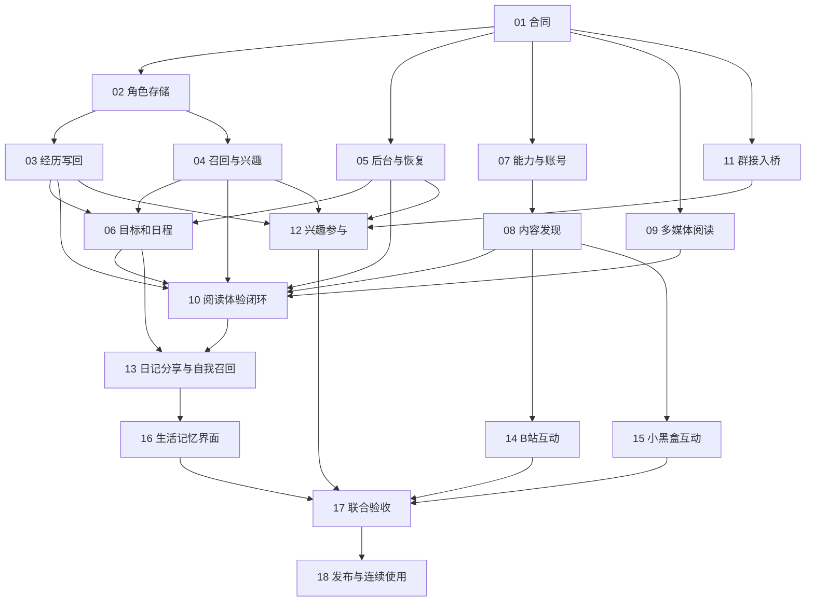

# 天枢自主生活完整开发队列

更新：2026 年 10 月 28 日。**18 项尚未全部完成**。当前以已部署的单容器 **R15** 为开发基线，保留内部模块分工和进程内通信；下文R14候选和旧交付条目保留阶段历史。

自身记忆独立域、原可靠写回/召回、后台调度、能力桥、AL08 内容发现和 AL11 群接入基础已在 R14 部署。本批 AL06、AL09/AL10、AL12 旁听沉淀已开发并在 R14 隔离单容器候选中验收：自主发现→实读→经历→理解/偏好→下一目标，以及旁听→observer 经历→反思→真实间隔后的后续目标，均有 SQLite/PG 证明。用户记忆逻辑表不变，普通用户记忆回流和日程回归保持。

**AL06、AL09/10、AL12已合入、推送并正式部署R15。** 镜像`f1d30d60…`，Companion `16ca5a8`、Memory `9453e5e`；20次ready、跨312秒租期、25逻辑源和actor guard实机通过。配置/数据保留、16.5MB逻辑备份、容量保护停机及恢复、真实账号与全套测试限制见[正式发布](autonomous-life-wave3-release-2026-10-28.md)。AL13以TS390–393并行开发/集中验收中；真实日记反思分享尚未集成/部署，外站账号、完整界面和持续使用仍未全交付。

本批已与两个既有协调线程确认最新 R14 写权边界，以 TS384–388 独立推进并由根集中装配；未覆盖原混合检出或在重构旧代码上并写。逐项最新状态以[配套 JSON](autonomous-life-development-queue-2026-10-23.json)为准；[执行记录](autonomous-life-wave3-execution-2026-10-28.md)保留阶段与修复过程。

设计依据为[角色自身记忆方案](../architecture/actor-self-memory-design-2026-10-23.md)和[前期可行性研究](../research/autonomous-companion-gap-analysis-2026-10-21.md)。本文件是本批功能范围与逐项完成条件的依据；[配套 JSON](autonomous-life-development-queue-2026-10-23.json)保存相同编号的依赖和归属，便于后续登记与调度。

## 初始研究截面与历史执行边界（当前基线见上方）

- Memory 协调基线为 `a3abf61ab15623803fd4043a1dd16d7b5b9e9f5c`，Companion 为 `a188a3b438ed100491198a1be49ab402e26b6fe5`。这些是本次研究截面，不是未来开工应永远固定的 SHA。
- [Q21 后续核心已于 10 月 26 日发布](memory-contextual-release-2026-10-26.md)：Memory `62206f2`、Companion `68b85d0`、Platform `506a820`。[TS313/314 扩展](memory-extensions-execution-2026-10-26.md)已在既有工作树本地交付；本批不接管 Memory 或 Companion src。TS316 在 `209df02` 已合原 TS310 能力桥，本批不重复合入。路径释放与精确新卡边界见[第二批执行记录](autonomous-life-wave2-execution-2026-10-26.md)。
- 计算主机已迁到 `.230`，PG/Redis仍在`.210`。后续验证遵守新拓扑与最新[部署记录](host230-deployment-2026-10-23.md)，不照旧 NAS 计算拓扑操作。
- DQ06–08 的独立时钟、日计划、对话影响和时间线已完成。本队列扩展这些能力，不重开[旧队列](quality-life-development-queue-2026-10-03.md)。通用插件也须按最新迁移发布证据认定，不能沿用 10 月 20 日文档的“未部署”字样推断当前状态；工具与消息桥是否实现仍按源码判断。
- `AL-01` 至 `AL-18` 是本批功能编号，正式运行任务已登记 TS309→AL01、TS310→AL07、TS318→AL08；TS313→AL02/04、TS314→AL03/05 由记忆扩展协调方维护。根 `tasks.json` 原有混合暂存/未暂存改动保留，新登记使用既有分配校验、互斥锁与精确 SHA 工作树，未改其他任务行或根 index；这里不是第二套运行任务板。
- 用户已明确授权本地开发、同聊天子代理并行和稳定后的集中验证；本批不修改用户对话记忆逻辑。生产发布与真实外站动作按对应阶段授权执行。

## 总体顺序

| 编号 | 完整功能块 | 主责产品 | 依赖 | 相对规模 |
| --- | --- | --- | --- | --- |
| AL-01 | 角色记忆与行动来源合同 | 协调 | 无 | 中 |
| AL-02 | 独立角色记忆存储与应用接口 | Memory | 01 | 大 |
| AL-03 | 自身经历可靠写回与历史导入 | Companion | 02 | 中 |
| AL-04 | 自我召回、长期兴趣与派生认识生命周期 | Memory | 02 | 大 |
| AL-05 | 生活后台调度与活动恢复 | Companion | 01 | 中至大 |
| AL-06 | 兴趣驱动目标选择与滚动日程 | Companion | 03、04、05 | 大 |
| AL-07 | 角色能力执行与账号绑定 | Platform | 01 | 大 |
| AL-08 | 网页与现有媒体的内容发现 | Platform | 07 | 中至大 |
| AL-09 | 多媒体真实阅读与覆盖 | Memory/Knowledge | 01 | 大 |
| AL-10 | 自主阅读到体验的完整闭环 | Companion | 03、04、05、06、07、08、09 | 大 |
| AL-11 | 普通群观察的参与请求与可靠出站 | Platform | 01 | 中 |
| AL-12 | 人格与兴趣驱动的群聊参与 | Companion | 03、04、05、11 | 大 |
| AL-13 | 日记、反思、分享与对话自我召回 | Companion | 04、06、10 | 大 |
| AL-14 | B站角色账号互动 | Platform | 07、08 | 中至大 |
| AL-15 | 小黑盒内容与角色账号互动 | Platform | 07、08 | 大 |
| AL-16 | 生活与自身记忆的完整界面 | Platform | 02、04、06、13 | 中至大 |
| AL-17 | 全链路隔离与负载联合验收 | 协调与 QA | 03、04、06、10、12、13、14、15、16 | 大 |
| AL-18 | 串行发布、实机验收与连续使用 | 发布协调 | 17 | 中，另含观察时间 |

规模是相对实现复杂度，不是未经估算的工时承诺。各卡自身的相关验证随功能完成执行，不能把正确性检查全部推迟到 AL-17。

## 可并行的工作流与共享入口

合同准备现在就能完成。实施时，每个产品同一时间一个写者，使用独立任务分支和 worktree；同一聊天子代理协作，不创建用户新聊天。默认三个产品实现写者加协调者即可，不需要为了本队列提高并发。

- Memory：AL02 → AL04；AL09在同一产品写者处串行安排。可与 Companion、Platform 并行。
- Companion：AL05 → AL03 → AL06；AL10、AL12就绪后依价值顺序串行，随后AL13。可先用既有 Knowledge 原件完成自主选择，不必等所有外站适配器。
- Platform：AL07 → AL08；AL11 可以在同一写者的可用时段提前，AL14/15 按实际平台接入路径推进，AL16 最后完整装配。TS318 已依 TS316 最终交付完成实际装配并本地验收，后续从精确候选另立卡，不续写已完成卡。
- 根协调者单写合同、正式任务板、产品集成顺序与部署清单。`core.py/store.py/clients.py/app.py`、Platform路由/账号入口、Memory应用注册/DDL登记均在所属产品内由唯一写者装配。
- Gateway 的调度机制优先复用，AL05/07核对真实工作类别绑定；若发现必须改 Gateway 公共协议或调度代码，按该独立产品另拆精确实施卡，不能由两个产品各自补一个调度器。

阶段可体验成果：第一阶段是“真实经历跨日可记、活动可以恢复”；第二阶段是“自己找内容、形成看法、写日记”；第三阶段增加自然群聊与外部账号动作。AL17/18覆盖最终完整范围；若先发布已验收核心切片，应明确该次子集与剩余AL项，不能提前把整批标完成。

## AL-01 角色记忆与行动来源合同

**交付。** 新增候选角色自我记忆协议，并明确与原用户记忆、Knowledge actor内容、Life事件和出站回执的引用关系。定义 actor 主体、经历/认识/偏好、真实/转述/推断/虚构、时间、覆盖、幂等、版本、来源撤回与跨域失效。候选实例包括双方不同喜好、私人共同经历、部分观看、未知发送、兴趣改观和撤回竞态。

**归属与范围。** 根 `contracts/` 和本批设计说明，由协调者单写；正式目录名和版本在实现准备时确定。明确旧用户接口无新必填字段，不给bot造person_id，不将self_private误用为角色域。记录Q20最终基线及AL→TS映射，不复制旧任务。

**验收。** 生产者与消费者用同一正反样例验证身份、来源、scope与状态；未完成不得冒称完成，派生认识不能扩大来源受众。完成后标明实际合同发布状态，不能只写一份JSON就称已经冻结。

## AL-02 独立角色记忆存储与应用接口

**交付。** 在 Memory 内新增有明确职责的 `actor_memory/` 模块、独立逻辑源/schema、自己的DDL/prepare、版本/guard/索引/任务/幂等回执。提供角色经历提交、状态核对、精确读取、修订/撤回的受限应用端口。角色注册核验复用现有能力；新域无person_id必填。

**范围。** 新模块及对应测试；现有Memory应用入口薄装配、存储登记和必要的部署配置。复用 `tianshu_storage.StorageRuntime`；不复制整个MemoryService，不改用户records、automatic_facts、search_index与jobs语义。新增存储身份只管理本域，独立准入和连接容量；SQLite兼容使用独立文件。新域初始化失败时用户服务仍可用。

**验收。** 相同关键词不同owner无串写；旧用户API结果与合成业务库保持；角色迁移失败/回滚/恢复只影响新域；跨角色、假主体、旧版本和同幂等键不同内容均正确处理。验证真实PG域锁身份、独立guard与来源撤回后的恢复，不能只测SQLite。

## AL-03 自身经历可靠写回与历史导入

**交付。** 实际阅读、活动、作品、图片和发送结果在原事实事务内登记待交付引用，沿现有持久后台机制进入角色记忆。共享经历仅引用可信来源和受众。重启补传、ACK未知核对、撤回传播与来源版本更新贯通。

**范围。** Companion `life.py/reading.py/runtime_execution.py`、原完成事件入口、窄客户端及所属领域的小模块；需要持久待交付结构时由本卡统一管理，不另加消息中间件或第二条用户记忆提取器。后续平台账号回执复用同一入口。

**验收。** 事件提交前后崩溃、Memory ACK丢失、多次重投最后只形成一份经历；未知动作不记完成；回放不增加证据次数。旧日记只作文学/虚构来源，有界导入已核验的历史活动，不扫描改写用户记忆。

## AL-04 自我召回 长期兴趣与派生认识生命周期

**交付。** 角色域的授权后检索、独立索引、有来源的认识/偏好/反思，以及可重建的兴趣与自传投影。提供当前兴趣和历史变化的查询；支持淡出、压缩、更正、替代、真正遗忘及依赖失效。长期兴趣由Memory唯一写入，Companion只取版本投影。

**范围。** `actor_memory/`内检索、派生、来源依赖与后台整理；复用实际可用的嵌入/重排传输和纯检索能力。不能直接套用强绑person的用户候选选择器，也不把外界事实、角色看法、主题相似链接当成相同证据。

**验收。** 对方/自己/另一角色同题相反偏好各自保持；检索与邻居扩展都先限制范围；私聊派生项在群不可用；删除原来源后摘要、索引、缓存和晚到整理不会复活。跨日兴趣持续，独立反例能支持改观，反复自述不能自动增强兴趣。

## AL-05 生活后台调度与活动恢复

**交付。** 修正活动及主动表达占用前台槽的问题；沿Life循环实现有界执行和多角色公平性。paused或到期活动可重评、恢复、取消或切换，不再永久阻挡后续日程；未知工具结果保持原核对语义。

**范围。** Companion `runtime_execution.py/life.py/life_activities.py/model_slots.py`及必要窄调度投影，接Q20最终调度基线。复用前后台 ModelSlots 和 Gateway已存在的interactive reserve，不扩大总槽、每会话active或恢复时限。工作类别必须核对受保护的实际绑定，不能靠caller自报。

**验收。** 慢模型/慢阅读不持PG事务、不阻塞全部角色；前台请求仍取得保留资源；一个角色持续失败不饿死其他角色；暂停到期能继续、取消不复活、重启不伪造离线进度。取得模型槽后失败也正确释放，不抢占或重放已开始的外部动作。

## AL-06 兴趣驱动目标选择与滚动日程

**交付。** 从人格种子、长期兴趣、当日关注、未完事项、真实经历和时间安排中提出并选择具体小目标；复用concern/activity保存执行状态。固定作息作为可用时间骨架，支持自主安排、改期、放弃、继续及已约定事项优先。

**范围。** Companion `life_daily.py/life_influences.py/life_work.py/life_activities.py`和自我记忆消费者。保留当日意向清理，但不清空Memory长期兴趣；不让人格或兴趣变成工具权限，也不新增平行计划账本。

**验收。** 零对话时能从既有可读资料选定目标；次日、停用再启用与重启仍有因果；接触不喜欢内容后可以改变选择；一次聊天建议不强行变成永久爱好。实际做过、计划做和没做成分开显示。

## AL-07 角色能力执行与账号绑定

**交付。** 平台已有动作/插件能力可以被授权角色调用，提供能力发现、可用性、执行和结果核对。明确actor与服务账号的绑定及动作范围，复用已有凭据加密、失效与重新登录。为后台与对话共用SkillRegistry执行提供一条正式路径。

**范围。** Platform角色/账号能力绑定、插件动作桥与内部调用端口；不替换插件宿主。Companion注册与调用方装配由AL10完成。现有五类插件能力或“已安装”状态不能直接冒充已经接上角色工具。

**验收。** 无绑定如实不可用；角色只能操作指定账号和动作；模型看不到原始凭据。对话与后台调用同一动作产生相同回执语义；未知结果不换新ID重复执行；服务连接失效不妨碍无关聊天。常规已配置动作不增加逐次确认弹窗。

## AL-08 网页与现有媒体的内容发现

**交付。** 真实搜索来源与网页候选、B站既有订阅/视频目录、音乐/书籍/漫画目录进入统一的可选择内容描述。保存来源、取得时间、作者、类型、候选版本与可读位置；支持去重、已看标记与失败替代。

**范围。** Platform现有media及搜索适配能力，复用AL07动作入口和Knowledge URL获取；只统一候选描述，不复制媒体库、下载器或原文存储。根据实际可用服务选择搜索后端，不把目录声明当真实handler。

**验收。** 她能找到尚未看过的真实内容；重复转载不算多次独立体验；搜索摘要与正文区分；部分来源故障不拖垮其他来源。没有搜索结果时可以选择已有内容，不捏造链接。

## AL-09 多媒体真实阅读与覆盖

**交付。** 扩展现有Knowledge actor内容读取，支持字幕或可用转录、音视频片段、长内容分页/时间进度与原件版本；统一返回actual coverage、gaps及可支持的表达范围。原网页、书籍、漫画和音频路径继续可用。

**范围。** Memory/Knowledge `knowledge_content.py/knowledge_sources.py/knowledge_media.py`和相邻内容模块。原30秒/8帧抽样能力可复用，是否改变预算依据实际任务；转录/视觉选现有可用能力，没有实际后端则明确缺口，不填假字幕。平台提供媒体来源，Knowledge维护理解输入的出处。

**验收。** 只读标题、部分字幕、静音视频帧与完整可用区间明确区分；长视频中断可从实际进度继续；版本变化不能沿用旧覆盖；缺音轨不声称听过。新媒体路径不改变用户内容授权和原有书籍/听书/漫画进度。

## AL-10 自主阅读到体验的完整闭环

**交付。** 后台活动通过同一能力注册表发现、选取、读取并理解内容，在现有活动步骤中产出短的认识、感受和待继续问题，沿AL03写回；读取新信息后可继续或改变目标。

**范围。** Companion `runtime_execution.py/role_actions.py/skills/registry.py/reading.py`及相关窄领域模块；保留actor主体与原工具预算。仅有Life操作枚举的后台路径在此接通AL07能力，不为后台另造工具定义。

**验收。** 零用户消息完成“选内容→实读→形成看法→长期记住→后续选择”；从已有网页起步，再覆盖视频与其他已接媒体类型。实际读取失败不生成已看完体验；不要求另一个模型逐条复述已有行动模型的输出。

## AL-11 普通群观察的参与请求与可靠出站

**交付。** 普通非@观察可以作为语义参与候选送到Companion；回复许可、是否值得参与、投递责任仍分开。协调adapter claim、Platform观察路由及已有BotDelivery回执，保留单一回复owner和现有消息去重。

**范围。** Platform `bot_observation.py/bot_delivery.py/bots.py`和窄路由装配；共享适配器变更由同一精确实施卡指定唯一作者，同步分发副本时不两边并写。建立在TS301/304最终结果上，不回退它们的轮询隔离和未知执行归属。

**验收。** observe_only仍不发言；许可群中的普通消息可产生候选，但不会自动变成必回。@、关键词和直接命令路径保持且不抢答；迟到参与决定不取得过期claim；超时后的已执行/未知发送不重复发布。

## AL-12 人格与兴趣驱动的群聊参与

**交付。** 聚合话题后结合角色长期兴趣、实际经历、相关关系、当前活动和已有发言，形成候选想法并决定回应、提问、分享、延后或静默。是否保留经历与是否发言独立：在既有观察与来源授权范围内，未回复但有价值的话题也沿AL03写回角色观察经历、认识或后续探索事项。旁听只能记为“看到群里讨论”，不能冒充自己参加过对话。

**范围。** Companion参与领域、受理观察入口、proactive与上下文装配，复用AL11来源。可用轻量信号初筛以节省调用，但最终语义选择不能退化为关键词规则。多角色同群共享参与预算，避免互相无限触发。

**验收。** 未@时能对真正相关话题贡献实际经历；无关时保持安静；发送前话题已变则延后或放弃。一个最终未回复的有趣话题，次日仍能触发自主探索；保留原群范围，原来源撤回后派生项失效。私聊来源不因“我记得”泄漏到群；被明确@仍正常回应；群友已有答案时不重复抢话。

## AL-13 日记 反思 分享与对话自我召回

**交付。** 原日记加入人格与真实数字经历材料，明确主观感受和虚构剧情；自动私密保存与公开分享沿原受众策略。普通对话可以追问她的过去，主动分享引用实际理解；反思发现的新问题回到concern/activity。

**范围。** Companion `life.py/proactive.py/runtime_execution.py/life_read*`、原写作模块和窄上下文组合器。用户记忆旧API不变，角色记忆单独按需查询，使用时分栏；不在每轮普通聊天新增规划或审核模型。日记正文仍唯一保存在原模块。

**验收。** 问她昨天做什么能找到真实经历，问用户的历史仍走原用户证据；两者同题不同偏好不混。日记、分享和活动覆盖一致；原来源撤回后日记派生缓存不能把私人事实重新学回。素材少时可短写或略过，公开范围不自动扩大。

## AL-14 B站角色账号互动

**交付。** 复用现有B站账号、列表和内容能力，增加角色收藏/取消收藏、点赞/取消点赞、评论/回复及可核对结果；明确观看理解与账号播放历史的区别。每种动作独立报告可用及验证状态。

**范围。** Platform既有Bilibili及账号适配器，按当前实际许可与可用接口选择实现；不因旧SDK曾存在就直接依赖。媒体下载、用户收藏夹和已有订阅不被角色行为覆盖。

**验收。** 在配置的角色账号上真实核验目标对象与结果；同一动作重复请求幂等，评论响应丢失先查结果。收藏是实际平台收藏而非只写本地笔记。真实账号接入与合成测试分列；若某公开接口不可用，明确该动作仍待完成，不以本地模拟替代。

## AL-15 小黑盒内容与角色账号互动

**交付。** 小黑盒独立来源适配器提供登录状态、分区/推荐流、帖子与楼层上下文、通知，以及实际可支持的收藏、点赞、评论/回复。浏览内容进入AL08，动作进入AL07，经历统一写回。

**范围。** Platform新的小黑盒领域适配器，复用账号、工具执行、回执和内容候选合同。参考公开实现时核对许可与当前接口；平台差异留在适配器，不把其会话/人格系统整体搬进天枢。

**验收。** 分区失败有可解释替代，楼层目标不串，登录过期停止相应操作；已读内容才支持实质评论；通知和自主评论不形成回复循环。收藏、点赞等动作若当前接入没有可靠路径，列为明确未完成，不偷偷缩减需求。

## AL-16 生活与自身记忆的完整界面

**交付。** 在现有生活、日程、阅读、日记页面增加当前目标、为什么关注、实际进度、长期兴趣变化、自身记忆来源和可修订状态。用户记忆与角色记忆有明确分栏，允许查看与合理更正/忘记。

**范围。** Platform原life/memory/角色账号页面及同源聚合。页面只读领域投影，不在浏览器新建计划或记忆权威。延续当前详细设置卡片与桌面/移动视觉约定。

**验收。** 切换角色不串资料；关闭页面生活继续；重新打开恢复服务端状态；“计划/正在做/完成/失败/结果未知”可辨。用户编辑自己的事实不会意外修改角色爱好；忘记能查看影响的派生内容，常规操作不新增无必要确认。

## AL-17 全链路隔离与负载联合验收

**交付。** 在稳定集成候选上验证“原用户记忆继续正确，自主生活真实且连续”，复用未变化的Q20证据，统一记录功能、语义、时机、成本和性能，不用消息数代表拟人程度。

**范围。** 隔离合成数据、现有测试体系和本批有意义的新增用例；无生产聊天或真实用户库输入。共享迁移/认证/事务修改遵循产品现有必需检查。集成按产品串行，跨合同联合样例先行。

**验收。** 至少覆盖：同题相反偏好、跨角色/私群、实际/虚构、跨日与重启、暂停/取消、重复回执、源撤回竞态、独立库失败/恢复、日记不回灌、旧@命令保留、外部账号结果。针对性比较用户业务表/索引/队列和相关版本前后不变。

性能采用同配置无自主负载/有限自主负载/暂停自主负载对照，记录用户首段/完整/整理延迟、Memory准入及PG锁等待、后台积压和模型用量。不是要求重跑全部历史PG优化实验；不能用提高总并发或放宽超时掩盖退步。LLM随机输出质量用有主语的人工语义核对，不承诺字节级相同回答。

## AL-18 串行发布 实机验收与连续使用

**交付。** 在获得对应发布授权后，按当前`.230`计算与`.210`PG/Redis拓扑更新部署，登记新增角色逻辑源、配置与备份恢复；保留用户库、媒体挂载、日常模型和其他服务。实际平台动作按已配置账号与授权范围验收。

**范围。** 根发布协调唯一写者，沿既有部署、guard、备份与恢复工具；明确新角色域版本，不拿旧用户数据库快照覆盖当前用户数据。新域独立恢复与停用路径可操作，不因角色功能故障回退整个用户记忆系统。

**验收。** 生产健康与相关功能验收分开记录；以同一角色连续一到两周观察兴趣延续、目标兑现、适时参与、事实与日记一致、账号动作和资源表现。观察时间不是额外模型调用额度。只有用户要求后才建立定期监测，不由本规划自动创建自动化。

若先发布核心子集，列出已发布AL项与仍未完成的账号能力；最终整批完成仍要求全部需求有实际结果。不得将开发、集成、部署、平台账号验收和长期体验混写成一个done。

## 本批不应顺手扩展的内容

不重构整个人类记忆系统，不引入万能主体/权限框架，不复制原记忆服务，不为自主生活迁移用户历史数据，不改关系账本权威，不自动训练模型或改变人格设定，不新增一套运行任务板。外部账号功能完整保留，遇到真实接口限制时公开记录具体缺口。

所有实现交付仍使用项目既有任务交接、精确提交、实际验证和串行集成方式；不要求为每个小改动新增报告、重复测试或多层审批。
