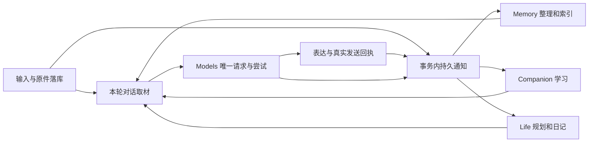

# 天枢全链路解耦与空库重构方案

> 本候选方案已由 [空库核心重构方案](tianshu-clean-rebuild-plan-2026-11-04.md)及 [RB 队列](tianshu-clean-rebuild-queue-2026-11-04.json)承接。下文保留为历史评估；SD 不再作为独立派发入口，全部需求已有映射。没有开始实施。

状态：候选规划，未派发、未实现、未清除数据、未调用真实模型或操作生产。日期：2026-11-04。

本方案承接记忆/自学习统一第二版，并纳入输入、后台任务、模型执行、日程、外部动作和页面状态。用户已允许舍弃现有数据，因此推荐以新空库和压平后的基线 schema 重构核心状态，不承担旧业务数据迁移、旧提案解析和历史缺口补偿。保留已有有效功能及可靠实现；本轮的数据舍弃许可用于设计，不在规划阶段执行删除。

[开发队列](system-decoupling-redesign-queue-2026-11-04.json)是新方案唯一候选派发入口，[任务说明](system-decoupling-redesign-tasks-2026-11-04.md)列出完整功能块、归属与验收。原 ML/LE 编号保留为需求来源，不能与新队列重复派发。

## 依据、现状与路线选择

源码基线为 C:/Users/Administrator/.codex/worktrees/frontend-807/tianshu-peiban-bot，HEAD c98e23c763cab6eded5cbd702773d9b3c7e8ca70，读取时已跟踪文件干净。运行依据仍为协调 CURRENT 的 2026-11-04 13:33 记录，运行源码 03130711fd6961dde31335a300aae23bbf58d9b7；本轮没有重新访问生产。历史故障用于设计反例，已修复故障不重新称作当前缺陷。

现系统已有 PostgreSQL/pgvector、Procrastinate 事务入队、35 个业务执行通道、独立 Models 配额调度、控制连接保留、来源/权限检查、CAS、独立计算重试、滚动日程和事件唤醒。当前源码依赖为 procrastinate 3.10.0、psycopg 3.3.6、pgvector Python 客户端 0.5.1；客户端版本不等于服务器扩展版本。这些能力继续复用。

| 路线 | 收益 | 代价 | 决定 |
|---|---|---|---|
| 延续 ML 第二版逐项调整 | 改动较小，复用当前状态结构 | 仍承担重复状态、冻结请求多处存储和跨域回调耦合 | 作为保留数据时的备选 |
| 核心状态与数据结构重构，空库启动 | 能删除旧兼容与补偿分支，集中解决工作等待、数据重复和日程资格分歧 | 涉及多个领域装配，需要覆盖真实边界 | 本轮推荐 |
| 全功能从零重写并拆为多个微服务 | 物理隔离强，可独立扩容 | 新增分布式事务、网络等待和运维，已有修复容易丢失 | 当前没有足够依据 |

目标是一个产品、一个应用镜像、清楚的模块与进程职责。PostgreSQL、现有外部引擎继续作为实际依赖。不同功能可以独立前进；共享模型、数据库和物理设备仍遵守同一资源预算。同一事实、同一活动和同一会话发送顺序存在必要串行边界。

## 从实际问题反推设计

| 证据 | 问题及状态 | 新设计必须防止 |
|---|---|---|
| E01：最新 CURRENT | 不可用附件导致整条输入失败；仍待修复 | 可用正文接收不依赖附件下载成功，原事件幂等 |
| E01/E09 | dormant 旧活动不满足续接条件，规划 rejected，角色当日无日程；仍待修复 | 候选生产与校验使用同一资格函数；失败提案不能清掉有效安排 |
| E01/E16 | 全批创建别名碰撞；仍待修复 | 每目标局部引用由编译器限定，不能靠猜改落库 |
| E02 | 日记正文已成功，自动状态因作者/闭日 scope 不同未收敛；历史已修复 | 业务对象拥有稳定身份，作者读取范围不能成为业务对象身份 |
| E03 | RPC internal_error 掩盖 Models transport_unknown；历史已修复 | Models 回执唯一解释物理尝试，RPC 不是业务结果 |
| E04 | 排队消耗执行时间、未知计算占住后续材料；历史已修复 | 排队、执行、业务截止独立；等待不占业务执行位 |
| E05/E06 | Episode 事务中直接调用 Growth 和 Diary 消费写者；源码路径 | 生产者只写自己的对象及可靠通知，消费者异常不能回滚生产者 |
| E07 | 单 worker 进程运行全部业务通道，一路 worker 退出会进入统一收尾；源码路径 | 前台接收/控制和后台计算分进程，后台故障不带走前台 |
| E08 | 每轮习惯取材调用管理 view；源码路径 | 运行读接口只读必要材料，不附带审核/重试统计 |
| E10/E11 | 大量来源/上下文/材料清单分散保存，模型请求分属多处；源码结构 | 正文、来源依赖、请求配方各有唯一归属，业务记录主要存引用 |
| E12 | 候选逐次加入时重复计量整个上下文；源码路径 | 单元计量复用，最终整包校验保留 |
| E13 | 旧日程发生保护期恢复/暂停循环；历史已修复 | 规划与执行所有权分开，暂停/保护语义只在一个领域位置判断 |

不能从字段数量推算数据库节省量，也不能从通道数推断吞吐。这里确认了结构问题和可达路径，尚未测量它们各自占总耗时的比例。

## 已修复行为保留与回归对应

用户本轮明确要求：重构不能让已出现并修复的问题再次发生。旧数据和旧格式兼容可以退出，修复后的有效行为必须保留。以下是本轮核对的13类历史修复与1类既有约束，挂接到原22卡；不是全部历史故障的穷尽审计，也不表示重构后的测试已通过。

实现时优先复用现有修复；更换数据结构或接口时，用新结构表达原失败场景和行为断言。旧格式专属兼容测试可退出，但其中的计时、身份、授权、未知与副作用断言不能一起删除。不得以放宽预期或跳过原场景来获得通过。

仅运行当前实际改动影响的回归和新装配边界；无变化范围的有效结果复用。当前实现改变后，历史测试通过数量不能直接继承为新版本验收结果。

| 编号 | 必须保留的行为 | 关联任务 |
|---|---|---|
| PF-01 排队与执行时钟 | 排队不扣执行时长；实际执行开始后固定时钟；真实业务截止仍生效，重启/查询不能刷新截止。 | SD-04、SD-05、SD-14 |
| PF-02 RPC错误不能覆盖原Models结果 | RPC internal_error/断开不等于模型失败；先观察原attempt，控制面不可用不成为重复提交许可。 | SD-04、SD-08、SD-15 |
| PF-03 纯计算让位、独立尝试与只应用一次 | 临时计算失败释放业务活动位，后续材料可推进；新attempt独立，迟到结果不重复应用；明确取消、源失效及永久配置错误不自动重试。 | SD-03、SD-04、SD-08、SD-09、SD-10、SD-15 |
| PF-04 日记scope与正文成功后的状态对账 | 作者范围较宽仍定位同一合法闭日，歧义不得任取；成功正文只对账派生状态，不重新生成、不改变原时区和来源范围。 | SD-02、SD-12、SD-15、SD-19 |
| PF-05 后台请求与供应商上下文隔离 | 后台按角色/场景/功能/intent隔离，不继承聊天、前日日记、失败输出或上游previous-response引用；聊天保留明确的会话连续性。 | SD-04、SD-11、SD-15 |
| PF-06 规划截断、无效结果与合法留白 | 截断/不合法提案不能当成有效决策指纹而永远跳过；完整校验后才应用，有界纠正；合法留白可正常读取并在真实边界复查。 | SD-12、SD-13、SD-14 |
| PF-07 滚动日程不恢复任意次数和占比限制 | 第五/第六活动可继续，排程只服从真实作息/承诺/保护；普通tick不反复刷新留白截止或无故重新规划。 | SD-13、SD-14 |
| PF-08 保护期内不循环恢复和暂停 | 恢复前即检查保护窗口；重复唤醒不能新增步骤、重复执行或空增语义版本；暂停不阻止作息/房间显示推进，空闲后沿同一检查点续接。 | SD-12、SD-13、SD-14 |
| PF-09 阅读失败后的同任务续接与执行上下文 | 确认失败只跳过对应未读候选，保留成功和剩余目标；暂停/未知效果不套用跳过；重新安排后实际执行与冻结授权上下文一致。 | SD-12、SD-13、SD-14、SD-18 |
| PF-10 检索来源证明、阶段降级和预算 | 保留批量来源证明的AND/OR/关系完整性、候选补位和最终复检；支路失败保留其他有效结果，真实取消/权限失效不能伪装普通降级；不恢复排队扣时。 | SD-02、SD-07、SD-09、SD-11 |
| PF-11 图文整理、短引用和一次远端候选准备 | 先确定完整材料范围再调用必要远端召回，试装不反复付费；原图/作者/引用保留，短引用绑定冻结批次；仅完整语义完全相同才无损去重。 | SD-07、SD-08、SD-10、SD-15、SD-17 |
| PF-12 独立订阅的作者授权与故障隔离 | 管理员独立订阅不绑定/借用角色；合法授权epoch变化可正常刷新，真实范围/权限丢失只阻止相关任务，不阻塞其他源。 | SD-02、SD-03、SD-05、SD-18 |
| PF-13 外部发送未知及迟到取消不产生二次效果 | 外部已提交/unknown不按新任务重放；明确取消与消费者中断分开，迟到控制不能改写原物理回执。空库切换同样不得重放旧外部任务。 | SD-04、SD-06、SD-16、SD-21 |
| PF-14 固定人格与独立日记材料预算 | 固定人格不可被预算裁掉；动态材料不升为系统权威；保留当前独立输入上限与完整单元预算，发现/读到/想象/未知结果分开。 | SD-04、SD-11、SD-15 |

具体原修复记录、当前实现入口和现有41处用例引用列在任务说明末尾，机器可读对应关系在队列 preserved_fixes 与各卡 preserved_fix_ids。当前只有源码和用例定位，没有运行产品测试。

PF-08明确保留覆盖缺口：当前已核对的用例包含单次保护边界和无变化指纹，但还不能据此宣称完整覆盖R67反复唤醒的旧事故。SD-14实施时须复用或补充“多次唤醒不新增步骤、不空增语义版本、暂停时作息显示仍推进”的相关断言。

最新记录中的不可用附件整条拒收、失效旧活动导致规划拒绝、提案创建别名冲突仍属于待修问题，不能列作已完成修复。空库路线可以取消旧批次恢复，但这些可由新输入再次触发的根因仍必须解决。

## 职责与联动

| 领域 | 唯一写入权威 | 联动方式 |
|---|---|---|
| Identity/Sources | 人物、群、场景、权限、原件、遗忘与来源依赖 | 同步授权/提交复检；异步传播派生失效 |
| Conversation/Channels | 接收、对话轮次、取材清单、表达顺序、发送身份 | 同步完成本轮必要工作；提交事件供后台消费 |
| Memory | 事实、事项、经历语义、历史反思及其证据 | 读端口返回有版本证据；变更通知更新派生索引 |
| Companion | 固定人格、情绪、习惯与偏好当前状态 | 有用途的运行投影；明确命令直接修订；学习异步 |
| Life | 目标、活动意图、时间安排、进度与日记 | 订阅真实结果和必要状态变化；工具效果归原动作账本 |
| Models | 冻结请求、物理尝试、资源准入、实际结果和 usage | 提交、状态、结果、取消及可靠完成通知 |
| Capabilities/插件/内容 | 外部动作、内容/媒体、插件与独立订阅 | 通过能力端口和实际回执联动；订阅保持可独立运行 |
| Runtime | 原生任务队列、执行资源、通知投递与消费进度 | 不解释领域事实、日程意图或习惯真假 |

每条业务链只有一个协调者。聊天由 Conversation、日程由 Life、整理由 Memory 协调；Runtime 不成为万能工作流引擎。

同步保留授权、当前请求所需读取和短事务提交。异步用于索引、反思、日记材料更新、统计和派生投影。不能把全部调用改成事件，以至于当前明确纠正也只能等待后台。

最小跨域合同如下，名称可沿用已有接口，语义不可由各域另写一份：

| 端口 | 输入 | 返回/责任 |
|---|---|---|
| Sources.prove | 原授权上下文引用、对象/来源版本、用途 | 逐组可用性与当前版本；不授予额外权限 |
| Models.submit | 不可变 request_ref、attempt_id、逻辑工作引用 | 持久接受身份；重复身份且不同内容明确冲突 |
| Models.result | attempt_id、观察者上下文 | 原状态/结果/usage，控制原因独立 |
| Memory.query | 场景、用途、主体/时间/查询计划、预算 | 有身份/版本/证据集合的完整单元与覆盖范围 |
| Companion.rules | 场景、用途、对象、候选版本 | 当前适用规则及语义失效原因 |
| Life.eligibility | 活动、目标、原回执、当前时刻/上下文 | 可执行性、原因和被核对的版本 |
| Runtime.wake | 稳定工作对象、最早due、变更版本 | 合并适用的待执行信号；不执行领域命令 |
| Expression.dispatch | 原表达身份、取材引用、当前提交边界 | 原Action/Attempt/Receipt；不因调用超时另造发送 |

所有跨域修改通过拥有者命令，读者使用公开端口/明确的只读投影。请求保存原授权上界；执行取原范围与当前权限交集，不因为当前管理员权限更宽而扩大旧任务。

### 可靠通知复用原队列

生产者在自身事务中写业务记录和 Procrastinate 通知任务，不调用消费者的业务实现。统一通知仅含 event_id、producer、对象 ID/revision、scene_id、发生时间和必要引用。消费者先按来源端口读取，再在自己的短事务中更新业务状态与消费标记。

已有 runtime.projection_cursors、原生 job key 和领域变更序列优先复用；不同时增加 Kafka、Redis Stream、自建事件总线和第二套任务队列。通知失败回滚生产者事务是必要的可靠投递边界，消费者逻辑失败则隔离在自己的任务中。

严格区分四类操作：

- 命令：保留 client_request_id、内容摘要和 CAS；不能按“最新值”吞掉。
- 状态脏通知：同对象的待处理唤醒可合并，消费者读取尚未处理的版本。
- 必须逐项处理的结果：每个事件保留身份与消费记录，不只取最大序号。
- 外部副作用：按原 Action/Attempt/Receipt 对账，unknown 不自动重放。

queueing_lock 只限制待执行重复项，不保证正在执行的任务互斥。短提交使用领域行锁/CAS/租约，模型等待期间不持有数据库事务。[Procrastinate 官方说明](https://procrastinate.readthedocs.io/en/stable/howto/advanced/queueing_locks.html)

不能把数据库全局自增序号的最大值当成“此前事务全部已提交”。使用已提交、按同一分区锁序列化的版本，或逐事件消费标记；并发事务倒序提交也不能漏事件。毒性材料记录自己的失败/重试身份，不阻止其他角色、分区和领域；跨过缺口时保留缺口账目。

## 数据结构重建

原则：减少重复事实和反复解析的数据，不追求最少表。高频筛选、排序、连接字段结构化；可变且不参与热查询的业务内容保留 JSONB。当前已有正确的领域表不合成一个万能 JSON/EAV 表。

| 数据组 | 新结构/约束 | 省掉的重复或歧义 |
|---|---|---|
| 场景与授权 | 稳定 scene_id 描述角色/会话/用途归属；当前权限、授权 epoch 单独读取 | scope 哈希变化不再制造新的日记/任务身份；scene_id 不是授权凭证 |
| 原件 | 原 source/version 为权威，正文/媒体定位单份保存，编辑追加版本 | 队列、经历、日记不再反复保存整份原消息 |
| 证据集合 | Sources 拥有不可变 evidence_set 与有序分组成员；反向索引到具体来源版本 | 复用大量相同来源数组；保留 OR 支持组、AND 生成依赖、反例和完成依据，不能压成无类型 ID 集合 |
| 事实/事项 | 延续有类型的 head + revision；高频当前读取直接读 head 投影 | 当前查询不反复扫描全部历史；历史仍可按有效时间/认识时间查询 |
| 经历与处理进度 | 经历语义版本不可变；提取游标、索引状态、重试信息放对应处理表 | 状态变化不触发正文语义修订和下游无效重算 |
| 行为规则 | 当前 head + 内容/状态修订 + 实际支持关联 | 反思是原提案依据，规则是当前行为；同一学习产物不用两套当前状态 |
| 检索文档 | Memory 一份可重建 search_documents 投影，按对象版本与 embedding profile 唯一 | 统一候选形状；向量不混在多个频繁更新的业务正文中 |
| 模型请求 | Models 拥有不可变 request/manifest、payload 与 attempt；领域只保存 request/attempt 引用 | 收敛 memory.model_steps 和 conversation.generation_requests 的重复完整请求职责 |
| 逻辑工作 | 各领域保存目标、输入版本、下一次 due 和应用结果；共同重试机制为代码复用 | 不让一个全局 work 状态覆盖日记、记忆、规划不同语义 |
| 日程 | 目标、活动意图、执行步骤、时间预约分别有结构化字段 | 不用 dormant + 字符串原因 + 多层 checkpoint 同时表达所有状态 |
| 日记 | 稳定 diary/day-session 身份，正文 revision 与生成尝试引用 | 自动/手动入口操作同一对象；作者权限范围不重新决定它是谁 |
| 页面状态 | 由领域对象和原回执投影；允许可重建 read model | 删除“另一张表再记一份成功/失败”的人工同步权威 |

新内部标识采用统一约定的原生 UUID；局部排序/游标用 bigint。QQ、供应商任务号等外部标识仍保留原字符串。哈希用于内容比较/幂等，不代替业务身份。不是为了变更类型而全库逐字段重写，未触及的成熟外围领域按原结构重新初始化即可。

正文/请求大 payload 与热点状态分开，但不承诺“每次更新都会重写整块 JSON”。PostgreSQL 已有 TOAST，未改变的大字段可能复用；本方案真正要减少的是应用层重复序列化、变动巨大 JSON 清单、SELECT * 和重复索引维护。[PostgreSQL TOAST](https://www.postgresql.org/docs/17/storage-toast.html)

完整冻结请求可直接保存一次，或由不可变片段和冻结配方确定性还原；必须能核对原请求摘要，包含模型/工具/模板版本和实际参数。不能引用会变化的“当前人格”来重建历史请求。请求裁剪、遗忘和访问边界仍由原权威执行。

单来源可直接使用原 source/version 引用，重复多源集合再共享保存；不为一条简单来源强制增加多层表连接。集合通过一次批读解析，不能出现逐条 N+1 查询。规范化会增加某些关联读取，只有实际行宽、查询与写放大对照才能确定收益。

检索投影替换原来分散的向量索引职责，不在旧业务向量列之外再叠一套。按时间语义保留需要查询的版本；当前索引限定当前适用记录，历史端口用明确的版本筛选和适配索引。不能为了让当前检索更小而取消历史能力。

EvidenceSet 是数据复用与批量证明的入口，不是新授权引擎。撤回先同步更新来源权威，当前读取/提交/发送复检立即受影响；后台再清理投影。任何缓存或 read model 均不能把已遗忘内容重新放行。相同正文跨私域不能仅凭 hash 合并授权身份。

## 后台任务和模型等待

当前 generate RPC 会等待完整模型结果，业务任务在此期间仍占所在执行通道。异步等待不占 CPU，并不等于释放了该通道的工作名额。

新后台链路采用短阶段：

1. prepare：冻结输入与领域 revision，短事务登记逻辑工作。
2. submit：Models 持久接受确定 request/attempt，返回身份；RPC 断开可按身份查询，不能盲目再次提交。
3. waiting：不占业务 worker 名额、数据库连接或领域锁；模型物理执行仍占其真实配额。
4. apply：完成事件唤醒领域消费者，重检来源/版本，提交或记录 obsolete/needs_replan。
5. retry/reconcile：纯计算按原分类独立尝试；副作用观察原动作。取消原因与传输结果分开。

Models 的完成通知与最终结果提交必须可靠关联；接收方重复收到只应用一次。结果已保存但通知暂未消费，可通过有界对账补齐，不每 30 秒无差别扫描所有运行任务。前台聊天保留正常流式体验；断开的流由同一请求结果恢复，不因客户端离开自动复制模型尝试。

通用部分只抽取请求登记、原结果观察、退避、尝试记录、租约与幂等应用框架；prepare/validate/apply 仍由各领域定义。共享框架不能把格式错误、输入过期、配置失败、用户取消、权限撤回全部归成可重试。

已有队列容量、模型并发、RPM/TPM、GPU/设备许可继续生效。按真实物理供应商/GPU划分资源，不能按模型别名重复计算容量。排队时间、供应商执行时间、业务绝对截止分开；200000 后台生成上限与已有专用模型窗口保持，降低无用材料量不等于调低功能上限。

### 进程与资源隔离

默认建议单镜像内四个职责进程：API、Models Broker、前台 worker、后台 worker。前台包含输入、会话、发送、取消和轻量到期处理；后台包含整理、索引、规划计算、日记及内容批处理。唯一 QQ 连接/输入所有者和唯一 Broker 不复制。模块 start/stop 按进程角色运行，不能在两个 worker 中各启一次全部领域；健康状态按该进程的必需依赖计算，未配置语音等可选能力只影响自身可用性。

保留现有逻辑通道标识，但每个通道不默认配一套独立大连接池。数据库、HTTP、CPU线程、模型/GPU预算分别有界，控制通道保留资源；各进程连接上限合计纳入总预算。后台大量索引不能消耗前台所有连接；没有真实空闲资源时也不能承诺各功能绝无时延影响。

长 CPU 工作使用现有有界线程/进程或外部引擎；不阻塞 async 事件循环。后台 worker 退出由 supervisor 单独恢复，前台继续服务并明确后台 degraded。四进程会增加常驻开销，须在混合负载中验证收益；不额外按每项功能拆容器。

唤醒合并只针对待执行信号；运行任务保留一个后继唤醒即可。可把新 revision 合入持久 dirty watermark，而不是每次 revision 都产生不可合并的新 queueing_lock。截止临近的真实承诺优先，后台按等待年龄获得进展，不能依赖无限延迟或强行中断已经提交的模型/外部任务。

## 全链路算法优化

### 输入与模型上下文

- 原事件和可用正文先可靠接收；不可用媒体有明确部分覆盖状态。附件失败不让正文一起丢失，恢复不重发历史消息。
- 当前输入、引用/回复/工具依赖先组成完整单元。Memory、当前规则和 Life 小型状态在依赖允许时并行读取，使用原连接池预算；不能先开满并发再一起等待池。
- 习惯取材使用薄运行投影，管理统计移出热路径。消息、规则、证据各有稳定身份，实际装入后冻结清单。
- 单元文本/图片成本按内容摘要与 tokenizer/profile 复用估算；不对每个候选反复 tokenize 全部已装内容。分段 token 不是严格可加，最后仍整包校验，必要时舍弃最低优先完整可选单元并有限复核。
- 前台不增加额外“选材评价 LLM”。同一请求已算过的查询向量/候选/来源证明在有效版本内复用，最终来源复检保持。

### Memory 整理与检索

1. 同角色、会话、授权分区共享一次原文理解；只取新语义变化与有关旧记录，不能按每个人重复整段请求。
2. 旧记录按已知主体、事项、时间和明确引用定位，再混合召回；保持低频参与者及冲突双方。输入与输出容量一起决定完整分段。
3. 创建引用沿现有分目标协议编译；同目标歧义拒绝。精确重复可去重，跨时间重复事件、不同说话者/范围和相近但冲突的事实不能按相似度合并。
4. 当前检索优先结构化过滤和窄 search_documents，先取 ID/版本/分数，再批量证明与装配正文。历史/list 查询走明确的历史端口，不用当前投影冒充。
5. 词法与向量独立支路可在预算内并行，延续 RRF/MMR、来源补位和最终复检；明确对象/精确查询减少无益重排，歧义查询保留必要重排。
6. 中文先完整名称、短语和词项，保留受控单字回退。新入库先可词法读取，向量尚未就绪独立报告，不能误称没有记忆。
7. 同语义文本且同 embedding profile 才复用向量；优先去掉同一原件在消息/经历两处重复索引的计算。不同语义视图不因共享 source_id 就复用同向量。
8. 跨请求缓存仅在实际重复负载证明收益后采用。索引分区、候选规模、重排条件由真实过滤分布决定，不按每个人无条件建 HNSW。

pgvector 近似索引的过滤可能使候选不足；当前已有迭代扫描/补位等能力应迁入，不能因为新建统一投影就省略。小范围精确查询与较大范围 ANN 的选择须按目标负载核对。[pgvector 官方过滤说明](https://github.com/pgvector/pgvector#filtering)

### 自学习

持续明确偏好、当次要求、推断习惯分开。当前规则与历史反思只有一份可证明关联；撤回不经 Memory 工具绕路恢复。支持、完整生成依赖和反馈分别保存，机器人重复使用不算独立支持。

自然语言纠正先影响当前理解；已解析且有权的命令直接修订规则，未解析的持久变化不能冒称已写入。普通支持增加不取消回复，确定影响已选规则的实质撤回才沿未提交边界处理。

表达样例使用真实回复关系；群词义使用真实群主体及说话者/assertion。二者按当前用途取材，允许零样例、零个性化，不扩展成自动修改固定人格或工具权限。

## 日程重构

### 四类对象分别负责

- Goal：为何做、目标是否有效、实际完成标准。
- Activity：做什么、当前语义状态及可续接检查点。
- ActivityStep：一次执行步骤，引用原 Action/Attempt/Receipt；不复制工具完整结果账本。
- Reservation：何时占用角色注意力、哪些承诺不可移动。

Activity 的生命周期、等待条件与外部尝试状态分开。等待用有限类型表示：时间、真实事件、资源、原动作结果、用户明确暂停；不能用一个 dormant 和任意 reason 同时承担全部意义。阅读/写作/图像等检查点各有类型化字段，不能将所有状态藏在 checkpoint_data 的任意 JSON 路径。

“角色在等图片生成”不自动等于角色必须一直占用一个活动槽。外部作业可以继续运行，角色可进行不冲突的事情；相同物理设备和同一个外部作业仍遵守原资源/动作边界。

### 一个资格函数，三个调用位置

领域内同一 eligibility(context, activity, goal, receipt, now) 同时供候选构建、提案应用和实际执行复检使用，返回 allowed/reason/revision。必须涵盖目标状态、用户暂停、保护期、来源、完成/未知回执及续接位置。

不可执行的旧活动可以作为历史说明，但不放进可选 option 列表。模型只选择候选或提出有依据的新活动，程序填 ID、revision、准确时间和执行键。这样直接对应 goal_not_active/planner_activity_unavailable 的已知故障，而不是放宽校验。

### 模型提议，程序安排

模型负责目标与活动的语义选择；日程程序处理作息、已承诺时间、时区、持续时间、冲突和留白。规划使用轻量能力目录及明确时效，远端可用性由后台刷新，真正派发仍检查当前能力，避免每轮规划附带全部外部探针。优先保持有效已有预约及进行中的步骤，重新规划只改受影响时间范围。

展示可以覆盖当天，但远期活动是可调整意向；临近可执行范围才绑定具体步骤和当前资格。范围以真实承诺、作息和活动边界决定，不新设每日活动次数或固定排程占比，也不把整天填满作为成功。

先按强约束过滤，再按明确承诺/截止、目标价值、等待年龄与切换成本稳定选择；已有排序和 next_gap 能满足时继续复用，不先引入求解器或新“智能调度模型”。

提案按有明确依赖的组成部分校验；同一目标变更与依赖活动一同提交。一个无关的旧候选失效不应清空全天；可剔除已证明独立的失效部分，否则进行有限纠正/重新取材。不能悄悄部分应用互相依赖的目标和活动。

格式错误可有限纠正；候选已变更应刷新候选；暂时模型错误延迟独立尝试；明确取消/配置错误/无授权保持终态。合法选择留白是正常结果，拒绝提案与合法留白不能混为一谈。新的规划失败时保留旧的有效安排和真实到期承诺。

### 何时唤醒

复用既有语义指纹和事件机制，修正变化的粒度。真正变化包括目标/承诺、活动结果、可用能力、明确偏好或到达时间边界；无关统计、相同内容换序和普通支持增加不引发 LLM 重规划。

下次 due 取真实承诺、时段边界、等待条件、明确重试时间和必要有界复查中的最早值；不每分钟调用规划模型。合并重复脏通知，同时保留正在运行规划的一个后继。

活动进度只由实际结果推进。计划成功不代表行动完成，调用 succeeded 不代表阅读/生成/送达成功。日记只消费实际经历的紧凑视图，失败、部分完成和未知也可如实记录，日记不成为新的独立事实证据。

日记自动和手动入口使用同一个稳定 day-session，保存其原日期、时区、作者场景与材料版本。合法更宽的作者读取权限不重新生成另一个业务身份；时区改变也不能悄悄移动已完成日记。正文成功后的派生状态修复不重新调用模型。

## 页面与功能保留

保留当前聊天、角色/人格、关系与冻结、记忆、成长、生活/日程/日记、小屋、模型配置、插件、图像/语音/自拍、书籍/漫画/音乐/视频、独立订阅、知识/项目资料及基础设施入口。是否已经配置真实外部引擎仍按现状显示，不用静态占位表示可用。

一个 QQ 连接对应一个角色；群策略继续按群配置，不恢复逐群角色选择。订阅可由管理员独立运行，不能必须经过 BOT/Life。学习规则不成为访问权限。

页面返回领域业务状态、实际尝试状态、效果状态和投影 freshness；不能只显示一个“成功”。由主业务对象与原回执生成当前状态，可缓存只读投影但不得成为第二写入权威。已接收、待计算、已提交、索引待就绪、已发送及送达未知分别表示。

## 空库切换与删除旧复杂度

本路线明确取消旧数据迁移、旧提案兼容读者、旧 Episode 历史补齐和旧缺口批量补偿。保留新系统从第一条数据开始的版本/遗忘/恢复能力。旧 ML-14 转为不实施的历史需求；其面向未来的原请求幂等和重试原则进入新后台链路。

新数据库使用各领域压平的 baseline schema，之后正常追加迁移。旧 migrations 不带进新启动链；Procrastinate 自身 schema 仍按其库版本安装，不能手写伪造其内部结构。

实际实施时先离线完成新包及初始化，再单写者切换。允许舍弃天枢业务数据；作者配置可以按字段显式导出重建，以减少重新设置，也可以重新配置。旧业务请求、供应商会话和未完日程不自动迁入新运行实例。

切换前停止旧任务生产者/连接，隔离旧实例身份。对已经提交的外部发送/作业观察或明确隔离，禁止因空库重启重放历史任务；新入站水位按连接真实语义建立。仅保留切换所必需的暂时非重放标记，未必需要保留旧记忆。新库不能把旧外部效果变成“未发生”。

代码回退不通过恢复整库覆盖新产生的正当数据。破坏性清理范围仅为确认归属本次天枢的资源，不扩展到共享 PostgreSQL、NAS 媒体库或其他服务。本轮没有执行任何切换或删除。

## 开发顺序、并行与停止条件

新队列共 SD-01 至 SD-22。先固定小型公共合同和文件归属，再按领域并行；同文件和迁移总注册始终单写。一个领域可跨多张卡连续开发，不把 22 张卡等同于 22 个同时工作的执行者。当前不创建窗口、子代理或 worktree。

先实施基础链：身份/来源引用、事务通知、异步 Models、进程资源；随后 Memory、Conversation/Companion、Life 各自演进；最终联动表达、外围功能和页面，集中完成必要集成验证。每卡的最小依赖、可提前准备项和来源映射见队列，不用虚构总工期或固定百分比承诺。

| 编号 | 功能块 | 主责 | 完成依赖 |
|---|---|---|---|
| SD-01 | 公共合同、功能保留与数据归属 | I | 无 |
| SD-02 | 场景、原件和可复用证据集合 | S | SD-01 |
| SD-03 | 事务通知与独立消费者 | R | SD-01 |
| SD-04 | Models异步提交和唯一冻结请求 | B | SD-01、SD-03 |
| SD-05 | 前后台进程与共享资源隔离 | R | SD-01、SD-04 |
| SD-06 | 输入接收与消息单元 | D | SD-01、SD-02、SD-03 |
| SD-07 | Memory当前状态、语义版本与检索投影 | M | SD-01、SD-02 |
| SD-08 | 共享整理、局部引用和增量算法 | M | SD-03、SD-04、SD-07 |
| SD-09 | 检索、重排与向量计算复用 | M | SD-04、SD-07 |
| SD-10 | 习惯规则、纠正与运行投影 | C | SD-01、SD-02、SD-03 |
| SD-11 | 按用途并行取材与上下文预算 | D | SD-06、SD-09、SD-10 |
| SD-12 | Life对象模型与统一执行资格 | L | SD-01、SD-02 |
| SD-13 | 滚动规划与确定性时间安排 | L | SD-04、SD-12 |
| SD-14 | 到期唤醒、资源等待与活动推进 | L | SD-03、SD-05、SD-12、SD-13 |
| SD-15 | 独立反思、经历与日记闭环 | L | SD-03、SD-04、SD-10、SD-12 |
| SD-16 | 表达、发送与业务结果收敛 | D | SD-03、SD-04、SD-11、SD-14 |
| SD-17 | 按需表达样例与群词义 | C | SD-08、SD-10、SD-11 |
| SD-18 | 外围功能独立任务与能力接线 | X | SD-01、SD-03、SD-04、SD-05 |
| SD-19 | 页面读模型与状态解释 | F | SD-07、SD-10、SD-12、SD-15、SD-16、SD-17、SD-18 |
| SD-20 | 全链路计量与代表性评估材料 | I | SD-04、SD-05、SD-09、SD-11、SD-13、SD-19 |
| SD-21 | 新空库安装与单写者切换材料 | I | SD-02、SD-03、SD-04、SD-05、SD-18、SD-19 |
| SD-22 | 完整装配与必要集中验收 | I | SD-01、SD-02、SD-03、SD-04、SD-05、SD-06、SD-07、SD-08、SD-09、SD-10、SD-11、SD-12、SD-13、SD-14、SD-15、SD-16、SD-17、SD-18、SD-19、SD-20、SD-21 |

需要定向验证的真实风险：

- 消费者失败不回滚已提交输入；通知重复/乱序/倒序提交不漏消费。
- 同角色聊天、整理、日记、订阅并发；后台退出/长模型排队不占住前台控制位。
- 模型 RPC 断开、迟到成功、纯计算重试只应用一次；外部 unknown 不自动重放。
- 不可用图片与可用文字共存；来源撤回、明确取消、跨群归属保持。
- pending 向量不影响精确/词法取材；历史查询不冒充当前状态。
- 目标失效、保护期、空检查点、跨日/时区、日记作者范围不同、无有效候选、合法留白。
- 样例/词义/习惯按用途工作，支持新增不造成回复取消，撤回后不绕路生效。
- 新空库启动和切换不回放旧 QQ/外部任务；现有外围功能仍可独立使用。

此次涉及共享运行链和数据结构，混合负载与重启/恢复检查有明确必要性；不因此重复整个无关产品套件。沿用已有有效测试，新增只覆盖实质变化；同一状态下成功结果直接复用。

衡量接收至可回复、首个有效输出/完整回复、每阶段排队/执行、数据库等待与查询次数、请求字节/token、实际物理尝试、日程有效落地率及滞后、最老后台工作、来源/语义正确性。分别报告冷/热、成功/失败/unknown 和不同角色负载，不能只展示最快查询。结构改动没有自动提高原 82 分，实际收益待实现后的同质量对照。

完整交付要求功能接线、适用验证和可安装包完成；上线健康、实际外部行为和长期效果仍分别报告。不把自然历史清零、固定长期观察天数或任意省钱比例增加为开发门禁。

## 证据入口

E01 至 E29 的源码路径与行号列在任务说明末尾。现有公开能力与历史修复分别来自当前源码、协调 CURRENT、NR-06/08/09 和 R67 记录；没有把历史部署回执当当前实机测试。上游官方文档仅核对队列、数据库与索引语义，不能证明天枢的实际性能。
