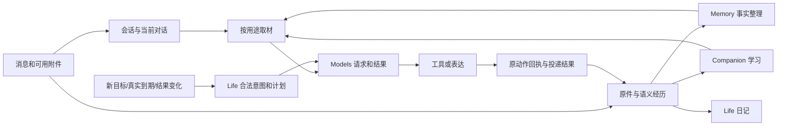

> 2026-11-05执行覆盖：用户已授权实施、13个独立工作包并行与集中验收，随后清空全部天枢自有业务数据/文件、仅保留配置并部署新版；不动其他服务。旧正文中的“只规划/保留独立业务数据”是前一阶段，按[正式执行记录](rb-execution-2026-11-05.md)执行。

# 天枢空库核心重构评估与完整开发队列

状态：**第六版候选方案（完整来源与功能盘点），26卡，未派发、未实现、未改生产、未清除数据。** 原方案日期：2026-11-04；第六版复核：2026-11-05，Asia/Shanghai。

第三版新增[最终系统审计与运维设计](tianshu-final-system-audit-2026-11-04.md)：22:13生产只读复核、7项新的结构缺口、失败材料隔离、指定模型的运维 Agent、管理员/邮件通知、独立日志页和系统统计页。该补充明确本版运行角色与恢复行为；所有新需求均已写入同一RB队列，不另建平行执行计划。

第四/第五版的CP与CW结论继续保留。第六版逐项复核原聊天17次请求、LE/ML/SD全部44项来源任务、RB26卡、现有导航/API与数据切换，形成22类功能清单、六角色归属及10组规划补全。详见[完整盘点第16节](tianshu-final-system-audit-2026-11-04.md)。原22组问题不增加为新事故，仍为26卡，本次未再次访问生产。

本方案承接本窗口的 Memory 评估、ML/SD 方案、全链路运行复盘、锁与日程解释，以及“评估自学习插件对天枢的启发”窗口的 LE 第二版。用户允许舍弃BOT域旧业务数据，因而对该域采用新空库基线，不安排其旧数据迁移或历史失败批次补偿；独立媒体及其共享依赖继续保留。现有功能继续保留，已经证明正确的行为继续保留；旧状态机、表和兼容代码不必原样保留。

**用户后续明确的模块边界：视频下载、音乐下载、图书订阅属于独立媒体业务，不归 BOT。本文的 BOT 空库重构不连带清空这些模块的订阅、任务、配置、库与文件。RB-18 仅负责保持独立模块边界、BOT 调用接口及必要共享设施适配，不授权重写独立媒体业务。** 当前实现为同一应用宿主中的独立业务模块，尚不是各自可独立部署的服务；共享宿主、队列基础设施和部分下载执行资源仍会产生运行影响。

这是对 SD 的结构性修订。唯一候选开发队列为 [26 张 RB 卡](tianshu-clean-rebuild-queue-2026-11-04.json)，[任务说明](tianshu-clean-rebuild-tasks-2026-11-04.md)列出改动归属、复用入口、删除项和验收；[历史行为与当前问题清单](tianshu-clean-rebuild-regressions-2026-11-04.md)保留 23 条历史修复/既有合同、41 个现有测试引用和 22 组当前问题（补录2组源码风险，不是新增生产事故）。SD/ML/LE 只作需求来源，不并行派发三套相同工作。

## 1. 重新评估：现在最值得改的是什么

建议继续以当前代码演进，但重做核心数据归属和等待方式。最影响顺畅使用的并非某一种模型不够聪明，而是几个独立概念被同一状态和约束绑在一起：

1. **上游结果不确定，被当成本地执行槽还在使用。** 普通云 API 调用在本地已经结束，却因 unknown 保留并发位，拖住其他后台请求。
2. **角色生活状态、时间安排与后台工作互相制约。** “她正在休息”“她正在阅读”“后台还在整理记忆”应能同时成立。
3. **学习历史与当前习惯有两条消费入口。** 一处撤回的行为可能经另一处记忆召回重新进入上下文。
4. **模型承担机械正确性，程序却在生成、提交、执行阶段使用不同资格解释。** 已完成目标、下一页能力和旧检查点之间出现冲突。
5. **同一结果被多层处理，却缺少统一可解释的业务收口。** 模型成功、入队成功、保存正文和实际任务完成并不等价。

因此，新方案以“减少重复权威、缩短持有资源的时间、让机械约束只实现一次”为主线。单纯删锁、换数据库、继续加提示词，均不能完整解决这些问题。

### 依据和证据边界

- 本轮重读的源码：统一检出 `C:/Users/Administrator/.codex/worktrees/frontend-807/tianshu-peiban-bot`，HEAD `c98e23c763cab6eded5cbd702773d9b3c7e8ca70`，已跟踪文件干净。
- 最近已核实运行源码：`03130711fd6961dde31335a300aae23bbf58d9b7`。本次22:13:37—22:13:39再次完成主机及同事务业务只读复核：Memory累计396批1729材料applied；13:33以来不完整响应65次，长排队33次、最长269.095秒。下方18:33和20:22是历史对照，不是最新数量。
- 18:33：进程、数据库和 QQ 连接正常，Memory 自启动已提交 276 批、1192 条材料；与此同时存在 8 条失败输入、反复不完整请求、Memory/Growth 局部失败和日程拒绝。
- 23 次不完整模型响应，以及 9 次 33—229 秒的后台等待，与 unknown 300 秒占位释放对应。证据支持后台资源耦合，不证明所有前台聊天都已受到影响。
- 20:22：两角色作息均为 07:00—23:00，空闲复查配置为 90 分钟。澄汐仍无有效当天安排；智乃仍有合法计划推进。智乃 25 个完成的虚构生活时段不能算成 25 次实际阅读或学习。
- 另一个窗口的“撤回复活、先截 40 条再筛选、当前对话被长期材料挤占”等来自当前源码；没有把它们夸大为已发生的真实错误回复。
- 日程读取两次约 8.7 秒，阶段根因尚未分解；供应商不完整回包的内部原因未查明。重构可消除天枢自身的放大效应，不能保证供应商不再出错。
- 本轮未运行产品测试或模型；41 个旧测试只做定位和行为映射，不能继承“以前通过”当新版验证结果。

主要依据见 [运行复盘](runtime-chain-review-2026-11-04-evening.md)、[LE 第二版](learning-enhancement-queue-2026-11-04.md)及队列内的源码/历史交付引用。

### 多维结论

| 维度 | 当前客观判断 | 重构重点 |
|---|---|---|
| 现有功能覆盖 | 聊天、多模态、Memory、关系、Growth、Life、日记、阅读、媒体与管理能力较完整 | 保留入口与功能，不从头再造全部产品 |
| 数据真实性与可追溯性 | 来源、版本、原回执、unknown 等基础较强，已有多次实际修复 | 保留行为，合并重复保存和重复证明 |
| 业务收敛 | 正常推进与局部长期失败并存 | 区分模型成功/业务应用，按错误类型恢复 |
| 并发与隔离 | 已有独立通道，但模型许可和领域状态仍有额外耦合 | 本地资源许可、业务状态、外部结果分开 |
| 日程自然程度 | 能滚动推进，但有资格冲突、失败后复查不足和生活/后台混杂 | 事件触发、统一资格、轻量时间安排 |
| 记忆与自学习 | 基础能力成熟；当前行为状态和取材优先级有明确改进点 | 唯一学习权威、上下文依赖优先、按需样例 |
| 性能与成本 | 有明确排队与页面慢样本，完整成本和长期质量证据不足 | 按链路分段计量，减少重复计算和无效重试 |
| 用户理解与维护 | 状态和保护理由分散，用户难理解为何不做事 | 页面直说等待原因、下一触发、实际成果 |

旧 Memory 的 82/100 是旧范围、旧时点的评估，不沿用为今天的全系统评分；这里以可核对的证据与问题清单代替无基准的新精确总分。

## 2. 方案选择，以及相比上一版真正变了什么

| 方案 | 评价 |
|---|---|
| 继续在现有结构补条件 | 能短期修个别故障，但双权威、等待占槽和概念混杂继续积累 |
| 只去掉并发锁、权限/来源检查 | 解决部分等待，同时可能重新引入重复发送、撤回失效和旧结果覆盖 |
| 全部从零实现，再拆微服务 | 重写已有可靠功能，并增加远程调用和运维；当前无收益证据 |
| **模块化单体，核心结构重构，空库启动** | **推荐。** 保留有效接口与能力，重做核心状态、数据和调度，删除旧数据兼容负担 |

与 SD 相比，明确改变六项：

1. 普通云 API 不继续采用固定 4/2/2 及 unknown 300 秒本地占位作为默认策略。
2. Life 拆开角色焦点与后台 intent/step，不再让一条 running 活动代表该角色全部工作能力。
3. 学习记录及其版本归 Companion 单独拥有，Memory 只建立引用索引；比“继续双写、再同步状态”更简单。
4. 当前对话的指代依赖先保留，可选习惯和长期记忆后选择。
5. 去掉泛用的最短时长、间隔、日额度和固定续读步数，用真实时间承诺、每步有界与进度判断约束。
6. 旧错由概括性的“保留 CAS/回执”变成按具体触发条件映射的卡级行为；同时覆盖新发现的错误和测试覆盖空白。

运行复盘曾建议谨慎保留 unknown 占位。本方案进一步区分资源类型：**保留结果未知不等于保留本地云请求许可**。本地连接已结束，可以释放本地资源，哪怕上游仍可能消耗 token；原 attempt、未知费用和迟到结果仍保留。确实仍在运行的 GPU/外部设备任务使用其真实句柄与容量约束。这个策略改变不能被实现成“所有 unknown 都失败、可立即重做”。

## 3. 新链路：三条主线，用可靠通知联动

图中的异步箭头使用现有 PostgreSQL/Procrastinate 可靠队列；它们不是新的消息中间件。

- **前台会话线：** 原消息身份 → 可用输入及缺失片段 → 当前对话依赖 → 可选材料 → 模型/工具 → 实际结果 → 表达/发送。
- **记忆学习线：** 原始材料或真实经历 → 可靠通知 → Memory 多主体共享整理、Companion 学习、日记各自独立消费。任何一个消费者失败，不回滚已提交原件，也不拖住另外两个。
- **生活执行线：** 目标/时间承诺/结果变化 → 合法候选 → 轻量排时 → 一个执行步骤 → checkpoint/真实回执 → 下一步或完成。

同步调用只留给“当前操作要成立必须知道”的事项，例如提交时当前版本、发送前实际授权、选中行为规则是否仍有效。派生学习、索引、日记、读模型更新都异步进行。对用户明确的“以后不要这样说”，当前回复立即遵守，已明确识别的规则修订同步完成；不能一边说已改好，一边等未知时长的后台学习。

## 4. 安全门和锁：删除、合并和保留的具体范围

以下是规则类别，不是对源码锁对象数量的统计，不能据此声称删了某个百分比。

| 类别 | 决定 | 具体边界 |
|---|---|---|
| 云 API 固定总 4、前台保留 2、后台最多 2 | 默认删除 | 用户实际配置的服务商额度仍有效；连接池和内存不能无限增长 |
| 云调用本地结束后 unknown 再占 300 秒 | 删除 | 结果/费用仍 unknown，迟到观测保留 |
| 空闲却不允许后台借用的模型位 | 删除 | 前台控制操作的数据库连接保留，不等同模型配额 |
| 全角色单活动锁限制所有后台工作 | 替换 | 只对生活焦点、真实资源和同一不可重复动作排他 |
| 模型/网络调用期间持有 DB 事务或业务锁 | 删除 | 领取与提交用短事务，外部等待用引用 |
| 作息、保护期限制无冲突的 Memory/Growth/索引 | 删除 | 真实预约、角色表现和打扰时段继续有意义 |
| 每日最多几项/固定占用比例 | 不保留旧限制 | 以前已修掉的限制不能换个名字回来 |
| 普遍最短 15 分钟、固定间隔、固定续读 12 步 | 去掉泛用硬限制 | 生活展示可有自然时长；后台以每步有界、真实进展、资源和取消控制 |
| 同一版本同一事务的重复来源证明 | 合并 | 同事务批量证明；跨异步/外部效果边界重新确认当前状态 |
| 生成、提交、执行各写一套资格逻辑 | 合并 | 一处领域规则，几个时点分别使用；最后的版本复核仍必要 |
| 多域复制学习有效状态和请求正文 | 合并 | 一个权威，其他保存引用和可重建投影 |
| 无变化仍轮询/增加 revision/调模型 | 删除 | 只唤醒真实新变化、结果或到期工作 |
| 任务领取短租约、同对象 CAS | 保留并收窄 | 防止两个执行者重复提交或迟到结果覆盖 |
| 实际发送/设备动作幂等身份与回执 | 保留 | 以前断线不明的请求不能当成没发过 |
| 当前来源/权限、关系不授予权限 | 保留 | 撤回应生效，学习和好感不能扩大访问范围 |
| 真实 deadline、取消、无进展判断 | 保留 | 防止失效意图继续执行及循环读同一页 |
| 必要磁盘容量和实际设备并发保护 | 保留 | 对应真实资源耗尽；不是“担心可能有风险”加的新门禁 |

API 能多路并发是取消任意低并发上限的理由，但它不解决本地连接、同一数据库记录写入和重复外部动作的问题。必要串行只覆盖冲突对象；独立动作和独立模块继续并行。

## 5. 数据结构：精简重复知识，保留明确语义

| 数据 | 唯一归属 | 精简方式 |
|---|---|---|
| 角色/人物/群与权限 | Identity | 稳定 ID 与授权版本分开；沿用已有群主体 |
| 原消息/附件与源版本 | Sources/Channels | 原event/revision/digest不变；附件补充与理解覆盖另有修订，关联原part/turn，不改原件再入站 |
| 事实、事项、关系与修订 | Memory | 当前 head 指向语义 revision；进度与访问统计不改正文版本 |
| 反思、习惯、偏好及其历史 | Companion | 一个学习记录系列，当前状态是同域视图；Memory 保存索引引用 |
| 目标、后台意图、步骤、角色焦点、时间承诺 | Life | 按不同变化原因分开；不再一张 activity 同时承担所有状态 |
| 冻结模型请求/物理尝试 | Models | 完整内容只冻结一次，其他域引用 request/attempt |
| 视频/音乐下载、图书订阅与媒体库 | 独立 Media 业务及其子模块 | 自有入口、订阅和任务；BOT 按需调用，不接管其生命周期或数据 |
| 外部动作及结果 | 既有 Actions/能力域 | 原动作身份、原 handle、原 receipt 连续；不另建同义账本；独立媒体所用共享身份与回执不随 BOT 清理 |
| 向量/词法搜索文档与读模型 | 各自派生投影 | 可重建，正文按需加载，不成为事实权威 |

具体取舍：

- 内部 ID 选合适数据库类型，外部平台原生 ID 保持原样；不把权限 scope 哈希当场景身份。
- 一条记录只有一个来源时直接引用；确有多来源才使用共享 evidence set，避免每个简单对象都套多层关系。
- 必要来源、可替代支持、生成依赖分开。一个反思参考 32 条上下文、只有 1 条直接证据，不能变成“32 次独立支持”。
- 索引只存检索所需摘要/字段及版本引用；模型需要细节时取完整证据单元。不能靠无条件截断正文获得速度。
- 会话文本块可按语义边界压缩/合并，不能破坏工具调用、思考与结果的顺序；原错误诊断和结果身份保留。
- 新库消除旧迁移适配和一次性恢复脚本。新产生的历史修订、撤回和原尝试仍需保存，不能把“不要旧数据”理解为“新数据不需要历史”。
- 不承诺表越少越好。验收看权威是否唯一、一次变更落在哪、读取往返与正文复制量是否下降。

### 唯一学习权威为何优于继续双写

旧路径把同一学习内容写入 Memory reflection 和 Companion style rule。即使加状态同步，恢复、撤回与索引延迟仍会产生两条有效性判断。

新路径由 Companion 保存学习正文、版本、来源、条件和当前资格。Memory 可检索它的引用，但普通事实召回不会直接把历史规则当现行指令；Context 对选中的规则一次批量解析当前有效版本。历史查询可说明曾经学过什么，不把旧历史再次执行。Memory 不直接导入 Companion 内部代码，由装配层的公开端口解析，避免反向依赖和循环导入。

## 6. 后台任务与恢复：把“等待”从“占用”中拿出来

一次典型工作：

1. 短事务领取一个当前逻辑任务，读取所需版本。
2. 需要模型时提交冻结 request，登记等待引用并释放 worker/DB 连接。
3. Models 持有实际网络调用，完整结束或本地中断后释放本地许可；保存物理结果。
4. 结果通知使所属领域续接。短事务检查当前语义版本并应用；已被后继替代的旧结果只记录，不覆盖。
5. 需要重试时记录 due，任务回到公平队列。等待期间不 sleep 占工作者，不阻塞后续材料。

同一共享材料批需要明确的一个当前申请者，防止同时制造一堆同义请求；这不应限制其他材料批。新模型 attempt 不等于新业务身份。

| 结果形态 | 处理 |
|---|---|
| 已知完整且合法 | 提交结果，通知后续消费者 |
| 已知完整但 JSON/schema/引用非法 | 程序给明确诊断；Memory/Growth 一次纠正，Life 沿用最多两次；仍失败只终止/标记该批 |
| 已知未提交的暂时失败 | 按实际退避到期重试，等待不占槽 |
| 本地结束，上游结果未知 | 保留原 unknown；可查询先查；纯计算允许独立尝试但最多应用一次；外部效果不盲重放 |
| 同材料、同路由、同形状连续失败 | 停止无上限原样循环；按已定义策略修复/缩小有语义闭合的批次，有限尝试耗尽后记录具体失败；新材料照常推进 |
| 来源/权限失效、用户取消或真实截止 | 按领域语义停止/归档，不伪装暂时故障反复重试 |

重试阈值由错误类型和领域操作定义，不新增每用户每天固定次数门禁。纯计算重新请求可能仍产生上游重复费用，账本必须如实记录已知和未知使用量；默认不能把未知费用算零。

生产者只在原事务入队，消费者提交自己状态与消费回执。合并通知只适用于“这份状态需要重算”；实际命令、原始输入和外部回执不能按最新一条覆盖。处理过程中收到新变化，要保留后继任务；不能用全局自增 ID 的最大值作为完整消费证明。

## 7. Memory 与自学习的算法调整

**共享理解一次，逐目标记录覆盖，整批原子提交。** 群消息整理继续使用同一材料组的一次多主体理解。先登记主体内声明，再解析successor、关系端点及反例引用；跨主体引用显式限定，同作用域冲突拒绝。规范提案、别名映射、编译版本/摘要和来源快照冻结后作为提交输入；相同结果恢复不重新生成身份。机械编号问题优先本地编译，语义错误才走有限纠正。

**在输入批和任务边界隔离失败。** 大批次根据完整问答、否定和关系依赖分段。每目标changed/no_change/unresolved是覆盖结果，不是多个提交事务；同一合法提案的操作、覆盖与回执同事务提交。协议非法时不截取所谓成功人物输出。未提交父批可在证明输入依赖闭合后有界重组，显式替代父批、阻止迟到应用，子批各有完整提案和原子回执，继承同一恢复预算。不能可靠拆分的批次保留失败，其他独立批继续。

**先选候选，再搬正文。** 主体/场景/时效/状态先约束，词法与向量召回轻量候选，批量验证来源后按需补候选和取正文。融合、多样性选择和重排只用于适合的候选集合；ANN 结果不能冒称完整清单，完整统计/历史清单走明确结构化查询。

**复用可证明相同的计算。** 向量键包含输入和模型/预处理版本；重排还需要 query 和候选版本。token 单元估计缓存后只做必要整包检查，原图准备/远程候选预取每批一次。缓存不能跨实际授权范围复用材料，来源撤回后不能继续返回旧正文。

**学习使用真实反馈。** 用户明确偏好、临时要求、推断习惯分别存；条件、对象和有效期明确。支持强度来自独立来源，不来自模型反复讲自己的话。表达样例按真实回复关系构造；群词义只帮助理解。情绪、好感和样例采用次数都不等于正确性证据。

**降低无意义反思。** 技术补取不产生学习经历；连续低信息虚构休息可汇总为生活记录，而非每条都启动反思。真正有内容的阅读、对话、创作与主观体验继续保留。保留 imagined、第三方观点、角色感受与用户事实的边界。

**预算保留原意。** 背景输入上限200000不是填满目标；普通聊天16000、输出预留2048，Growth 180秒、Memory 300秒、embedding/rerank各30秒独立。已部署的本地向量候选/来源校验2秒还须同步到代码fallback、新装配置种子与示例；当前源码仍0.8，不能只写“保持2秒”。显式用户配置继续有效，阶段失败保留合法其他结果。

## 8. Life：让角色有生活，同时让后台正常工作

把三个问题分开：

- **她现在表现为什么状态？** 角色焦点和生活时间线，例如休息、阅读、创作。
- **系统现在在做哪些事？** 独立后台 intent/step，例如下载、检索、整理、日记生成。
- **她何时应该打扰我？** 联系策略、用户约定与当前适合表达的机会。

睡觉不应阻止索引或 Growth；有预约也不妨碍后台下载。真实需要角色注意力的两件事仍有顺序。当前代码已有部分外部等待会释放注意力，新实现应保留并推广，不能把既有能力当成完全缺失后再重复开发。

触发链明确为：新目标、用户改变、任务完成、外部结果到达、材料语义变化、真实时间边界。日程页面读取只读，不触发模型。兜底时钟检查漏掉的到期任务，不能承担全部业务推进。

候选由程序提供合法的 key、当前版本、允许的下一步和必要参数。模型负责选什么、为什么，程序负责还是否有效及实际执行哪个能力。同一个 eligibility 函数用于候选、提交和执行，避免“给了选项却拒绝选项”。模型可以提出新的有依据目标，但不能凭空发明执行能力或目标 URL。

计划应用按候选返回已安排、主动留白、暂排不下、状态已变、提案非法及原因/版本/下一触发。只有明确留白才保存有效空白指纹和绝对复查时间；有意图但全被跳过不能等价留白。混合结果逐项保留，等待窗口、刷新候选、有限纠正各走适用路径，已成功目标变更和联系不重放。每分钟流逝不等于材料变化，既有合法承诺不被失败提案清空。

阅读采用单步工作、cursor 和真实进展驱动。移除固定 12 步作为整段任务的总额度，但单步网络调用仍有界，同页循环会停止，真实截止与取消仍生效。不能为了“无限阅读”允许无进展重复请求。

日记按角色当地日期和稳定作者场景独立构造请求，不串聊天或前一天上下文；结果正确保存后以原请求/回执对账状态。实际读过、只发现、读失败、想象、未知图像分别呈现。

## 9. 从 DSH 与“我会永远陪着你”保留什么启发

可借鉴的是具体互动细节、少量相关记忆、自然短表达、允许安静、可理解的生活展示和主动表达与后台工作的独立性。不能把随机 followup 当作完成阅读或学习，也不能把“简单”理解为完全没有任务去重、超时和预算。

参考的 [private_companion](https://github.com/menglimi/astrbot_plugin_private_companion/tree/527bd907eeb54cb055763cc05432e30158a51a26) 本身有任务并发、超时与预算管理；[DSH](https://github.com/deepseek-ai/deepseek-harness) 是宿主，[speak-up](https://github.com/Yuuyuko-uu/dsh-speak-up)、[fish-memory](https://github.com/Yuuyuko-uu/dsh-fish-memory)、[feiyu-mood](https://github.com/Yuuyuko-uu/dsh-feiyu-mood) 才是本次查阅的具体机制样本，不能代表所有“养鱼”实现。

[自学习插件](https://github.com/NickCharlie/astrbot_plugin_self_learning/tree/962276786a7fba8242fcdfaca1bcd9201c80cb01) 的表达样例和词义提供增强方向；天枢已有整理、反思、撤回和来源失效能力，不应再复制第二套学习引擎。本方案优先修当前规则消费，再增加样例，而不是增加一个每轮评判的模型。

以上是源码机制比较，没有长期用户盲测结果，不能据此宣称重构后的陪伴质量必然超过其他项目。

## 10. 开发顺序、并行边界和交付

| 卡 | 主要交付 | 负责人 | 完成依赖 |
|---|---|---|---|
| RB-01 | 功能保留、领域归属与最小合同 | I | 无 |
| RB-02 | 稳定场景、来源与分型证据 | S | RB-01 |
| RB-03 | 事务通知、短任务与到期唤醒 | R | RB-01 |
| RB-04 | Models 单份请求、异步结果与云 API 调度 | B | RB-02、RB-03 |
| RB-05 | 前后台进程和实际资源隔离 | R | RB-03、RB-04 |
| RB-22 | 失败材料隔离与统一恢复策略 | R | RB-01、RB-02、RB-03、RB-04、RB-05 |
| RB-06 | 分片输入与附件渐进补全 | D | RB-02、RB-03 |
| RB-07 | Memory 当前事实、修订与搜索投影 | M | RB-02 |
| RB-08 | 共享整理、局部别名编译与覆盖闭环 | M | RB-03、RB-04、RB-07、RB-22 |
| RB-09 | 候选检索、重排与计算复用 | M | RB-04、RB-07 |
| RB-10 | 唯一学习账本、偏好修订与 Growth 恢复 | C | RB-02、RB-03、RB-04、RB-07、RB-22 |
| RB-11 | Life 对象解耦与统一执行资格 | L | RB-02、RB-03 |
| RB-12 | 对话依赖优先、分用途取材与预算 | D | RB-06、RB-09、RB-10、RB-11 |
| RB-13 | 事件驱动规划与轻量时间安排 | L | RB-04、RB-11、RB-12、RB-22 |
| RB-14 | 后台执行、阅读续接与局部失败恢复 | L | RB-03、RB-04、RB-05、RB-11、RB-13、RB-22 |
| RB-15 | 语义经历与独立日记闭环 | L | RB-03、RB-04、RB-07、RB-10、RB-11、RB-14、RB-22 |
| RB-16 | 对话、工具与发送结果收敛 | D | RB-03、RB-04、RB-05、RB-06、RB-12、RB-22 |
| RB-17 | 按需表达样例与群词义 | C | RB-07、RB-08、RB-10、RB-12 |
| RB-18 | 独立模块边界与 BOT 调用接线 | X | RB-02、RB-03、RB-04、RB-05 |
| RB-23 | 指定模型的运维 Agent 与验证闭环 | O | RB-02、RB-03、RB-04、RB-05、RB-22、RB-08、RB-10、RB-15、RB-16、RB-18 |
| RB-24 | 独立日志页与不阻塞业务的日志链 | R（F负责页面） | RB-03、RB-05 |
| RB-25 | 系统统计页与准确的增量计量 | O（F负责页面） | RB-03、RB-04、RB-05、RB-07、RB-10、RB-11、RB-22、RB-13、RB-23 |
| RB-26 | 独立守护、升级通知与恢复验证 | O | RB-03、RB-05、RB-22、RB-23 |
| RB-19 | 现有页面装配、运维配置与业务解释 | F | RB-07、RB-09、RB-10、RB-11、RB-12、RB-13、RB-14、RB-15、RB-16、RB-17、RB-18、RB-23、RB-24、RB-25、RB-26 |
| RB-20 | 空库基线、交付包与切换步骤 | I | RB-02、RB-03、RB-04、RB-05、RB-06、RB-07、RB-10、RB-11、RB-15、RB-16、RB-17、RB-18、RB-19、RB-22、RB-23、RB-24、RB-25、RB-26 |
| RB-21 | 完整装配、旧错验证与同质量对照 | I | 其余25卡 |

编号保留，执行次序以依赖为准。RB-21为最后一张集成卡。I总装配、R运行设施、S身份来源、B模型、M记忆、C学习、D对话通道、L日程、X独立能力、F前端、O运维；均为职责，未创建窗口或代理。

1. RB-01～05完成最小合同与运行基础，随后RB-22确定故障隔离和恢复语义。
2. 原Memory/学习/日程/对话卡按依赖推进；领域内同文件同负责人串行，独立领域可依据公开端口准备。
3. RB-23运维 Agent、RB-24日志、RB-25统计、RB-26守护通知按合同并行准备，必要接线到位后完成；计量和日志不会等到最后才考虑。
4. RB-19装配页面与设置，RB-20准备仅BOT域空库及独立媒体依赖保留，RB-21集中补实际装配差异验证。

部署仍采用同产品镜像。运行角色按需分为API、Models、BOT前台worker、BOT后台worker、独立媒体worker、Operations；监控子进程独立监管，宿主守护负责容器外兜底。共享数据库和物理资源仍有真实影响，不承诺单机故障时全部功能持续可写。

迁移注册、全局配置和总装配有唯一负责人。没有改根CURRENT/全局任务板，没有派发另一窗口。SD 22项、ML 16项、LE 6项全部有映射，仅ML-14旧业务补偿因BOT空库路线退役，新任务恢复继续保留。新增FR需求及NF发现详见[最终审计](tianshu-final-system-audit-2026-11-04.md)。

## 11. 防止旧错回归的具体做法

[清单](tianshu-clean-rebuild-regressions-2026-11-04.md)记录 23 条必须保留的行为、现有测试入口、历史修复说明和负责卡。原 14 条映射有 41 个测试函数；补充的 9 条先列出确切行为与修复依据，未假称已有完整测试。PF-08 已知现有用例只覆盖部分暂停/保护行为，重复唤醒与时间前进需在新结构实现时补足。

实施规则只有三条：

1. **改某条链路，就保留该链路的旧反例。** 模块/表变了可以改夹具与调用方式，不得删掉“不会重复发送”“不会串前一天”“不会丢撤回”等断言来获得绿色测试。
2. **每条未解决问题在相应卡证明关闭。** 传输成功、队列清空、数据库无锁、界面能打开都不能替代业务结果。来源失效、未知结果和真实无材料是合法状态，不强改成成功。
3. **复用适用结果，只补装配差异。** 这次核心改动广，跨域并行与重启验证有必要；不默认跑全部历史目录、双后端矩阵、重复 20 次健康检查或固定多日观察。不增审批门禁。

必须有的几组代表性反例：

- 排队很久后仍获得完整执行预算，但原真实 deadline 不刷新。
- 旧 unknown 迟到、新 attempt 已应用：旧结果不能回退当前状态；外部发送不重放。
- 消息中两个视频不可用、其他图片可用：仍接收有效内容；后来补全不重复回复。
- 完成目标被模型选中、read/discover 续接、完整非法 JSON、截断 JSON分别正确处理。
- 规则撤回后从两个检索入口都不可采用；同类两条规则版本都留在取材清单。
- 当前问题引用较早一轮内容时，相关上文不能被可选长期材料挤掉。
- 没有新变化的连续唤醒不形成空轮询；旧活动失败不阻塞新材料和新日期。
- 同事务刚写的真实回执能推进目标；另一个消费者失败不回滚已经提交的事实。
- 日记保存后只修派生状态，不改原正文、日期、作者和已知结果。

不能给出“任何重构绝不会有新 bug”的保证。可以要求每个已经知道的失败触发条件都有实现归属和验证证据；未覆盖的部分明确保留，不能包装成已经通过。

## 12. 性能、成本与体验如何评价

本轮不虚构倍数收益。重点观察四类可归因变化：

| 目标 | 对照方式 |
|---|---|
| 去掉未知结果对无关任务的占位影响 | 同类失败注入时，看其他独立请求是否还等固定 300 秒；分开排队、执行和恢复时间 |
| 减少日程页面开销 | 同规模 40 时段/9 活动材料，拆 SQL、来源证明、正文搬运、序列化；排除网络和首次加载差异 |
| 降低相同知识的重复工作 | 每批远程调用次数、正文复制量、来源往返、重复向量计算、实际输入用量 |
| 保持记忆与陪伴质量 | 完整人物归属、否定/条件/更新、当前指代、真实例子、撤回即时生效、任务实际完成率 |

评价应同时记录成功样本、失败和重试、缓存/推理用量与未知费用。较少 token 不自动意味着更好，减少上下文不能以丢掉当前对话和人格完整性换取。两次耗时不能叫 p95，没有用户反馈或长期自然样本时不能写“长期陪伴质量已提升”。

学习对照承接LE-06：先比较原实现与核心选择修正，再按相关场景单独比较有无样例、有无词义；不跑全组合门禁。HTTP按实际可观测阶段计量，等待响应不能冒称纯推理时长。架构目标是删除不必要的等待与重复权威；实际模型质量、供应商稳定性和最终速度需要实现后对照。共享 CPU、数据库和网络仍有物理竞争，目标是独立推进和有界影响，不承诺各模块完全不消耗共同资源。

## 13. 空库切换的边界

允许丢弃天枢旧业务数据意味着可以取消历史数据迁移、旧 schema 逐级兼容、旧坏任务补偿与旧提案恢复入口。默认不重做作者已经配置的人格、连接、供应商和工作流；保留它们是方便重建的配置种子，用户也可以选择全部新建。外部 NAS 服务、共享媒体与其他数据库不属于“天枢旧业务数据”。

按用户明确的独立模块归属，上述空库范围收窄为 BOT 业务域。即使使用同一物理 PostgreSQL 数据库，也不能整库 DROP/TRUNCATE；独立媒体引用的 Identity、Sources、Action/Receipt、队列记录及凭据必须保留或在共享接口改动时正确承接。视频、音乐、图书模块的优化需单独范围，不随 BOT 重构顺带实施。

空库不会自动消除外部世界已发生的事情。切换必须先停止旧生产写者，按渠道实际支持的游标/纪元隔开新输入；拿不到可靠游标时，使用最少的已接收身份防重放。BOT发起且确需切换的旧GPU/下载任务用原句柄对账；独立媒体现有下载继续保留，不能因BOT新库没有记录就重复提交或停止它们。

回退按新旧 schema 兼容性安排，不直接用旧快照覆盖新版已产生的合法数据。发布核对实际版本、启动健康与受影响关键入口，业务成功仍按实际链路证据判断。以上是未来开发卡的切换步骤，本轮没有删除、部署、恢复或触发外部效果。

本次交付为第六版完整盘点及原26张卡的补全：17次请求、44项来源任务、22类功能、10组规划修订均有处置；22组原问题和20项CW继续保留。全部卡仍planned，未开始产品实现。

本次仅验证文档/JSON一致性、26卡依赖、旧需求和两窗口结论映射、问题双向归属及本地引用。产品行为仍待实施验证；生产数量来自此前22:13快照，本次未重新检查。

第四版明确：这是BOT核心整体重构，旧BOT业务数据不迁移；可靠实现和独立模块复用。弃旧数据只发生在本次重建，后续升级保留新版数据；缓存、上游会话和归档回填不得重新灌入旧BOT历史。所有已知缺陷与升级需求已映射，但实施完成和必要行为验证前不声称已修复。

## 14. 第六版完整盘点后的实施重点

完整表和证据见[审计第16节](tianshu-final-system-audit-2026-11-04.md)，机器读`original_request_inventory`、`source_task_inventory`、`feature_inventory`及`whole_review_corrections`。这些是同一队列的核对维度，不是新派发卡。

- 补回ML/SD合并时省略的细节：未整理新消息、逐消息来源、学习规则语义变化、原生工具/渲染/发送、Episode历史、中文检索、轻量能力目录、故事家族对照。
- 把异步提交/结果交接、流式重连、唯一连接owner、角色ready及退出流程写成可验证合同；可选功能失败不因旧整体探针把可用API一起重启。
- 创作章节、共读、小屋服装、项目知识/经验、资源资产、设备基础设施/游戏、天气和插件技能都明确保留。独立非BOT内容及作者配置按真实引用保留；BOT空库不等于只保媒体、其余都清空。
- 日志在实际查询源验证同时间戳超页限的续取；计量不制造每个job一条永久时序，原回执和未完成工作证据不因统计压缩删除。
- 日志R牵头、统计O牵头、前端F单写；词义M与样例C各有归属，RB25补齐RB13/23结果依赖。LE/ML/SD保持历史来源，唯一候选执行队列为RB。

当前更优路径是减少无必要调用、重复证明和无变化重算，并把真实等待交还队列；跨请求缓存与排序参数仅在同质量实测有净收益时采用。没有证据支持本轮另拆微服务、换消息总线/向量库或增加前台评判模型。
