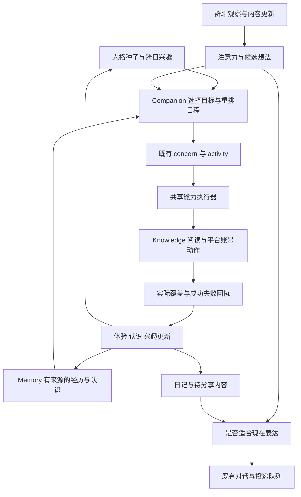

# 天枢自主生活与持续人格可行性研究

核对日期：2026 年 10 月 21 日。研究范围为现有天枢架构、相关产品源码、原始论文和开源实现。

2026 年 10 月 23 日接续：已细化[角色自身记忆的隔离存储与应用方案](../architecture/actor-self-memory-design-2026-10-23.md)及[完整开发队列](../development/autonomous-life-development-queue-2026-10-23.md)。新文对齐 Q20 与主机迁移进展；本文保留 10 月 21 日的研究截面。

**用户设想可以在工程上实现：角色能从人格与经历中形成兴趣，自行选择可完成的小目标，浏览真实内容，保留自己的体验，在适合的时候参与群聊或分享，并让今天的经历影响明天。天枢已有较完整的生活、活动、阅读、记忆和投递基础，主要工作是接通这些能力之间的因果关系。**

这里的“有自己的想法”指可观察、可持续的自主行为：选择有依据，经历能追溯，兴趣会积累，未完事项能延续，表达具有个人取舍。这些行为不能用来证明系统具有主观意识。实际产品可以做到很有连续性，但长期稳定程度仍需连续使用验证。

本文补充并更新 [9 月 11 日的陪伴架构研究](2026-09-11-humanlike-companion-architecture.md)，以当前产品实现为依据；旧文中的未实现状态、旧天枢接口和职责过渡方案不覆盖当前 V2。以下方案是研究建议，没有发布新合同或派发开发任务。

## 1 核对基线与现有能力

本次审计了相关调用链，没有运行真实模型、发送 QQ 消息、操作外部账号或访问 NAS。部署状态取自项目已有发布记录，不代表本次重新完成实机验收。

| 对象 | 审计基线 | 状态解释 |
| --- | --- | --- |
| Companion | `5f569c7bc71a9beef7d9c2ee45d4a5d17daf0f41` | 协调检出干净；CURRENT 顶部记录 Q15 已部署 |
| Memory | `75df5539d7f896f15e3bc6ecba4c508ed00749dc` | 协调检出干净；CURRENT 顶部记录 Q15 已部署 |
| Platform | `e60c4bfbde55b46192fc95f59f705355f62f4200` | 存在既有未跟踪 build/；包含未部署的通用插件候选，不能整体当作线上版本 |
| 部署依据 | [CURRENT](../development/CURRENT.md)、[Q15 发布说明](../development/memory-quality15-release-2026-10-21.md) | 最新记录为 PG 已启用、Q15 已发布；较旧能力汇报中的 SQLite、Q10 等状态已过时 |
| 正在进行的相关工作 | [Q16 计划](../development/memory-quality16-plan-2026-10-21.md) | 回应对象、时间来源、明确限流恢复另有任务负责；本文不重复接管 |

目前的天枢已超过“静态人格加定时回复”：

| 能力 | 当前实际实现 | 与本目标的距离 |
| --- | --- | --- |
| 人格 | 已发布人格修订与角色生活同步，生成今日安排时读取人格 | 有稳定身份基础；后天兴趣还缺独立长期演化 |
| 后台生活 | 服务启动独立生活工作者，浏览器关闭后仍可工作 | 已有常驻基础；常驻检查不等于持续调用模型 |
| 日程 | 固定作息时段内，可由模型生成不同活动和细节 | 有个性化安排，但时间骨架固定，缺少跨日目标主导的滚动计划 |
| 自有活动 | 有 checkpoint、next_due_at、状态、来源、结果引用；可调用工具推进 | 已有真实行动框架；暂停恢复与统一目标选择未闭合 |
| 自有事项 | `life_concerns` 保存开放事项、认识片段、来源及确定程度 | 可承载愿望和未完项目，不必重建待办系统 |
| 网页阅读 | Knowledge 接受 actor 主体，支持 URL 获取、正文解析、按范围读取 | 已有“拿到地址后读取”；发现、挑选、读后兴趣反馈未接完整 |
| 视频输入 | 支持短片段抽帧和音频片段，明确标记覆盖与缺口 | 不等于完整观看；还需字幕、转录、长视频进度和媒体获取链 |
| 群聊观察 | 非 @ 消息有独立观察、来源证明和归档链 | 能看到不等于会因兴趣主动加入 |
| 长期记忆 | 有来源、主体、修订、范围、撤回与召回 | 主要人物事实能力不能直接冒充角色自己的兴趣模型 |
| 主动分享 | 生活事件可产生 motive，模型可决定发或不发，经现有队列投递 | 已有表达与可靠投递基础；缺少更多真实自主经历作为输入 |
| 日记 | 可从生活材料自动生成草稿，具有版本和发布接口 | 材料、人格输入和反思反馈不足；当前不是完整的数字生活日记 |
| 平台账号 | B站和音乐已有账号生命周期、订阅或媒体能力 | 未接角色自己的点赞、收藏新增、评论及个人选择 |

## 2 研究证据支持哪些设计

研究支持若干组成机制，但没有一篇论文证明“把这些模块装起来，就能无限期稳定地拥有完整人格生活”。

| 一手来源 | 对天枢最有用的机制 | 证据边界 |
| --- | --- | --- |
| [Generative Agents，2023](https://arxiv.org/abs/2304.03442)；[作者计划代码](https://github.com/joonspk-research/generative_agents/blob/main/reverie/backend_server/persona/cognitive_modules/plan.py)、[反思代码](https://github.com/joonspk-research/generative_agents/blob/main/reverie/backend_server/persona/cognitive_modules/reflect.py) | 经历进入记忆，反思连接原始依据，计划随环境调整 | 25 个角色的短期模拟和消融支持可信行为；不是数月真实网络生活的验证 |
| [Voyager，2023](https://arxiv.org/abs/2305.16291)；[作者项目](https://voyager.minedojo.org/) | 根据现状和成功失败历史提出下一小目标，从实际执行反馈中继续学习 | Minecraft 的探索与技能实验；不能直接推断开放网站操作或长期人格表现 |
| [MemGPT，2023](https://arxiv.org/abs/2310.08560) | 有限上下文与外部长期记忆分工，按需调取 | 解决记忆访问与控制流；不会自动产生兴趣和社会动机 |
| [Sleep-time Compute，2025](https://arxiv.org/abs/2504.13171)；[Letta 实现说明](https://www.letta.com/blog/sleep-time-compute/) | 闲时处理上下文、整理认识，前台对话不必承担全部整理工作 | 论文收益来自特定实验，产品文档也不是长期陪伴效果证明；不能据此给天枢承诺相同比例的提速或降本 |
| [Inner Thoughts，CHI 2025](https://arxiv.org/html/2501.00383v2)；[作者实现](https://github.com/xybruceliu/thoughtful-agents) | 把形成候选想法和决定表达时机分开；有想法也可以暂时不说 | 作者同时报告无关或矛盾想法、重复、阈值难调、漏掉时机或突兀插话；需要真实群体验校准 |
| [MaiBot 调度源码](https://github.com/Mai-with-u/MaiBot/blob/ff0fe42500f5f7581e9655d1e78379407233207a/src/maisaka/turn_trigger/scheduler.py)、[轻量门控](https://github.com/Mai-with-u/MaiBot/blob/ff0fe42500f5f7581e9655d1e78379407233207a/src/maisaka/turn_trigger/reply_likelihood.py) | 同时保留 @ 与非 @ 路径，聚合消息，轻量筛选后再进入较重决策 | 有实际代码支持；概率门控本身不等于语义兴趣，也不证明“数字生命”已完整实现 |
| [LongMemEval，ICLR 2025](https://arxiv.org/abs/2410.10813) | 分开检查提取、跨会话、时间、更正和无依据时不回答 | 记忆问答成绩不能替代主动生活、工具成功或群聊自然度 |
| [lettabot 发布记录](https://github.com/letta-ai/lettabot/releases/tag/v0.2.0-alpha.10) | 后台唤醒可以静默工作，只有明确发送动作才联系用户；高频唤醒可能昂贵 | 是特定产品配置的工程经验，不能当作天枢报价；[该仓库](https://github.com/letta-ai/lettabot)已归档，适合参考而非直接选为活跃依赖 |

由这些机制和天枢现状推导出的路线是：**持续维护状态，在有意义的变化发生时做决定，执行后保存结果，再改变下次决定。** 没有必要让模型每分钟写一段内心独白，也没有必要为同一个角色再套一整套多代理框架。

## 3 当前最具体的八个缺口

### 3.1 当日意向还不是长期爱好

`LifeInfluences` 从已受理对话中提取当天意向；输入主要是对话、当前活动和短期情绪，没有把人格作为这一提取步骤的判断依据。`DailyLife` 在跨日建立计划时明确清空 `life_interests`。这能防止一次随口建议永久改写人格，但也意味着目前的兴趣容易停留在当日。

应把四类内容分开：人格给定的基础偏好、经过多次经历形成的长期兴趣、最近想了解的主题、某次对话临时引起的念头。例如“喜欢音乐”是种子，“最近关注某位作曲家”是兴趣，“想比较这两首配乐”是目标，“今天下午读一篇访谈”才是活动。

长期兴趣至少需要主题、倾向、形成依据、最近接触、变化历史和当前未完事项。多次独立经历才支持稳定变化；一次别人推荐不自动变成她的爱好。同一条内容被重复转载，也不应被当成多次独立证据。人格可以约束选择，但允许她探索原来不了解的东西。

证据：[life_influences.py](../../projects/tianshu-companion/src/tianshu_companion/life_influences.py) 第 77、204 行；[life_daily.py](../../projects/tianshu-companion/src/tianshu_companion/life_daily.py) 第 176 行。

### 3.2 已有日程和目标容器，尚缺统一的选择与重规划

今日安排可以由人格生成，但受原作息时段约束；模型不能自由增删时段。后台活动步骤主要读取人格、当前活动、开放事项第一页和当前时间，没有完整的跨日经历召回与候选目标比较。

建议保留作息作为可用时间的骨架，把自选活动排入空闲段。选择依据包括兴趣、未完成目标、刚遇到的新线索、已有承诺、可用工具、预计时间，以及是否刚做过同类事情。日程应关联一个具体目标和完成条件，允许延期、放弃、切换与恢复。已有明确约定优先于自由探索。

这里需要的是一个有界决策步骤，输出仍写现有 concern/activity。可先让模型提出少量候选，程序校验时间、状态和可用能力，选择结果记录简短依据。无需新建另一套任务中心，也不应通过随意生成“精力值”制造虚假的精密心理模型。

证据：[life_daily.py](../../projects/tianshu-companion/src/tianshu_companion/life_daily.py) 第 18、78、394、577 行；[runtime_execution.py](../../projects/tianshu-companion/src/tianshu_companion/runtime_execution.py) 第 304 行；[life_work.py](../../projects/tianshu-companion/src/tianshu_companion/life_work.py) 第 38 行。

### 3.3 暂停之后可能没有下一次决定

发现一条明确的静态代码路径：模型没有推进活动 checkpoint 时，运行时把活动从 running 改为 paused；活动工作者只扫描 running；日程协调又把 paused 活动视为仍占据当前活动。因此可能出现活动持久保存了，生活却停在等待下一步的状态。

本次未用真实服务复现这一场景，结论是源码中的可达风险。需要在现有活动调度内补上：到期重评、满足恢复条件后继续、无法继续时选替代活动、已经过时则取消。未知外部副作用仍先核对，不能为“活跃”而盲目重放。

证据：[runtime_execution.py](../../projects/tianshu-companion/src/tianshu_companion/runtime_execution.py) 第 429 行；[life_activities.py](../../projects/tianshu-companion/src/tianshu_companion/life_activities.py) 第 167 行；[life_daily.py](../../projects/tianshu-companion/src/tianshu_companion/life_daily.py) 第 218 行。

### 3.4 旁听和按兴趣参与尚未连起来

现有账号观察入口区分了“允许观察”“允许回复”“触发回复”。但触发规则仍是私聊或 mentioned；共享桥接适配器也采用相同资格判断。未触发的普通群消息可以归档，却不会自然进入人格兴趣选择。

这不是整个 Core 都只能响应 @：通用对话 dispatch 可以给已绑定角色派发消息。真正要修改的是从观察到参与的责任链，不能只改 Core 的目标角色检查。

建议沿现有观察通路增加一个角色注意力步骤：对聚合的话题窗口理解“在讨论什么”，结合她的兴趣、亲历内容、关系和当前活动，产生“想了解”“想回应”“暂不参与”等候选。只有合适的参与候选进入现有对话和出站路径。明确 @、命令、关键词能力继续走原规则。

轻量筛选只用来减少无价值模型调用，不能用关键词命中代替最终兴趣判断。选择发言还应考虑是否有新内容、是否有人正在回答、她刚才说了多少，以及发送时话题是否已变。一个候选可以延后、失效，或者永远不发出。

证据：[bot_observation.py](../../projects/tianshu-platform/services/platform/bot_observation.py) 第 58、1071、1277 行；[共享适配器](../../projects/tianshu-companion/integrations/shared/tianshu_adapter_rpc.py) 第 525 行；[bots.py](../../projects/tianshu-platform/services/platform/bots.py) 第 633 行；[observation.py](../../projects/tianshu-companion/src/tianshu_companion/observation.py) 第 221 行。

### 3.5 阅读能力存在，搜索发现和后台工具接入仍有断点

Knowledge 已有真正的 actor 所有权、URL 获取、HTML 正文提取和按范围阅读。视频读取也存在，当前一次范围限制在 30 秒内，最多抽取 8 帧，并明确返回 `frames_sampled`、`audio_not_transcribed` 和 `complete=False`。

所以不应把问题写成“天枢完全不会上网或读视频”。欠缺的是发现值得看的内容、筛选和去重、取得合法可读的媒体与字幕、持续阅读、形成个人体验的完整流程。

另一个接线问题是：`web.search`、`media.video` 等在当前 Companion 技能目录里只有声明，没有实际 handler；后台活动调用的是现有 life 操作集合。只给聊天加搜索插件，并不会自动让无人聊天时的生活工作者也会搜索。应使对话和后台活动复用同一能力执行归属，同时保留 actor 与用户请求人的身份差异。

证据：[knowledge_content.py](../../projects/tianshu-memory/src/tianshu_memory/knowledge_content.py) 第 30、252、348 行；[knowledge_sources.py](../../projects/tianshu-memory/src/tianshu_memory/knowledge_sources.py) 第 218、256 行；[knowledge_media.py](../../projects/tianshu-memory/src/tianshu_memory/knowledge_media.py) 第 221、258 行；[skills/native.py](../../projects/tianshu-companion/src/tianshu_companion/skills/native.py) 第 106 行；[skills/registry.py](../../projects/tianshu-companion/src/tianshu_companion/skills/registry.py) 第 67 行。

### 3.6 自己的体验还没有充分改变下一次选择

Memory 的人物兴趣画像主体是 person/group；不能拿“她知道用户喜欢什么”充当“她自己喜欢什么”。另一方面，Memory 的 Knowledge 内容已经允许 actor owner，也不能说系统完全没有角色自己的资料。

需要在真实阅读或行动后形成简短体验：看了什么、实际覆盖多少、有什么认识、喜欢或不喜欢哪里、下一步想弄清什么。事实、主观评价、推测和愿望分别标记。将它们与活动、内容版本和来源连接，并让之后的计划、聊天和兴趣更新能够检索到。

日记可表达这些体验，却不应成为新的独立事实证据：同一次阅读被写进日记、摘要和反思三次，仍然只是一段原始经历。角色后来发现理解错了，可以修订认识，保留当时为何那样想。

证据：[profiles.py](../../projects/tianshu-memory/src/tianshu_memory/profiles.py) 第 43 行；[knowledge_content.py](../../projects/tianshu-memory/src/tianshu_memory/knowledge_content.py) 第 30 行；[memory_context/application.py](../../projects/tianshu-memory/src/tianshu_memory/memory_context/application.py) 第 222 行；[reading.py](../../projects/tianshu-companion/src/tianshu_companion/reading.py) 第 397 行。

### 3.7 日记已有形式，需要真实材料和人格一致性

当前日记生成读取 actor_id、配方和生活事件摘要，没有直接附人格快照；素材函数排除带 scope 的事件，并统一以 fictional 标记。草稿会自动生成，但公开版本走显式发布接口。它目前偏向虚构生活作品，不能直接称为融合真实浏览、群聊体会的个人日记。

建议在原日记模块上增加人格表达与可用的真实数字经历材料：读后感、未完成的探索、发生变化的兴趣、合适范围内的社交体会。只读了简介就写“今天看到一个介绍”；看过字幕和片段才谈其内容；没有成功访问就保留“原本想看，但没打开”。

日记可以自动私密保存，公开分享沿既有发布与受众策略。无需把每一篇草稿变成例行审批。反思产生的“明天想继续”应转入原 concern/activity，而不是只留在一篇不会再被读到的文章中。

证据：[life.py](../../projects/tianshu-companion/src/tianshu_companion/life.py) 第 594、738、820 行。

### 3.8 外部账号动作需要角色身份和真实回执

现有 B站适配器能读取列表、收藏夹、稍后再看并处理登录；读取收藏夹不等于新增收藏。相关实现未见角色点赞、发布评论、写观看历史。音乐也主要是账号歌单和媒体管理。小黑盒在本次定向核对的 Platform 服务中未见接入。

需要明确哪一个角色使用哪一个服务账号，复用现有凭据、失效和重新登录机制，增加具体动作及结果核对。角色不必拿到 Cookie 或管理员会话；执行器持有凭据。已配置范围内可以自主行动，不需要每次点赞都弹确认。

评论超时是具体的重复风险：服务器可能已经发出评论，只是响应丢失。因此动作记录需要区分意图、已提交、成功、失败和结果未知；未知时查询原结果，不能盲目再发一次。网页内容也只能作为材料，不能给角色增加账号权限或发出新的系统指令。

证据：[media/bilibili.py](../../projects/tianshu-platform/services/platform/media/bilibili.py) 第 144、375、469、499 行；[media/accounts.py](../../projects/tianshu-platform/services/platform/media/accounts.py) 第 89 行。

## 4 在原架构中如何接成闭环

建议继续使用 Companion、Memory/Knowledge、Platform、Gateway 的现有分工，初期不增加新的独立服务。

这里有三个协作循环：生活循环决定做什么，行动循环完成并记录结果，社交循环决定什么值得对谁说。它们共用同一角色和状态，不能各自编出一套生活。常规对话继续沿原路处理，不要求每一轮都额外经过完整规划、反思和日记生成。

| 数据或决策 | 建议归属及复用位置 |
| --- | --- |
| 稳定人格 | Companion 现有人格版本；日常浏览不自动改写身份和核心价值 |
| 当前兴趣、关注、计划与活动 | Companion 生活模块；扩展原意向、concern、activity，不另建平行待办 |
| 自主经历的业务源事件 | 现有 Companion 活动、阅读和发送记录；维护唯一完成状态 |
| 长期经历与认识的检索投影 | Memory；引用源事件与内容版本，支持更新、撤回和范围检查 |
| 原文、媒体片段和来源覆盖 | Knowledge 现有 actor-owned 内容接口 |
| 人物画像、关系和好感 | Memory 原领域；关系不能转化为账号或工具权限 |
| 平台账号与外部动作 | Platform/对应适配器；模型只得到能力和结果 |
| 模型并发、用量、故障 | 原 Gateway 和任务队列；交互优先，自由探索可延后 |
| 页面 | 原生活、日程、阅读和日记视图；展示当前在做什么及进度 |

角色自身长期兴趣目前没有完整合同。实现前应明确 actor 主体及唯一写入方，避免把它塞进 person 画像或用虚构 person_id 伪装自己。建议由 Companion 管理当前兴趣版本，Memory 提供历史经历与检索投影；这是本研究的设计建议，不是已发布数据归属变更。

一个最小的候选想法只需保存主题、来源、关联目标、简短表达意图、适合的受众和失效条件。它是可检查的产品状态，不需要持续记录长篇内部推理。大多数想法可以被遗忘、延后或转成自己的活动，不必都变成消息。

## 5 浏览与账号互动分平台实现

| 用户期望 | 可行路线 | 主要现实限制 |
| --- | --- | --- |
| 自己查网页 | 搜索适配器发现候选，复用 Knowledge 获取原文，形成体验和后续问题 | 搜索摘要不能代替正文；动态页面、登录内容和失效来源需分别处理 |
| 自己看 B站 | 复用现有视频/订阅目录挑选内容，接字幕或授权媒体片段，按实际覆盖继续理解 | 下载、页面打开、抽帧、字幕阅读和完整观看是不同状态 |
| 收藏与点赞 | 角色账号绑定，具体动作适配器，结果核对 | 必须核实当前可用且获准的接入路径，不能只依据旧接口文章 |
| 评论与回复 | 使用读过的内容和她自己的观点生成评论，经既有可靠出站思想实现 | 对象、公开受众、重复发送与认证失效需要被正确处理 |
| 刷小黑盒 | 新增来源适配器，分区/推荐流进入统一内容发现，复用角色决策 | 当前公开案例主要依赖可变化的客户端接口，维护成本更高 |
| 音乐、书籍、漫画 | 优先利用天枢现有库和进度，为角色建立自己的选择和体验 | 库中有文件不等于角色已经读过或听懂 |

小黑盒已有较贴近的开源案例：[AstrBot 小黑盒适配器](https://github.com/674537331/astrbot_plugin_xiaoheihe_adapter)把通知和主动浏览接入宿主人格与 Agent，而不是另造大脑。本次还核对了其 [分区读取源码](https://raw.githubusercontent.com/674537331/astrbot_plugin_xiaoheihe_adapter/main/xiaoheihe/topic_service.py)和[端点定义](https://raw.githubusercontent.com/674537331/astrbot_plugin_xiaoheihe_adapter/main/xiaoheihe/endpoints.py)，确有分区流和评论动作；[接口说明](https://github.com/674537331/astrbot_plugin_xiaoheihe_adapter/blob/main/docs/xiaoheihe-api-contract.md)明确其并非稳定公开 API。它证明存在工程参考，不证明移植到天枢即可直接可靠运行；其特有的审批配置也不是天枢必须照搬的产品要求。

B站方面，过去常被推荐的 [Nemo2011/bilibili-api](https://github.com/Nemo2011/bilibili-api)在本次查询时已标记 2026 年 7 月 6 日归档，README 声明停止维护和关停。应优先核对[官方开放平台](https://open.bilibili.com/agreement/developer-service)实际授予的能力，再决定具体接入方式；本次未核实它涵盖普通账号全部点赞、收藏和评论需求。不能把旧 SDK 的存在当成今天稳定可用的保证。这也不构成对天枢现有 B站下载功能已失效的判断，本次没有测试线上下载。

“观看”尤其应作为产品语义明确：角色可以读字幕、分析音频和关键帧，并形成自己的理解；没有必要为了声称“看过”去制造播放计数。若用户需要账号观看历史，也应作为独立的实际平台动作核验，而不是由模型口头宣告。

## 6 用户最终能感受到的一天

以下是目标体验示例，所述爱好和内容是假设，用来说明因果关系：

| 时间与事件 | 她如何决定 | 应留下的真实状态 |
| --- | --- | --- |
| 上午空闲 | 人格偏好细腻叙事，过去几次阅读让她对独立游戏配乐感兴趣；决定了解一部作品 | 兴趣依据、今天的小目标、待阅读来源 |
| 找到评测 | 读完正文，发现一段提到作曲家，于是想查访谈 | 原文版本、已读范围、认识和新问题 |
| 下午看视频 | 先读字幕，再看相关片段；发现某种配器手法 | 实际时间区间、感受、未覆盖部分 |
| 群里有人谈配乐，没人 @ 她 | 她有相关经历，先判断是否能补充新内容；别人已经说过就不重复 | 参与候选或静默消费记录 |
| 决定分享 | “我下午刚读到他的访谈，原来这段用了……我更喜欢另一首，因为……” | 来源与个人看法分明，发送成功才算已分享 |
| 看到另一个有趣作品 | 自主收藏，留待周末了解 | 角色账号的实际收藏回执、后续事项 |
| 晚间 | 写下为什么改变了最初看法，以及还没弄明白的问题 | 有人格风格的日记、可追溯的认识、明天的候选目标 |
| 次日或重启后 | 从未完事项继续，也可以因为新经历改变选择 | 不重置爱好，不冒称离线期间已经看完 |

这种体验里，她可以与用户喜好不同，可以暂时没有话说，也可以中途失去兴趣。选择应随自身经历变化，不能把“得到更多回复”当作唯一奖励；否则容易变成追逐热点和不断打扰。

## 7 建议按完整功能块推进

### 第一块 跨日兴趣与可继续的生活

复用原 Life、Influences、Concerns、Activities，完成长期兴趣与临时念头分离、目标选择、活动暂停后重评，以及跨日和重启续行。用现有知识库中的一本书或已知网页作为真实输入，让她能自行选择、读一段、留下体验、第二天继续。

完成判断是“无人发消息也有可核对的进展，重启后能继续”，不是页面出现了一个“自主模式”按钮。

### 第二块 内容发现与经验回流

接通一个搜索来源和现有媒体目录；对话与后台活动共用能力执行接口。把阅读范围、理解、感受和后续问题写回原事件及记忆路径，让它们影响下一次选择。完善日记人格输入、真实材料与后续目标提炼。

完成判断是“她能解释为什么选了它、实际看到了什么、以后想接着做什么”。此阶段可在天枢内部形成有明显生活感的体验，不必依赖所有外站账号都接好。

### 第三块 群聊语义参与

沿现有观察链增加话题理解、兴趣关联与候选表达，协调共享适配器的 claim、Platform 路由和 Companion 决策。保留原 @、关键词和命令能力；普通话题由角色决定是否参加，发送前检查候选是否仍适合当前讨论。

完成判断是“该接的时候能接，不相关时能安静，而且发言与自己的真实经历有关”。该块与外部来源适配可按不同归属并行开发，共享入口保持单写。

### 第四块 角色自己的平台账号

按 B站、小黑盒等服务分别接入登录、读取、收藏、点赞、评论和结果核对。复用现有账号管理，增加角色绑定和动作范围。外部网络访问受限时，她仍能继续阅读本地资料、写作或调整计划。

这些功能应保留在最终范围内；分开实施是为了让每个平台都能实际验证，不是把用户需求缩减成只读。公开动作可在预先配置的范围内自主进行，常规操作无需每次再次确认。

### 持续使用验证

以上四块是实现顺序建议，不是新任务卡，也没有恢复已完成任务。正式开发时需对齐 Q16、存储性能任务和插件候选的最终版本。

建议在相关逻辑验证通过后，用同一角色连续试用一到两周，结合反馈再延长；这是观察长期体验的建议，不新增默认 CI 门禁。第一轮就记录实际成本、兴趣延续和打扰情况，避免一次演示顺畅就宣布“有了完整生活”。

## 8 成本与验收应该怎样衡量

持续存在依靠持久状态和可靠调度，不要求模型永久占用一个上下文。现有生活循环的秒级检查可保留；只有阶段切换、重要事件、新内容、活动到期或需要分享时，才做较重的语义决策。

建议采用消息聚合、便宜的初筛、按需召回和有限次目标重评。后台探索遇到前台聊天负载时延后；模型不可用时保留计划、进度和失败事实。已经看过的内容可复用解析和覆盖记录，同一事件不反复做全套总结。

可用以下公式预算，价格使用实际模型账单，不写虚构报价：

`每日增量成本 = 计划调用 + 活动执行调用 + 参与判断与表达 + 整理日记 + 搜索/转录/视觉工具成本`

例如仅作算例：一天 4 次重规划、12 个活动步骤且平均每步 2 次模型调用、6 次参与判断/表达调用、1 次整理，共 35 次调用。若平均每次输入 4000 token、输出 600 token，则约为 14 万输入、2.1 万输出 token，未计普通聊天、搜索费用、视频处理和额外失败重试。这不是天枢当前实测、建议硬上限或价格承诺；多轮工具的实际均值必须测量。

当前 [Q15 发布记录](../development/memory-quality15-release-2026-10-21.md)还显示供应商可用性及时间表述等未完全解决的问题。自主生活会放大这些问题：调用失败可以延期，不能编造完成；时间和归属错误会污染之后的计划。应与已有修复衔接，不通过新增更多反思调用掩盖基础错误。

| 验收场景 | 需要观察的结果 |
| --- | --- |
| 连续一天无人聊天 | 自己选择并完成至少一个有依据的可执行活动；没有强凑消息 |
| 跨日与重启 | 保留兴趣、实际进度和未完目标；不虚构离线完成 |
| 人格与经历冲突 | 可以形成不同于用户的偏好；一次诱导不覆盖稳定人格 |
| 群友未 @ 的相关讨论 | 有内容时自然参与；多数无关消息静默处理 |
| @、关键词与明确命令 | 原有功能继续可用，同一消息不被多个路径抢答 |
| 只读标题或部分视频 | 准确描述读到或看到的范围，不宣称完整观看 |
| 工具失败、暂停、来源失效 | 合理延后、恢复或切换，不永久占住活动，也不报假成功 |
| 重复分享与未知评论结果 | 记录是否已经分享，核对未知结果，不重复发布 |
| 私聊、群聊和角色隔离 | 兴趣可以产生适当投影，私人原文和他人所知不越界 |
| 日记与事实一致 | 观点可以文学化，经历有来源，日记不被循环当成新事实 |
| 兴趣有变化 | 能追溯变化依据，既不每天重置，也不永远追逐最新热词 |
| 资源有界 | 前台响应、后台 token、失败重试和多媒体处理分别可见 |

体验指标应分开看：经历真实性、跨日连续性、主动发言合适度、观点与人格一致性、承诺兑现、成本和延迟。可以用相同模型和相同内容比较“现状”“加入跨日目标”“再加入语义参与”，不只比较哪个版本说得更多。

本研究建议优先完成的可体验成果是：**她能自行选一份真实内容，读出自己的看法，把它带进一次合适的聊天和一篇日记，并在第二天接着做。** 这个完整循环一旦成立，B站、小黑盒、音乐和更多爱好就能成为同一种连续生活中的不同活动。
