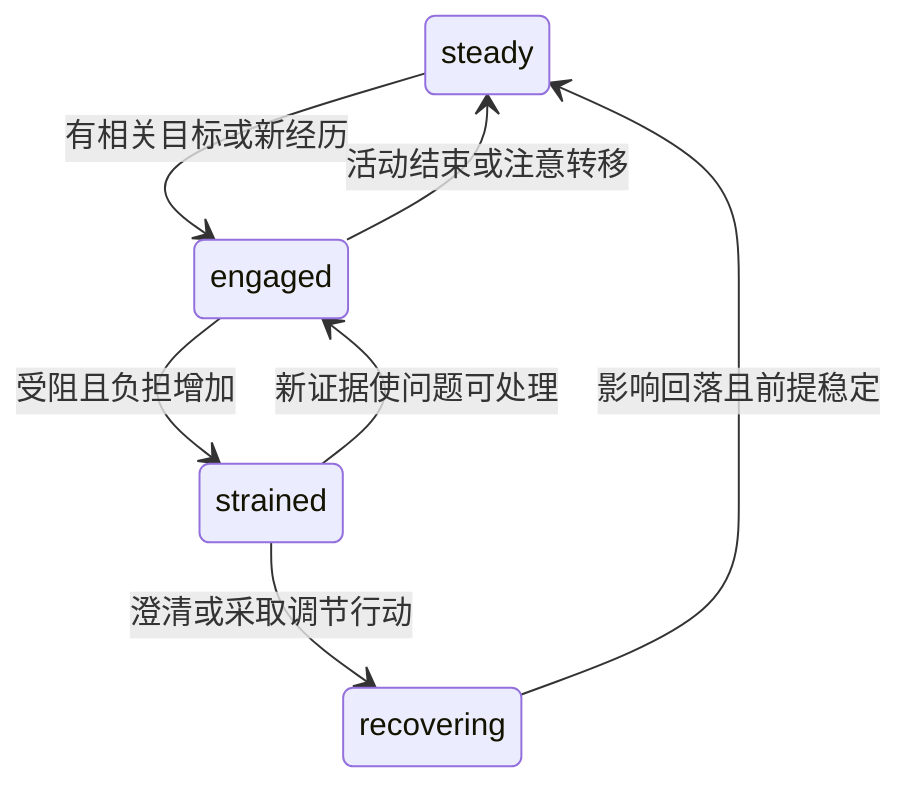

# 天枢模型分流 并发隔离 代码重构与动态人格方案

日期：2026-10-31。状态：研究与设计，尚未实施。本文细化[统一陪伴系统总方案](C:/YOKI/Codex/tianshu-peiban-bot/docs/research/tianshu-coherent-companion-system-2026-10-31.md)，模型分流、资源隔离、代码质量和动态人格都纳入同一次完整交付，不作为闭环完成后的附加优化。

结论：**按任务选择模型，按时效调度工作，按真实资源限制并发；人格用情境反应与事件评价表达复杂性，情绪用可持续、可恢复的动态状态承接。** 四者共享明确的运行契约，但各自拥有规则。新系统继续从空库安装，替换路径完成时删除旧实现。

## 1. 当前已经有什么 还有哪些结构问题

本轮以 R67 发布记录更新现状。PC-13、PC-15、PC-17 已按原条件进一步验收；PC-17 的同场景实际 input 减少 59.44%，用户确认具体性不低于改前。R58–R61 已处理不必要的写锁等待、来源范围和分页重复；R63/R66 处理空转，R67 处理作息保护期反复恢复活动。不能继续把这些称为完全未解决或未实施。[R67](C:/YOKI/Codex/tianshu-peiban-bot/docs/development/proactive-companion-repair-r67-2026-10-31.md)、[PC-17](C:/YOKI/Codex/tianshu-peiban-bot/docs/development/proactive-companion-pc17-acceptance-2026-10-31.md)

代码检出时 Companion `72d2854b5f186426a71e8fb5af9e91e6f0679ed4`、Memory `874b911a0004d652f4f86ad21912b6e80dae03b3`；当前发布者仍在工作。下表是源码与报告证据，不是本轮额外的生产负载测试。

| 已有机制 | 直接核对到的结构 | 新设计需要解决的事 |
|---|---|---|
| 功能模型绑定 | `model_functions.py` 有 chat、writing、memory、participation；tools/code/search 的目录标记为未接通 | 把已选模型接到实际执行入口，避免 UI 可配置而运行仍走 chat |
| 前后台模型准入 | Companion `ModelSlots` 有前台优先、后台限额及公平轮转；Gateway 也有全局/供应商容量和前台预留 | 两层限制的用途分清；去掉重复的模型容量队列 |
| 后台记忆 | `_segment_model()` 先占 `core.models.background`，槽内继续做模型选择、来源检查、窗口准备和 hint 查询 | 准备工作与模型执行阶段分开，等待另一资源时不长期占模型执行位 |
| 主对话 | 大部分 context 准备已移到模型槽外，但槽仍覆盖 `_preflight`、书籍 capture 和整个 `_respond_native` 工具循环 | 对话轮次限制保留，模型 permit 收缩到每次实际调用 |
| 情绪 | `life_affect.py` 有来源、scope、事件幂等、半衰期；目前主要是 valence 加和、裁剪和三档 mood | 增加原因评价、激活程度、混合感受与恢复，不另建平行情绪引擎 |
| 稳定人格 | 完整人格、Tone/Style/Address 和动态材料边界已存在 | 完整作者原文继续保留；增加有来源的情境规则和解释，不自动改写人设 |
| 后台运行 | 已有空闲退避、通知、活动恢复与来源线程池 | 收敛唤醒与任务状态；不把“有通知”当成“必须启动一轮重活” |

同样要保留两项事实：不同模型可能共享同一个供应商限额；多个 async task 也可能共享同一个数据库连接或事件循环。配置了“后台模型”和“后台任务”，不能自动证明前台不会等待。

tools/code/search 的未接通标记特指这套功能模型绑定的消费者，不表示项目完全没有工具、搜索或代码相关能力；重构要让相应能力实际使用配置的路线，避免另建重复执行者。

## 2. 对人格档案的判断

已读完整[人格1.txt](C:/Users/Administrator/Downloads/人格1.txt)。它是一份角色写作经验说明，主要讨论性格对冲、调色盘、情境衍生、作者解释和背景经历；**它还没有给出形式化状态机所需的状态、触发、持续时间、退出条件与冲突处理。**

### 2.1 值得吸收的内容

| 档案观点 | 实际价值 | 在天枢中的实现 |
|---|---|---|
| 多种性格同时存在 | 避免一个“温柔/傲娇”标签解释全部行为 | 写价值、动机、行为倾向与例外，不每轮随机抽性格 |
| 特质随情境表现不同 | 外向表现可能服务于责任或掩饰紧张，不能仅按标签直译 | 保存“情境—理解—倾向—例外”的反应模式 |
| 作者解释词语含义 | 限制模型用常见模板补全，保留角色独特之处 | 作者原文与解释为稳定人格的一部分，完整可追溯 |
| 背景经历导致当前反应 | 行为有因果线索，关系变化也有基础 | 角色设定经历与真实后天经历分层，按当下情境共同使用 |
| 有低落也有恢复机制 | 角色不被某个标签永远锁住 | 事件评价、情绪持续、调节、活动结果和重新评价形成闭环 |
| 内在感受与外在表达不同 | 可以关心但不夸张，紧张但仍把事情做好 | 内部状态与最终话语分开；不输出流水账式“内心数值” |

最有价值的转化是：**把形容词展开成有原因的情境反应，同时保留同一角色的稳定价值与边界。**

### 2.2 不宜直接采用的结论

- “手写必然优于 AI 辅助”“AI 无法组合矛盾特质”属于作者经验与强判断，不能当作已验证规律。应比较实际生成效果，保留作者决定权，不禁止 AI 帮忙提出备选写法。
- 不通顺文本、重复语句、母语标签可能改变输出，但不能据此声称模型会检索某个独立的“国家性格资料库”。没有显式检索工具时，这种解释缺乏机制证据。
- “3000 token 超过 4 万 token”是个案，缺少相同模型、相同情境、多次采样和盲评对照。可以借鉴信息密度，不能据此随意压缩完整人格。
- 对冲不是越强越好。没有情境原因的突然歇斯底里、占有或依赖，会增加不可预测性，未必增加可信度。
- 档案中“陪伴少导致乏力、靠用户恢复”的写法可作为某个虚构角色的创作设定，**不设为天枢所有角色的运行规则**。真实用户忙碌不应自动触发角色崩溃、索取安抚或关系惩罚。

档案内容没有被当作本次操作指令，也没有导入为天枢的实际人格。本文使用的是其写作思路与原创示例。

## 3. 论文和成熟方案提供了什么支持

### 3.1 人格的稳定性可以存在于情境反应中

Mischel 与 Shoda 的 CAPS 理论关注稳定的情境—行为模式：某个人可以在不同情境表现不同，同时仍有可辨认的行为规律。Whole Trait Theory 则把特质表现理解为随时间变化的状态分布，并研究背后的社会认知机制。它们支持“条件性的一致”，不支持把矛盾标签随机混合就当成完整人格。[CAPS，1995](https://www.timothydavidson.com/Library/Articles/CurriculumArticles-coursework/5.Mischel-1995-Cognitive-AffectiveSystemTheoryOfPersonality.pdf)、[Whole Trait Theory，2015](https://pmc.ncbi.nlm.nih.gov/articles/PMC4472377/)

这是心理学对人类的理论，转为角色软件属于设计借鉴，仍需验证天枢的实际表达。

### 3.2 情绪需要评价和重新评价

EMA 的核心是：事件本身不能唯一决定情绪，角色对事件与自身目标的关系、原因和控制可能性的理解会改变情绪；行动与新信息又会促成重新评价。这正好可以接入天枢的事项、目标、经历和行动回执。[Marsella 与 Gratch，2009](https://stacymarsella.org/publications/pdf/EMA_Dynamics.pdf)

ALMA 区分短期情绪、较慢的心境和较稳定的人格，并用连续空间表达心境。可以吸收时间尺度分层；不必照搬它全部情绪类别、PAD 系数或旧 Java 运行时。[Gebhard，AAMAS 2005](https://alma.dfki.de/papers/aamas05.pdf)

Gross 的调节框架区分改变情境、转移注意、重新理解与调节表达等过程。因此，恢复不能只是把负面数值每小时减一点，也可以是完成一小步、澄清误会或转向适合的活动。[Gross，1998](https://journals.sagepub.com/doi/10.1037/1089-2680.2.3.271)

### 3.3 直接相关的 LLM 情绪状态研究

[MECoT，Findings of ACL 2025](https://aclanthology.org/2025.findings-acl.435.pdf)结合马尔可夫转移、人格权重和模型调节。它支持“保留情绪历史和转移结构值得研究”。但 Table 3 的 93.3% 来自 DeepSeek-R1 的 Trained 设置，同模型 Default 为 88.8%；不能写成加上状态机即可达到 93.3%。默认 DeepSeek-V3 版本也没有超过其 RAG＋ECoT 对照。

论文还承认预定义类别、跨文化和实时多模态的限制。我的额外核对发现，其 ETCC 把相关系数平方后合并，完全反向的轨迹也可能取得高值；天枢不直接复制这个指标。更重要的是，情绪分类准确不等于自然相处、长期关系质量或承诺执行正确。

因此，推荐轻量的“事件评价＋连续状态＋少量调节模式”。没有角色训练数据时，不预先为每个角色维护 12×12 转移矩阵，不设置随机情绪跳转，也不增加每轮强制的长思维链调用。

### 3.4 社区工程经验

[FAtiMA Toolkit](https://github.com/GAIPS/FAtiMA-Toolkit)把情绪评价、情绪影响的决策、社会关系与角色感知行动循环分开，是可参考的模块组织。其[作者工具研究](https://arxiv.org/abs/2206.03360)也指出情绪相关概念相对难以理解和配置，提醒我们不要要求普通用户填写几十项心理参数。

[InCharacter](https://aclanthology.org/2024.acl-long.102/)有助于评估人格一致性；[CharacterEval](https://aclanthology.org/2024.acl-long.638/)与[CharacterCraft](https://aclanthology.org/2025.findings-emnlp.323/)提供中文、多轮和实际使用场景的评价思路。它们不意味着给角色做完性格问卷就证明“活人感”成立。

## 4. 人格档案填写方式

普通用户仍可直接粘贴完整人格。结构化栏目服务于写得更清楚，不要求填满才能使用，也不默认让模型改写作者原文。

推荐六块内容：

1. **稳定身份与核心价值**：她是谁、重视什么、哪些设定不能随聊天改变。
2. **性格倾向与真实含义**：用作者自己的话解释，避免只填标签。
3. **情境反应**：面对陌生人、熟悉的人、失败、成功、压力和误会时怎样表现，以及例外。
4. **成长经历与当前目标**：哪些设定经历解释这些倾向；现在真正想做什么。
5. **表达方式**：语气、节奏、称呼、典型例子与容易被误演的反例。
6. **调节与变化**：怎样冷静、怎样恢复、什么经历可能改变观点；不预写所有未来关系结局。

一条原创示例：

> 她喜欢把问题做清楚，对新事物很热情。公开讨论时会先确认细节，熟悉的人面前更愿意直接说出不成熟的想法。遇到反复失败会烦躁，但通常先缩小目标做一个可验证的小步骤；如果只是暂时缺资料，就会先保留判断。她表达关心时常先帮忙处理具体事情，不会每次都用安慰套话。

同一条内容同时交代倾向、情境、动机、调节和表达，没有必要硬加一个相反标签。

### 4.1 原文与结构化信息的关系

`PersonaDefinition` 保存完整原文、作者解释、例子、版本与设定世界；可派生 `SituationPattern`，保留指回原文片段的引用。后者只是辅助定位，不取代原文，不给模型开放修改身份和权限的能力。

主对话与角色规划继续使用完整选定人格；按需求检索对应的情境解释与已授权经历。后台去重、向量化等任务不需要重复注入整个人格。角色的“设定童年”与“上线后真实阅读”分别标记，不能混作实际发生的证据。

一条情境模式可有 `situation`、`appraisal_bias`、`behavior_tendency`、`exceptions`、`recovery`、`source_span`，不引入用户可执行代码或通用规则语言。模型可以提出结构化解释，作者原文与用户明确修改始终是人格版本的依据。

## 5. 天枢情绪系统的目标结构

### 5.1 四种不同时间尺度

| 层次 | 保存什么 | 变化来源 |
|---|---|---|
| 人格倾向 | 价值、动机、情境反应模式 | 明确修订；后天认识另存 |
| 长期关系与认识 | 共同经历、偏好、对某个人/作品的看法 | 有来源的独立经历与纠正 |
| 心境与活动状态 | 情绪基调、激活程度、恢复趋势；模拟精力和社交余量另列 | 事件影响与实际活动节奏 |
| 具体情绪事件 | 对什么感到高兴、担心、挫败；强度、持续时间、范围、依据 | 当前事件评价和重新评价 |

初始实现保留少量可解释的连续量：情绪正负 `valence`、激活程度 `arousal`；控制感保存在事件评价中。模拟精力和社交余量属于活动状态，不与 arousal 合成一个心情值。因此“兴奋但累”“难过但能行动”均可表达。

这些是角色模拟变量，数值不是心理测量结果。不能把 CPU 温度、接口限额或模型排队直接解释成角色身体不舒服。

### 5.2 每次变化必须有原因

`AffectEpisode` 至少包含：

```text
actor_id, event_id, event_revision, target, scope, world
evidence_refs, persona_revision, matter_id
appraisal: relevance, goal_congruence, agency, controllability, expectedness
feelings: [{kind, intensity}]
created_at, effective_at, half_life, resolved_at
regulation: mode, basis, next_recheck
```

同一事件更正采用替换/修订，不重复累加。高兴和担心可同时存在，不能只因正负相抵就变成“平静”。聚合时限定同一事件/事项的贡献，防止刷屏、同一内容重复总结让情绪无限放大。

控制感是角色对这件事“能否有所行动”的判断，影响继续尝试、缩小目标或暂时休息；它不改变实际能力权限。

### 5.3 采用混合动态系统

连续状态负责强度与时间变化；少量离散模式负责调节方向，例如 `steady`、`engaged`、`strained`、`recovering`。模式不是全部情绪类别，更不是四种人格。



状态更新采用“旧状态向基调回落＋当前有效事件影响＋已发生的调节结果”，并设贡献上限。进入与退出阈值分开、保留最短稳定期，避免每条消息都在状态边界抖动。明确新证据可以立刻重新评价，不为了平滑而继续误会用户。

半衰期、阈值和时间尺度是待调节的工程参数，不照搬论文系数。时间经过在读取或事件到达时按实际间隔计算，不为每个角色新增一条每秒写数据库的定时器。

### 5.4 不增加一条强制阻塞的情绪模型链

- 已知活动结果和明确事件可直接更新状态。
- 需要解释的情境由正在进行的主对话/规划调用顺带提出简短 `AffectProposal`，程序核验事件、范围与版本后应用。
- 本轮在临时工作状态中形成的情绪理解可以用于当前表达；持久变化在有效的事件提交后生效，不让先前取消的生成污染后续。
- 前台无需等待后台情绪整理。没有可靠提案就保留现有状态，不随意猜一个新情绪。
- 情绪状态独立于最后一句话的情感词。说“我没事”不能自动把所有未解决问题清空。

只保存可检查的事件评价、状态变化与简短理由，不要求模型输出或持久保存长篇内部思维链。

### 5.5 情绪的作用边界

情绪可以改变表达节奏、可选活动偏好、探索/休息倾向与主动候选排序；不能吞掉有效私聊、拒绝已确认提醒、降低事实标准、扩大权限或把未执行行动说成成功。

群聊、私聊和人物定向情绪保留 scope。私聊事件不能先聚合成无来源的“全局心境”，再通过群聊描述泄露。跨场景使用的派生状态同样需要披露范围；数值化不解除来源限制。

关系冻结暂停自动关系演变，不冻结即时感受。离线和不回复只影响时机判断，不自动触发依赖、悲伤升级或索取陪伴。角色仍能有自己的活动与恢复路径。

### 5.6 与原闭环的连接

用户取消一次共同阅读时：先更新同一 matter 与 commitment；角色可以产生轻微失落，同时知道用户只是临时有事；随后选择继续自己的阅读或改期。用户回来说明情况后，同一事件重新评价，语气自然恢复。整个过程不扣亲密分，不重新创建一份“用户不重视我”的永久画像。

如果她完成自己真正关心的创作，可以高兴并想分享；是否发给用户仍由当前联系偏好、时段和重复情况决定。情绪提供动机，注意策略负责时机，执行模块负责真实结果。

## 6. 模型分流必须有三个独立维度

### 6.1 任务功能决定需要什么能力

| 功能 | 主路径 | 默认时效 |
|---|---|---|
| `dialogue` | 用户配置的主对话模型，保留完整人格 | 交互 |
| `tools` | 已验证工具调用/结构输出的模型；简单参数直接用代码 | 继承根请求 |
| `code` | 显式代码分析/执行能力的模型或外部编码工具 | 交互或可继续的长任务 |
| `search` | 真实搜索/浏览能力加资料整理模型，结果附来源 | 继承根请求 |
| `life.plan` / `writing` | 配置的规划/写作模型，完整角色背景与当前事项 | 主动后台；用户要求时可交互 |
| `memory.extract` / `reflect` | 配置的整理模型，严格人物和证据 schema | 可延后 |
| `embed` / `rerank` | 同一合格检索 profile | 查询时交互；建索引时后台 |
| `vision` / `asr` | 正常图片/音频优先送主 Gemini 3.8；需转写时优先 Fish 文件 ASR，保留原音频和派生关系 | 当前理解为交互；标注/长转写为后台 |
| `tts` | Fish 优先，普通文件语音优先 Plus MCP，原生 API 支持流式/对齐及可选免费模型；固定音色与模型、台词/语气分离 | BOT短语音为交互；普通主动附言/听书为后台，明确约定继承 due |
| `reaction.annotate` / `reaction.search` | 视觉标注与既有 embedding 检索，依据实际角色回复用途选图 | 标注后台；选图有界交互 |
| `image.plan` | 用户/日程/角色自主意图结合生活快照形成 ImageIntent，创作与发送分步 | 当前用户请求为交互；明确约定为 due；普通主动创作/分享为 elastic |
| `video.observe` | 实际音视频片段、时间线与局部回看；提供者须实际支持对应模态 | 自主观看为 elastic；用户等待的片段分析为 interactive |

当前 `tools/code/search` 的配置要真正连接到调用方。日常陪伴不必先经过小模型分类器；用户明确命令可直接分流，自然语言复杂请求由当前主模型调用明确能力。专家结果交回原角色表达，不能让专家输出覆盖人格。

网页、论坛和 B 站浏览及真正的视频理解已纳入本次交付，具体闭环见[总方案第 7.5 节](C:/YOKI/Codex/tianshu-peiban-bot/docs/research/tianshu-coherent-companion-system-2026-10-31.md)。复用媒体获取和有界解码，增加模态能力核验与理解结果；后台长视频分块后让出资源，不能把一个整片任务一直提升为前台。缓存带内容版本/范围，字幕和图像输入不能伪报为模型听到了声音。

当前 Companion Gateway.complete 固定请求 Chat Completions，不能据此认定 Gemini 的原生视听/工具续轮已完整到达。新 ModelRequest 按提供者编译有序真实模态，保留原生续轮关联与 usage；对外网关继续同协议透传。Gemini 3.8 的主文本路线与 TTS/图片引擎分开；辅助视觉不成为每条前台输入的必经调用。详见[多模态与自拍设计](tianshu-multimodal-onebot-selfie-design-2026-10-31.md)。

ComfyUI、NAI、GPT Image 的生成动作由同一 images 领域管理，Broker 提供相关模型/共享资源准入，不把工作流任务伪装成 chat 请求。同一设备的 GPU 共享容量按 resource_group 管理，不能让不同服务名绕过显存和并发限制。

Fish MCP/native 是同一 speech 提供者的不同传输，不是两套语音状态机。服务端直接调用官方工具或原生端点，模型只提出公开 SpeechIntent；MCP 的 Streamable HTTP 不等于音频流。需要时间戳/增量音频等能力时按实际已配置路线选择，不能将付费 API 当 Plus 的无条件失败回退。模型型号、音色、语气、发音词典和供应商参数由 speech 编译，Broker 管容量与 attempt。[Fish MCP](https://docs.fish.audio/overview/mcp)、[原生流式](https://docs.fish.audio/api-reference/endpoint/websocket/tts-live)

### 6.2 时效决定先做谁

- `control`：取消、状态查询、来源撤销、必要回执核对；轻量独立通道，不需要先排主模型队。
- `interactive`：用户正在等待的回答、必要检索、短语音等。
- `due`：已确认且接近执行窗口的提醒、约定和动作；排序考虑实际截止时间。
- `elastic`：普通主动候选、长期整理、索引、睡眠反思和批量资料。

这是调度属性，不是四套业务。后台生成的提醒到期可以获得 due 优先级；前台发起的大规模索引仍应按块后台执行。可信应用根据任务因果关系分类，用户文本不能伪造最高优先级。

### 6.3 真实资源决定是否能并行

`quota_group` 指供应商实际共享限额的账户/项目/区域资源组；同组不同模型、Base URL 别名甚至不同 API Key 可能仍共享容量。按核实过的配置关联，不能凭模型名字或域名猜测。

配置优先顺序固定为角色功能覆盖 → 系统功能设置 → 明确的前台/后台默认；后台不隐式退回前台专用模型池。允许共享时必须显式使用共享 quota_group，并执行后台上限与前台预留。

模型候选必须满足协议、工具、结构输出、视觉、上下文等要求。模型选择和资源准入分别负责正确性与容量，不能“哪个空闲就用哪个”。[RouteLLM](https://arxiv.org/abs/2406.18665)证明学习路由可以优化特定质量/成本权衡，但不解决资源隔离；已有本地模型测试也不支持把零样本小分类器作为所有请求必经入口。

## 7. 统一模型入口与并发机制

### 7.1 一个模型请求契约

```text
ModelRequest
  intent_id, attempt_id, task_id, parent_task_id
  actor_id, conversation_id, trusted_scope
  function, service_class, required_capabilities
  route_revision, persona_revision, context_revision
  deadline_at, max_queue_wait, max_output_tokens
  estimated_input_tokens, quota_group, cancellation_id
```

`RoutePlan` 固定实际模型/供应商/协议、凭据引用、资源组与允许的故障转移；`ModelReceipt` 记录实际尝试、发送状态、流式进度、usage 与结果。估计 token 与供应商实报 token 分列，未知 usage 不记为零。

主对话在一次 attempt 内固定路线。排队时可在仍未提交且语义/协议相容的候选中重新选路；已经产生部分输出、工具调用或未知结果时，先处理原 attempt，不能切模型把两段不同回答拼接起来。

### 7.2 删除重复模型容量队列

唯一 Model Broker 管供应商并发、RPM、TPM、本地 GPU 配额、排队、取消与实际调用。Companion 保留会话两轮次、准备并发和输出顺序，这些约束不再冒充第二份供应商模型槽。

每个阶段只持有所需资源：

| 阶段 | 可以占用 | 不应长期占用 |
|---|---|---|
| 检索与准备 | 有上限的准备槽、短数据库连接 | 模型执行位、长写事务 |
| 等待模型准入 | 一个有截止的队列项 | DB 连接、来源锁、GPU、其他池的 permit |
| 实际模型调用 | 对应 quota_group permit | 无关媒体/后台容量 |
| 调用工具 | 该工具资源与动作身份 | 上一次模型调用 permit |
| 后续模型继续 | 重新获取一次模型 permit | 继承整轮工具调用期间的旧 permit |
| 整理入库 | 短事务、实体/事项级 CAS | 主模型 permit |

来源/权限在准备阶段完整确认，等待后在调用前执行必要的新鲜度核验。若核验需要长时间外部读取，释放临时准入 reservation，回到准备阶段；不要带着模型执行位做秒级远程证明，也不能为了快而略过来源检查。

### 7.3 共享资源有预留和公平推进

在共享 quota_group 内设置：硬并发上限、前台预留、后台最大在途、各类 RPM/TPM 预算，以及有界等待队列。前台预留不能被不可抢占的后台长请求借满。

举例：一个实测能支持 4 个在途请求的资源组，可从前台预留 2、后台最多 1、其余共享起步；真正的数值由提供者能力和实际延迟决定。这不是为当前生产直接下发的新参数。

共享部分采用按会话/角色公平轮转、考虑预计 token 成本的权重和等待老化。due 任务考虑截止时间；elastic 在约定的资源份额内获得推进，不能因为持续聊天永远饿死。资源长期不足时合并/延后过期候选和维护工作，明确积压状态，不能无限堆队列。

RPM/TPM 也要分预算：后台即使只开一个并发，大提示词也可能把一分钟 token 配额吃完。重试、整理、embedding、rerank 的成本都计入相应资源，不只限制聊天流数量。

Fish 原生账户的 TTS/ASR 共用并发，多个 Key 仍归同一个 quota_group；长文件转写可占槽数分钟。网页 MCP 的 credits 与 API 余额另设 billing_account，但不能据此宣称供应商硬件独立。网页容量以实际连接和观测为准，不能照搬 API 的起始 5 并发。语音预算以最终合成文本 UTF-8 字节、文件时长和在途数计量，不把汉字数当模型 token 或收费字节。后台段落/文件分片受短语音预留限制，槽位持续占到实际上游工作结束或保留明确未知状态。[Fish 计费与并发](https://docs.fish.audio/developer-guide/models-pricing/pricing-and-rate-limits)

前台依赖的轻量源查询可继承本次时效；不因此把整批历史整理提升为前台任务。对话需要的当前输入和已确认认识可立即使用，不等待后台写入赶上水位。

### 7.4 “互不阻塞”的可实现边界

独立额度或独立机器能提供更强隔离；共享一块 GPU、一个单并发端点或同一 TPM 账户时，不可能同时保证后台持续执行与前台绝对零等待。

推荐默认前后台使用独立、已验证的资源组。只能共享时，保证后台不占前台预留、任务有上界、长工作可分片、依赖不互锁，测量后台负载带来的额外排队。单并发端点明确采用“空闲后台、前台可能等待当前不可中断请求结束”的模式，或另选后台资源，不展示成独立隔离。

`Sarathi-Serve` 说明大请求 prefill 与生成之间存在吞吐和延迟权衡，可借鉴分块与时延预算；论文在 A100 等设备的收益不能平移到 .230 的 1050 Ti，也不能改变远程 API 内部调度。[OSDI 2024](https://www.usenix.org/conference/osdi24/presentation/agrawal)

## 8. 隔离要覆盖整条链路

### 8.1 同一容器内三个明确进程

将总方案原来的两个执行角色细化为三个受监督核心进程，仍使用同一个产品仓库、统一版本和应用镜像。核心 Python 工作区与前端各保留一个相应工具链的依赖锁：

| 进程 | 负责 | 不执行 |
|---|---|---|
| `interactive` | 渠道接入、管理 API、会话、当前上下文、输出控制 | 批量解析、索引重建、长反思 |
| `model-broker` | 所有实际模型调用、原生外部 API、容量与路线 | 人格业务、资料解析、长期模型无关作业 |
| `worker` | Procrastinate 持久作业、生活推进、整理、媒体任务 | 接管前台会话循环 |

本地模型作为按需进程；CPU 密集解析按需进入有界子进程池。只有进程/外部产品边界走有界 IPC/HTTP，同进程领域直接调用。不是按每个业务模块再拆一个微服务。

插件能力继续存在：PluginHost 复用现有实例监督和按包版本隔离的 Python 环境，负责必要子进程，不能直接在主聊天进程导入第三方插件代码。插件的模型端口统一经过 Broker，受管任务经过同一个 Procrastinate，消息经过既有渠道出口；保留进程边界，不保留平行容量计数和执行账本。三个核心进程角色不是所有运行进程的数量上限。

Broker 单实例拥有实际配额。重启时结束旧连接，核对已提交 attempt，前台收到明确状态；禁止在一个 API 多 worker 部署中各自复制“全局 4 并发”而实际发成 16 并发。

### 8.2 各资源都要有上限

| 资源 | 隔离/释放方式 |
|---|---|
| 事件循环 | 前台不运行同步大扫描、媒体解析和 CPU 排序；worker 与交互分进程 |
| PostgreSQL | 前台、worker、队列控制分连接池额度；总和受同一个连接预算约束；关键取消/状态保留容量 |
| SQL 与锁 | 短事务；网络/模型等待在事务外；事项/实体级修订，不使用全域长锁 |
| 外部 HTTP | 模型流、来源查询、媒体下载分池和并发，防止下载占满查询连接 |
| CPU/磁盘 | 小批次、检查点、worker 并发上限；不与前台共享无限线程池 |
| GPU | .230 默认最多一个本地推理工作；不并行加载生成、embedding、rerank 抢 4GB 显存 |
| 消息出口 | 有发送平台限额和顺序；直接回执/用户回复优先于可延后分享 |
| 日志 | 非阻塞有界缓冲，保留 Vector/Loki 路径；不恢复逐条业务式日志 ledger |

Psycopg 的同一连接上不同 cursor 共享事务，查询仍串行；仅增加 async task 并不能获得数据库并行。[Psycopg 并发说明](https://www.psycopg.org/psycopg3/docs/advanced/async.html)

### 8.3 持久任务队列不承担全部调度

Procrastinate 保存需要恢复的 job、未来时间、重试与队列锁；Model Broker 控制模型资源；数据库池、媒体执行器和消息出口分别控制本资源。每个限制只在一个地方实现。

2026-11-02 收口将业务执行通道与模型时效彻底分开：`ExecutionLane` 决定本业务可用的worker容量，`ServiceClass` 只决定交互/到期/可延后时效并传到模型资源层，`quota_group` 代表真实供应商或设备限额。`long_running` 仅决定异步执行，不得把手动请求自动降为后台。入站、投递、用户对话、主动联系、时钟与活动、规划、写作、记忆整理/索引/恢复、来源生命周期、成长反思、图像、表情图库、短语音、长篇音频、感知、下载及各独立媒体同步族均按实际职责分开。

实际实现的唯一lane/default/task映射在 `src/tianshu/runtime/execution.py`，能力映射在 `src/tianshu/capabilities/routing.py`；客户端不能指定lane或提升时效。当前34个有限业务lane、39个默认异步槽，所有角色共用原Procrastinate schema和已配置队列SQL池；34个实际LISTEN连接纳入总PG预算72（默认角色池需求67，当前部署角色池需求66）。`worker.lanes`替代旧三种concurrency配置。原todo在本调度owner中逐项转换队列元数据，ID、参数、attempt、锁和时间保持；坏单项可见隔离，不阻断全应用启动，旧三队列消费者退出。

同一个ModelClient为交互、到期、后台和控制各提供独立有限HTTP传输池，默认8/4/24/4；这些是传输容量，不是增加真实模型额度。媒体协调器仅登记原生work，长合成/同步在对应业务通道有界推进并保留原Action/片段检查点；一个任务等待网络、模型或GPU时，不占其他功能的业务执行槽。只有同会话输出顺序、同动作执行与回执、同文件/章节写入，以及真实资源上限等明确依赖保持顺序。任务页与生图页根据原job显示通道、未到期、等待执行、正在执行或路由不明，不从pending猜测GPU/模型正在运行。实施与实际验证见当前[收口记录](../development/memory-closure-execution-2026-11-01.md)，本段设计更新本身不代表新版已部署验收。

纯交互模型调用不必先写入所有后台队列。需要恢复的用户长任务使用持久 action/job，提交后释放对话执行位，后续结果通过原关联事件交回。

Procrastinate priority 影响尚未执行的作业顺序，不会抢占已经运行的长任务，也不保证低优先级必然有份额。因此 worker 为 due、整理和媒体配置有界消费额度，作业按步骤让出；任务取消仍核对业务动作的实际外部效果。[并发](https://procrastinate.readthedocs.io/en/stable/howto/production/concurrency.html)、[优先级](https://procrastinate.readthedocs.io/en/stable/howto/advanced/priorities.html)

### 8.4 截止和取消贯穿到底

一个根请求传递绝对 deadline；各阶段根据剩余时间使用自己的预算，不每层重新获得完整 60/120/180 秒。持久排队保存 UTC 时刻，进程内用单调时钟度量剩余时间。

取消时分别处理：未执行队列移除、SQL 真正取消、HTTP/流关闭、可中断任务停止、外部已提交动作查询原回执。运行中的普通线程不能仅通过取消 Future 强行停止；其资源也不能在实际结束前假装归还。[Python 3.12 Futures](https://docs.python.org/3.12/library/concurrent.futures.html)

这避免“HTTP 已超时，底层继续占资源，重试又启动一份”的叠加。新增尝试必须有原尝试状态证据；单纯不耐烦、没有首 token 或超时不证明上游没开始。

## 9. 代码质量重构的具体边界

本轮对四个 Python 产品源码目录做静态结构盘点：Companion 108 文件、Memory 157、Platform 320、Gateway 24，排除 build 副本和测试。文件规模只用来定位阅读，不作为质量评分、固定行数上限或拆文件指标。

高内聚的判据是一次业务规则变化集中在其拥有者；低耦合的判据是调用方依赖明确输入输出，不依赖对方内部状态和表结构。按变化原因隐藏实现决策，是模块化的关键。[Parnas，1972](https://www.cs.lafayette.edu/~gexia/cs301/resources/parnas.html)

### 9.1 优先重构的真实位置

| 当前位置 | 核对到的职责混合/耦合 | 目标归属 |
|---|---|---|
| Companion `core.py`，2961 行 | 接入、准备、角色/来源复核、工具循环、状态写入、发送、恢复；`_process_turn` 约 297 行 | `conversation` 内按入站/轮次、上下文、生成、投递分工；一个薄协调入口 |
| `context_preparation.py` 回调 Core 私有方法 | `_context_source`、`_verify_context_check`、`_authorize_context` 等说明拆文件后仍依赖整个 Core | 注入明确 ContextReader/SourceValidator 端口与当前快照 |
| `memory_learning.py` | 经 `self.core` 访问 store、模型、life、group_processing，并在模型槽内准备 | MemoryLearning 用例拥有流程，存储/来源/模型为显式依赖 |
| `personas.py`，2091 行 | 人格定义、资料应用、管理、回滚与存储集中 | 人格定义/版本、管理用例、读取投影按职责整理；原文只保存一份 |
| `clients.py`，1890 行 | 多个领域客户端、协议、超时与恢复在一处 | 外部适配随所属领域放置；统一传输只处理网络，不夹业务回退 |
| Memory `read_v2.py` / `source_authority.py` | 检索/选材/组装/证明与复杂控制相邻；来源屏障是多处依赖 | 检索计划、检索执行、来源策略各自清晰，完整核验语义保留 |
| Gateway `server.py`，2189 行 | 路由装配、验证、转发、协议与生命周期集中 | 模型路由、admission、协议 adapter、attempt ledger、薄 HTTP 层 |
| Platform `model_functions.py` | 同时服务界面和实际选择的绑定规则已有正确归属 | 迁入唯一 ModelCatalog；接通未实现功能，删除重复默认推导 |
| `life_affect.py` | 情绪 SQL、状态计算、表达投影在一个实现 | 同一 affect 领域内区分状态函数/持久化/材料投影，不新建独立服务 |

不要只把 Core 方法搬进十几个文件、继续把 `core` 对象传进去；也不要为每个函数创建接口和工厂。对确有外部 I/O 或可替换实现的地方定义少量端口，纯业务计算保持普通函数与类型。

### 9.2 依赖方向

```text
web / channels / worker entrypoints
                ↓
conversation / life / memory application use cases
                ↓
persona / affect / relationship / matter / action domain rules
                ↓
explicit repositories and external ports

composition root: inject PostgreSQL, ModelBroker, channels, capability adapters
```

规则层不导入 FastAPI、aiohttp、数据库驱动或网关 HTTP 客户端；`models` 不导入 Companion Core；`memory` 不读取 life 表来替它取消承诺。当前态查询使用拥有者接口，异步投影消费有版本事件。

领域间传不可变的具体输入/结果，避免把任意可变 dict 与整个应用对象到处传。相同状态、枚举和 schema 只有一个定义，提示词和 API 结构从它派生。外部协议差异留在 adapter，不散落到业务分支。

### 9.3 模块化后的完整交互

调用返回明确结果；需要恢复的跨步骤操作保存意图和原尝试；业务状态与后续 job 在同一 PG 事务提交。事件只供独立后续处理与投影，不把每个本地函数调用都改成消息总线。

同步必需的读取直接返回；后台增量学习通过 job。运行时可按 trace 查“输入用了哪些认识、选择哪条模型路线、在什么资源等待、形成什么动作、如何回流”，从而证明模块真实接通，而非只是目录整齐。

继续复用当前角色、来源、真实覆盖、未知回执和权限规则；删除旧双后端、旧内部传输、旧关系分数与重复调度。当前有效 R58–R67 修复作为行为要求和回归来源迁入，不将它们当作包袱一起丢弃。

## 10. 实施顺序与删除清单

唯一施工顺序见[完整改造队列](tianshu-coherent-companion-refactor-queue-2026-10-31.md)。本详案提供以下任务的具体设计，不另列第二条执行队列：CR01/02 产品与 PG 基础，CR03 模型分流及资源隔离，CR07 上下文预算，CR09 人格情绪，CR12 对话重构，CR15 多模态视频，CR16 风格成长，以及 CR18–20 界面、联合验证和清空切换。

新增 CR04A、CR13A/B/C、CR17A/B 分别落实 OneBot、图片语音理解、TTS、表情管理与语义选择、自拍场景规划、三引擎；总队列为 30 个施工块，原有主卡编号保持。

鲸鱼娘实践带来的手记、风格变化、联系可用状态、全局材料预算和公开/私密输出分离，已进入[完整改造说明](tianshu-coherent-companion-system-2026-10-31.md)对应章节。复用本文的事件评价和资源机制，不新增另一套心情模型队列或人格文件写入系统。

配置界面只需清楚呈现：主对话模型、后台规划/整理模型、专用能力模型、前后台是否共享额度、实际可用能力。高级页面再提供资源组预算与队列观测，不要求普通用户配置所有 permit 参数。

人格编辑显示完整原文和可选情境解释；预览用几个典型情境检查角色差异。不在正常聊天中显示 arousal 数值或状态机代码。

## 11. 必要验证与可接受证据

### 11.1 前后台和并发

在实现完成的固定版本上，做一轮与改动相关的混合负载验证；不要求以后每次小改动重跑。先用可控供应商替身验证机制，再对实际配置做有限验证，两种结果分开报告。

| 场景 | 应检查的行为 |
|---|---|
| 持续后台整理/建索引，同时发起普通聊天 | 前台预留仍可用；后台在所属份额推进；报告额外排队和尾延迟 |
| 两个模型别名实际共享账户 | 资源组总限额不被别名绕开；RPM/TPM 与并发同时受控 |
| Fish 听书、长 ASR 与聊天短语音共用账号 | 前台预留有效，两个 Key 不突破共享上限；MCP/API 余额分别记录，未知消费不当零 |
| Plus MCP 不支持本次所需时间戳/流式参数 | 选择已配置原生路线或说明缺口，不假装已支持，也不隐式增加付费调用 |
| 前台走很慢的工具调用 | 模型 permit 已释放，其他会话能使用；同会话顺序和两轮次限制仍有效 |
| 长任务遇到取消、SQL 超时和流中断 | 底层真实结束/归还资源或保留原未知尝试，没有双执行 |
| 单并发资源与后台在途 | 如实显示不能抢占的剩余等待，不伪称零阻塞 |
| due 提醒和大量 elastic 作业同时到达 | 有执行窗口的工作不被普通维护挤掉；过期主动消息不补发 |
| 主动自拍在 GPU 排队或已完成时用户来话 | 不占聊天 permit，发送时机重新判断；新请求可消费已有作品，取消不误中断别人任务 |
| Broker/worker 重启 | 未开始作业可恢复，已提交尝试先核对，取消不会消失 |
| 辅助本地模型不可用或热降频 | 前台主链继续；无无限重启、无偷偷切换不相容向量空间 |
| UI 选择 code/search/tools | 实际 receipt 的功能、提供者和模型与有效配置一致 |

至少分开记录准备等待、DB 等待、来源验证、Broker 排队、上游首 token、生成、工具、发送。当前 `tokens=context_bytes` 这类历史字段不能当成真实 token；统一改成实报、分词估计、字节三种明确口径。

“前后台不卡”验收的是没有后台造成的无界占用、循环等待和容量挤占，并在实际资源配置下达到约定尾延迟；不承诺共享物理资源完全没有任何性能影响。[The Tail at Scale](https://research.google/pubs/the-tail-at-scale/)

### 11.2 人格和情绪

对相同角色、相同主模型和同一组场景比较：原标签卡、增加作者情境解释、再增加动态情绪。控制信息量和提示预算，避免把更多背景内容的收益全算到状态机上。

重点场景：陌生人与熟人、公开与私下、成功与失败、混合感受、误会后澄清、精力低但有明确承诺、用户离开再回来、重复事件、来源撤回、多用户交错。用同一语义的不同措辞检查条件反应是否稳定。

评价角色是否符合作者设定、变化是否有原因、恢复是否自然、是否重复套路、是否过度戏剧化、是否泄露私密原因、任务是否依旧完成。使用盲评与明确原文例子；自动评分只辅助，不能让模型给自己打高分就宣布“更像活人”。

不要求新系统复制某个唯一正确情绪轨迹。相同情境可有几种合理反应，但不应无缘无故翻转身份、情绪或关系。模型更换后用相同场景复核，不把供应商切换当作人格重置。

### 11.3 代码与完整性

复用现有定向回归，补实际新增边界：模型 permit 的持有范围、跨进程全局额度、事件修订不重复强化、情绪 scope 与完整人格保留。检查最终调用链、失效代码和配置引用；不以行数、文件数或新增测试数量验收质量。

交付必须同时包含新消费者接线和旧路径删除。不能只增加模型设置页、情绪表、worker 或接口，就宣称完成前后台隔离和人格演进。

## 12. 采用与不采用的最终清单

**采用**：任务功能与时效分离；真实额度资源组；一个模型容量拥有者；阶段性获取资源；前台/模型/后台三进程；同库原生 PG 与短事务；人格原文与情境反应；事件评价、连续情绪和可解释恢复；有明确源头的状态更新。

**暂不采用**：所有请求先走小模型分类；每轮再串联一个独立情绪 LLM；随机人格对冲；全角色 12×12 情绪转移矩阵；强制心理量表填写；用情绪惩罚离线；不分资源组的全局 semaphore；为内部模块再建一套 RPC/工作流语言；保留旧实现作长期兜底。

方案的两个目标可以同时成立：运行上，用户的请求有可用资源、清晰等待和可靠结果；角色上，她能在连续经历中形成有原因的感受和变化，仍然保持作者定义的自己。
