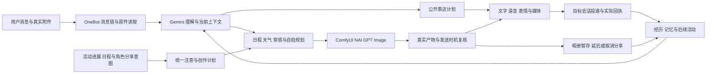

# 天枢语音 视觉 表情 OneBot 与自拍生图改造详案

日期：2026-10-31。状态：研究与设计，未实施。本文细化[完整改造说明](tianshu-coherent-companion-system-2026-10-31.md)与[施工队列](tianshu-coherent-companion-refactor-queue-2026-10-31.md)，相关能力属于本次完整交付。

确定采用：Gemini 3.8 主理解路线、可选辅助视觉、Fish Audio 优先的语音合成和辅助转写、按角色回应意图选择表情、OneBot v11 全消息链与 API 适配，以及同时支持用户请求和角色主动分享的自拍规划、ComfyUI/NovelAI/GPT Image 引擎。用户已购买 Fish Plus 年费；接入方案同时覆盖官方 MCP 的网页订阅额度和原生 API 的独立额度。实际供应商 model ID、协议和模态能力以配置及验证结果为准，不根据显示名称猜测。

## 1 当前系统与实际安装核对

### 1.1 AstrBot 实际页面

在用户指定的 `192.168.31.210:26185` 已登录页面进行只读检查，看到：

| 项目 | 页面显示 |
|---|---|
| AstrBot | 4.27.3 |
| 我会永远陪着你 | 6.4.5b，已打开 |
| 表情包管理器 | 4.15.4，已打开 |
| ComfyUI 工作流 | 1.1.2，已打开 |
| 我会画给你看 | 0.4.1，已打开 |
| 当前查看的表情包 | 67 张，标记为未语义化 |

这确认了插件身份与页面状态，不能据此宣称已启用向量选择或已经验证发送效果。陪伴插件面板本次显示空白，未读取到其具体实验开关；没有借此修改、重启或升级插件。

公开源码另行区分：陪伴插件当前上游为 7.0.5；本次同时读取与安装版本对应的 `v6.4.5b` 标签提交。表情包管理器上游为 5.2.11，图像扩展上游为 0.4.5。安装版本不等于这些新版本，标签匹配也不能证明本机没有额外改动。

### 1.2 天枢已有能力及缺口

| 实际源码 | 已有能力 | 本次补齐 |
|---|---|---|
| [sdk.py](../../projects/tianshu-companion/integrations/nonebot/tianshu_nonebot/sdk.py) 与 [rpc.py](../../projects/tianshu-companion/integrations/nonebot/tianshu_nonebot/rpc.py) | 原始消息链、作者、引用 ID、精确 @；出站 image/record/video 与实际消息 ID | 入站仍只接受纯文本/引用/普通 @，媒体或 @all 会使整条变 unsupported；出站缺完整有序消息链 |
| `rpc.py:146` 的媒体白名单 | PNG/JPEG/WebP、WAV/MP3/OGG、MP4 | 没有 GIF；需增加保留动图和其他已验证格式的媒体链 |
| [Gateway.complete](../../projects/tianshu-companion/src/tianshu_companion/clients.py:1494) | 当前 Companion 主调用固定走 `/v1/chat/completions` | 需要真正的原生 Gemini 编译/响应适配；不能因网关能代理就推断 Companion 已完整传递所有模态 |
| [role_actions.py](../../projects/tianshu-companion/src/tianshu_companion/role_actions.py) | 实际图像、视频帧和音轨可成为工具内容 | 接入原始用户图片/语音，统一模态与来源，不只限于阅读工具结果 |
| [书籍音频 Providers](../../projects/tianshu-platform/services/platform/media/books/audio/providers.py) | Edge、Fish 与 OpenAI 风格语音 API，音频与时间边界 | 复用合成能力到 BOT 短语音；分开书籍长任务与聊天短任务预算 |
| [skills/image.py](../../projects/tianshu-companion/src/tianshu_companion/skills/image.py) | 普通对话可请求自拍/衣服/场景，成品自动回原会话 | 保留现有自然语言入口，补足场景快照与多引擎能力 |
| [runtime_execution.py:690](../../projects/tianshu-companion/src/tianshu_companion/runtime_execution.py:690) / [runtime_photo.py](../../projects/tianshu-companion/src/tianshu_companion/runtime_photo.py) | 主动表达可决定带图，候选绑定原生成任务，等待真实产物后统一投递；图片完成事件有防再触发处理 | 演进既有主动链，接通日程/角色创作、暂存后分享和双阶段时机判断，不误判为只有被动自拍 |
| [image_prompt.py](../../projects/tianshu-companion/src/tianshu_companion/image_prompt.py) | 衣橱、活动、房间、天气、季节组合为语义提示 | 补请求时刻、日程实际状态、天气来源时效、摄影构图及跨字段一致性 |
| [image_provider.py](../../projects/tianshu-companion/src/tianshu_companion/image_provider.py) / [image_comfy.py](../../projects/tianshu-companion/src/tianshu_companion/image_comfy.py) | 已有 ImageProvider、ImageResult、ComfyUI 提交与恢复 | 演进同一接口，增加 NAI/GPT Image 编译与传输；不另造生图调度器 |
| [image_backend.py](../../projects/tianshu-companion/src/tianshu_companion/image_backend.py) / [web_weather.py](../../projects/tianshu-platform/services/platform/web_weather.py) | 角色与服装参考图的来源校验、天气设置与查询 | 复用已配置来源和参考，不从零重做天气、衣橱或人物一致性 |

旧 `docs/images.md` 中“普通聊天不调用 ComfyUI”等早期限制已不能描述当前源码，本次以实际 `ImageSkill` 和调用链为准。当前多模态实际质量、真实语音播放和所有协议动作尚未由本次只读检查验证。

## 2 主模型 辅助视觉与原生协议

用户配置的 Gemini 3.8 继续承担主要对话和多模态理解。以官方 `gemini-3.8-flash` 为例，输入支持文本、图片、音频、视频与 PDF，输出为文本；音频生成、图像生成和 Live 是不同能力，不能从“多模态输入”推导出这些输出已经接通。[官方模型说明](https://ai.google.dev/gemini-api/docs/models/gemini-3.8-flash)

| 工作 | 默认路线 | 辅助模型的用途 |
|---|---|---|
| 用户发图片并提问 | 原图或必要分区直接交主模型 | OCR、缩略预处理、复杂图局部分析；结果可被主模型复查 |
| 用户发语音 | 主模型接实际音频，形成回复 | 需要转写时优先 Fish ASR；用于展示/检索，涉及语气或声响时保留音频 |
| 表情包入库标注 | 后台视觉路线 | 提取画面、OCR、动作、语用含义及动图变化 |
| 表情检索 | 已有 embedding 路线 | 必要时对少量含糊候选做视觉复核 |
| 大批媒体预处理 | 后台辅助视觉/ASR | 预计算与缓存，避免占满主聊天资源 |
| 说话 | Fish TTS，普通文件语音优先 Plus MCP | 原生 API 承担流式/时间戳等 MCP 未确认能力，保持稳定音色 |
| 自拍规划 | 主模型或已指定的 image.plan 路线 | 产出结构化 ImageIntent；具体渲染交图像引擎 |

**推荐保留一个可配置的辅助视觉槽，但不强制每张图先经它描述一遍。** 主模型本来能直接看图，额外串行视觉调用会增加延迟，还可能在文字摘要中丢失信息。辅助路线未配置时，按后台预算使用已允许的主模型路线；同额度组仍遵守前台预留。现有 4GB 本地 GPU 不默认装入朋友使用的 7B 视觉模型，是否本地化沿实际显存、质量和持续负载结果决定。

内部 `ModelRequest` 保留有序文本/图片/音频/视频、MIME、文件引用、时间范围、工具、思考配置和能力要求，由提供者 adapter 生成原生请求。Gemini 原件通过该实际入口支持的文件或内联方式传递；供应商返回的工具关联和续轮所需原生字段保持完整。对外网关仍同协议透传，不把客户的 OpenAI 请求自动改写成 Gemini 协议。

配置页必须同时显示“模型宣称支持”和“当前路线已验证支持”。第三方中转即使模型叫 Gemini 3.8，也可能只开放部分输入；不能把音频丢掉后当作成功。模态转换、读取覆盖与缺失均进入结果元数据。[Gemini 音频理解](https://ai.google.dev/gemini-api/docs/audio)、[视频理解](https://ai.google.dev/gemini-api/docs/video-understanding)

## 3 听懂语音与看懂图片

统一路径是：

> OneBot 原始有序消息链 → 身份与处理模式 → MediaResolver 获取原件 → 必要解码/分区 → 主模型或辅助路线 → 带来源的观察 → 当前回复及后台记忆。

### 3.1 媒体对象与读取

`MediaRef` 保存原消息、段序号、提供者文件 ID、实际 MIME、字节摘要、大小/时长、作用域、原件位置及可用期限。文件路径属于产生它的协议端/容器，不能直接当成天枢本机路径；临时 QQ URL 也不是永久资源地址。读取通过对应来源适配器，在允许范围内获取并生成稳定引用。

图片支持静态图、长图和 GIF/动态 WebP；原件用于发送与精细复查，模型输入可以是选帧/分区。必须保留“处理了哪些帧/区域”的信息，不能把中间一帧当作整段动画。损坏、过期和不支持格式分别处理，不静默丢掉同条消息中剩余文字。

语音先识别实际容器/编码，使用协议端 `get_record` 能力或明确的解码适配处理 QQ 语音。不能只改后缀，也不能假设任意 FFmpeg 构建都支持所有 QQ SILK 变体。解码后得到主模型接受的音频表示，保留时长和原件对应关系。

### 3.2 转写与理解分别使用

转写是派生文本，不是第二条人类消息。原音频、转写、识别片段与最终回复共用一个来源事件，长期抽取不重复记忆。噪声、重叠说话或听不清的关键内容保留不确定；必要时自然询问关键一句，而非替用户猜出确定的人名、时间和承诺。

音频中的他人声音不自动建立账号身份；图片 OCR、引用消息与视频中的文本不改变调用权限或角色人格。用户问“她这句话什么语气”时应使用实际音频，单靠转写不能假装已经听到声音。

前台只等待当前理解所需的有限处理；整段长录音、整本扫描件和批量图库标注成为分片后台任务。主模型能直接理解的正常输入不强制经过 OCR→ASR→视觉总结→主模型四步串行流程。

## 4 Fish Audio 优先的完整语音接入

### 4.1 Plus 与 API：两种官方接入 共用一个语音领域

**用户的 Plus 年费有直接可用的官方接入方向：Fish MCP。** 官方说明 `https://api.fish.audio/mcp` 使用 Streamable HTTP 与 OAuth，消耗网页账户/团队额度；开发者 API 使用 API Key 和另一个余额，Plus 不自动兑换 API 余额。这一结论来自产品与协议文档，本次没有登录 Fish 账户核对实际余额。[MCP 说明](https://docs.fish.audio/overview/mcp)、[套餐与 API 区别](https://fish.audio/plan/)

| 路线 | 推荐用途 | 确认能力与边界 |
|---|---|---|
| `fish_web_mcp` | 普通 QQ 语音回复、主动语音、无需精确对齐的日常合成，优先使用现有 Plus | 官方 TTS 返回音频链接，支持声音搜索、克隆和文件转写；不据此假定拥有 REST 的全部参数或逐音频块流式能力 |
| `fish_native_api` | 精确时间戳听书、增量文本/音频流、需要完整原生参数的合成、文件 ASR | 原生 HTTP/SSE/WebSocket；独立 API 余额及实际并发限额 |

二者是同一 `capabilities.speech` 下的传输适配，共用 VoiceProfile、SpeechIntent、AudioArtifact、缓存、任务与结果。天枢服务端直接调用 MCP 工具，不为每句语音再启动 Codex/Claude 或另一个 LLM 代理。正常语音无需逐次确认；一次连接设置确定可用路线和是否允许 API 支出，运行中不因 MCP 失败就偷偷改用另一个收费账户。

网页当前公开 Plus 为每月 250,000 credits，年费不等于全年额度一次性到账；余额和单次上限以连接后的 `get_credit_balance` 为准。MCP 文档按 UTF-8 字节计 TTS，标签也计入，使用其他团队的专业克隆音色有加倍条件。因此不能把 credits 当成汉字数，或把营销中的分钟数当中文用量保证。仅按每字约 3 字节估算，250,000 credits 约对应 8.3 万常见汉字，尚未计标点、标签、其他消耗或加倍条件。[套餐](https://fish.audio/plan/)、[MCP 计费](https://docs.fish.audio/overview/mcp#credits)

### 4.2 现有实现如何复用

现有 [providers.py:57](../../projects/tianshu-platform/services/platform/media/books/audio/providers.py:57) 已调用 `/v1/tts/stream/with-timestamp`，发送 model、reference_id 和 prosody，并解析 SSE 音频与累计对齐快照；本次下载的官方 OpenAPI 仍包含该路径，不能误删成“非官方旧接口”。[config.py](../../projects/tianshu-platform/services/platform/media/books/audio/config.py) 已有 `s2.1-pro`、`drama-3` 等模型配置，缺口主要是 BOT 消费者、完整参数、MCP、原生流式和统一资源治理。[官方 OpenAPI](https://docs.fish.audio/api-reference/openapi.json)

提取这些通用能力，书籍章节、阅读位置和章节缓存编排仍归 books。原有 Edge/兼容 speech 能力保留为明确配置的可选提供者；后续确需 Gemini TTS 时可接同一提供者接口，当前不为它建空壳类，默认语音及本次验收优先 Fish。普通 Gemini 主文本模型不冒充音频输出，Fish 自身的 Voice Agent 平台也不接管天枢的人格、记忆和对话循环。

### 4.3 原生模型与能力范围

| 能力 | 本次实现和默认选择 | 注意点 |
|---|---|---|
| 日常 TTS | 原生 API 默认显式指定 `s2.1-pro`；MCP 按实获工具 schema 选择可用模型 | 不依赖 SDK/服务端默认值，MCP 若不开放模型参数则记录为提供者选择 |
| 免费 API 与定制音色 | 显式选择 `s2.1-pro-free`，可使用有访问权的 `reference_id` 或参考录音；复用同一 VoiceProfile | 不扣 Plus 网页积分，不另建免费合成器；额度/有效期和可用性按实际路线显示 |
| 表现力较强的语音 | `drama-3` 作为可选语音表演 profile，适合精细停顿、情绪和局部词句处理 | 不把每句普通回复都升级到更高价格路线；质量需实际中文音色样本判断 |
| HTTP 文件与时间戳 | `/v1/tts` 与 `/v1/tts/stream/with-timestamp` | 普通语音不强制等待不需要的对齐；听书使用真实边界，保留原文映射 |
| 增量合成 | `wss://api.fish.audio/v1/tts/live`，MessagePack | start/text/flush/stop 与接收音频并行；不是 Chat Completions SSE |
| 文件转写 | 原生显式指定 `transcribe-1-pro`；MCP 使用工具实际支持的 pro/flash 参数 | 输出归属原音频，不重复形成消息；不同路线的同名档位不强行当同一 model ID |
| 音色与发音 | 公共/自有音色查询、角色绑定、样本试听、受支持克隆、发音词典/单次读音 | 模型、voice ID、词典 ID 分开；仅在用户发起音色创建时处理样本与所需授权 |

官方当前推荐日常生产使用 S2.1-Pro，Drama 3 于 2026-10-13 发布；S1 与 transcribe-1 已宣布 2026-12-31 退役，新装不保留它们作为默认回退。`s2.1-pro-free` 是有期限和条件的评估选项，不能承担一年订阅的长期可用承诺。[模型](https://docs.fish.audio/developer-guide/models-pricing/models-overview)、[Drama 3](https://docs.fish.audio/features/text-to-speech/drama-3)、[更新记录](https://docs.fish.audio/developer-guide/getting-started/changelog)

免费模型不是仅能用默认音色。官方明确其支持声音克隆；保存音色可由 `reference_id` 选择，参考录音按原生接口支持的 `references`/MessagePack 表达。天枢固定音色和模型分开配置，切换模型不擅自换声音，音色不可访问时准确报错。开发/试听可选择免费路线；当前方案保留 Plus 日常入口，不因新增免费选项自动修改全角色默认值。免费期目前公布至 2026-11-30，受公平使用、延迟及数据使用条件约束；到期或不可用不静默升级到付费模型。[免费模型与克隆](https://fish.audio/blog/s2-1-pro-free-api/)、[TTS 参数](https://docs.fish.audio/api-reference/endpoint/openapi-v1/text-to-speech)

原生 TTS 的 model 拼错可能被服务端静默改成默认付费模型，ASR 也存在不精确匹配时转到旧模型的行为。因此提交前使用已核验能力表，记录 requested/effective model；供应商未返回实际模型时标为未知，不把请求值冒充实测值。官方 SDK 与接口字段更新可能不同步，已有 aiohttp 原生传输可继续承载 SDK 尚未暴露的字段，不为使用 SDK 再包一层空转发。[TTS 契约](https://docs.fish.audio/api-reference/endpoint/openapi-v1/text-to-speech)、[ASR 契约](https://docs.fish.audio/api-reference/endpoint/openapi-v1/speech-to-text)

### 4.4 音色 人格 情绪与台词

`VoiceProfile` 保存角色、Fish 连接引用、voice ID、可用模型、稳定音色设定、词典版本和 profile 版本。`SpeechIntent` 保存 expression_id、公开台词、语气/强度、节奏、停顿、发声事件、输出模式与截止时间。角色当时的情绪及交流目的形成轻量 `VocalDirection`；稳定音色不随每轮情绪更换，也不由好感分选择“更亲密音色”。

主模型在已经存在的表达计划中决定这次怎么说，不额外串联“情绪分析模型→语音文案模型→语音监督模型”。公开文本与语音台词可以做数字、链接、符号的口语化，但否定、日期、数量和承诺保持一致；不将私人手记、内部推理或整份记忆发送给 Fish。

编译器区分 `display_text`、`spoken_text` 与带标签的 `synthesis_text`。S2 系列使用方括号方向描述；Drama 3 另支持其官方列出的局部成对标签。它们是模型能力，不能通用改写成 SSML；用户原文中的括号也不能未经区分地当成发声指令。情绪标签少而明确，过密笑声/喘息不作为自然陪伴的默认效果。[情绪控制](https://docs.fish.audio/developer-guide/core-features/emotions)、[Drama 3](https://docs.fish.audio/features/text-to-speech/drama-3)

中文人名、多音字、称呼和项目名使用角色/用户允许范围内的读音词典。原生请求支持已发布词典的 id/version 或单次内联规则，缓存包含词典版本；MCP 未确认支持的字段不能假装已经应用。官方提示无法解析的词典引用可能被跳过，所以试听专名比 HTTP 200 更能验证效果。`language=zh-CN` 影响归一化和对齐，不等于修改音色口音。[发音词典](https://docs.fish.audio/developer-guide/core-features/fine-grained-control/pronunciation-dictionaries)、[中文读音](https://docs.fish.audio/developer-guide/core-features/fine-grained-control/chinese)

### 4.5 MCP 接入 认证与产物

服务端持有经过正常 OAuth 连接获得的凭据引用，沿现有密封凭据存储管理；一次绑定记录 team/workspace。令牌刷新、重启恢复、失效后重新连接的体验必须在实现阶段验证，不从“官方支持 OAuth”推断无人值守永不失效。本次未读取用户密钥、Cookie 或 Fish 账户。

连接后读取工具 schema，把 `text_to_speech`、`speech_to_text`、`search_voices`、`get_voice`、`get_credit_balance` 等接入对应领域用例；上传与创建音色仅由实际需要的用例调用。普通聊天模型无需看到钱包、凭据或整套 Fish 管理工具。长期保留单个连接配置与明确的调用结果，不靠网页自动点击合成。[工具目录](https://docs.fish.audio/overview/mcp/tools)

TTS 工具可能把长文本返回为多个片段，按实际顺序收取、校验并登记 AudioArtifact；不截取第一条链接就宣布全部完成。MCP 工具流式传输协议不代表逐块音频实时返回，工具文档未承诺时间戳或 WebSocket TTS 等价能力。需要这些能力时走配置完成的原生 API，或者准确说明当前路线不足。

MCP 文档说明生成音频链接可长期被持链者访问。天枢应把产物纳入现有受控媒体存储、向渠道发送文件，不在日志和长期记忆中保存公开链接；这不能撤销供应商原链接。连接设置应说明这个具体属性。已有数据位置/访问要求不允许此类链接时选择原生音频字节路线，不能把本地下载伪称供应商侧也已私有化。声音克隆显式采用 private 可见性；MCP 的默认可见性与 REST 不相同，不依赖默认值。[MCP 数据与音色说明](https://docs.fish.audio/overview/mcp#good-to-know)、[创建音色](https://docs.fish.audio/developer-guide/core-features/creating-models)

### 4.6 前后台并发 预算与流式语音

Fish 原生 API 的 TTS/ASR 按同账户共享并发；多个 API Key 不构成隔离。官方当前普通起始档为 5 并发，长转写持续占位，具体限额以账户为准。Broker 同时管理短回复预留、后台最大在途、UTF-8 字节预算、合成时长和有界队列；听书与批量转写按自然段/片段运行，不能占满短语音的槽位。[并发和计费](https://docs.fish.audio/developer-guide/models-pricing/pricing-and-rate-limits)

MCP 单独记录网页额度和连接级容量，不能照搬 API 的 5/15/50 并发数字。两种账单分开不证明提供者计算资源完全隔离，未确认的跨通道限制仍要观测。余额短时缓存，不每说一句就多调用一次账户接口；估计成本使用最终 synthesis_text 的 UTF-8 字节数，实际费用未返回时标为估计/未知。

流式 TTS 只接已确定公开且语义完整的文本片段，不能把尚未确认的模型 token、工具计划或内部标签先读出去；按句意缓冲，避免逐字 flush 导致断句破碎。HTTP 首音频、完整生成、下载/转码、渠道提交与实际播放分别计时，不拿官网首包延迟当 QQ 端到端延迟。[WebSocket 协议](https://docs.fish.audio/api-reference/endpoint/websocket/tts-live)

本批实现文件 ASR 与 HTTP/SSE/WebSocket TTS 适配。Fish 的 `transcribe-stream-1` 实时 ASR 已有官方 Preview，可供未来确实增加实时对话时使用；它每个长连接持续占并发并按会话时长计费，不能为普通 QQ 文件语音常驻开启。它的说话轮次检测/打断方案有参考价值，但当前不扩展原来排除的网页实时通话、电话平台或第二套托管对话代理。[实时 ASR](https://docs.fish.audio/features/speech-to-text/realtime)、[语音轮次示例](https://docs.fish.audio/developer-guide/sdk-guide/cookbook/realtime-voice-agent)

### 4.7 输出 投递 缓存与恢复

支持文字、语音、文字加语音及自然选择；“说给我听”“这条只打字”覆盖本次输出。主动问候、活动分享和自拍附言也能选择 Fish 发声，统一消费联系时机与表达预算，不另起一个自动说话定时器。网页提供文件播放及适用的增量播放，OneBot 用实际 `record` 文件；QQ 不因上游 WebSocket 就自动成为实时 PCM 播放器。

一次 expression 可含文字、图片与语音，使用稳定段序号和同一目标。optional 语音迟迟未完成时可只发已经准备好的主体并结束可选段；用户明确要求的语音则按该用例等待/报告真实结果，不能换成纯文字冒称已满足。三类媒体的部分成功分别记录，整次反馈只计一次；也不要求每张主动自拍都附带语音。

缓存键包括租户/允许范围、实际提供者及连接范围、model/version、voice/reference 版本、完整合成台词、语气/速度/语言、词典、格式与必要参数。命中有效音频可避免再次收费；账单未知不是零费用，已缓存音频不重复记一次新的经历。ASR 的缓存另按原音频摘要、模型和输出选项管理。

沿用现有“提交结果未知不盲重试”的语义：明确未开始的 429 可按截止与退避重新排队；402 停止该收费路线并显示余额不足；已开始后超时/断流保存原 attempt，MCP 缺少可查询句柄时如实记 unknown。取消本地等待不等于供应商已停止或退款；取消后晚到的音频可归档但不偷偷发送。渠道 unknown 不自动补发文字或第二条语音；OneBot 成功回执也不能证明对方已听过。

## 5 语义表情选择与表情包管理器

### 5.1 社区方案已验证的机制

与安装版本匹配的陪伴插件 `v6.4.5b` 确实存在向量机制：描述、可见文字、标签、情绪和交流用途组成 embedding 文本；向量关联提供者与元数据 hash，查询结合语义向量、词法、场景和使用偏好。[元数据与向量](https://github.com/menglimi/astrbot_plugin_private_companion/blob/30d7ed078daf325f9f449de6e834345d1c6eacb4/reaction_asset_library.py#L481)、[检索入口](https://github.com/menglimi/astrbot_plugin_private_companion/blob/30d7ed078daf325f9f449de6e834345d1c6eacb4/reaction_asset_library.py#L1138)

表情包管理器当前上游具有多包语义检索、提供者/维度检查、候选 ID 校验和动态图多帧标注。其实现不等于已安装 4.15.4 的全部行为，但这些机制适合作为设计参考。[多包查询](https://github.com/anka-afk/astrbot_plugin_meme_manager/blob/d5e9475b00669aecd6596bf49af159c889725a3b/backend/semantic/query.py)、[动图标注](https://github.com/anka-afk/astrbot_plugin_meme_manager/blob/d5e9475b00669aecd6596bf49af159c889725a3b/backend/semantic/caption.py#L285)

### 5.2 选图依据是角色回应的交流用途

统一 `ReactionIntent`：回复准备表达的意思、用途（安慰/庆祝/接梗/问候/婉拒等）、情绪与强度、对象、受众范围、是否反讽、近期已用素材和明确的用户要求。意图来源于本次实际回复及必要上下文，不只复制用户消息里的关键词。

例如用户说“考试没过”，角色正在安慰，查询应表达“温和支持、陪对方缓一缓”，不直接以“失败”选到嘲讽图片。用户说“太好了”但在讲反话，也不能仅按正面词选择庆祝图。图中文字、动作和反讽可能改变含义，必须进入候选解释。

建议链路：

1. 先判断本轮是否适合附图，尊重只文字、群场景和已有表达；显式索要表情直接进入检索。
2. 在当前角色/会话允许的素材包内，按用途、语言、禁用状态和实际文件存在性过滤。
3. 用现有 embedding profile 对“描述 + OCR + 动作 + 适用/不适用语境”检索，结合词法和场景约束产生少量候选。
4. 对候选按当前回复匹配、近期重复和风格适合度选择；讽刺或模糊图可按需做小规模视觉复核，普通清楚候选不强制额外模型调用。
5. 选中稳定 reaction_id 后再复核素材版本和发送目标，沿同一 ExpressionPlan 发送实际原图。

初始可采用候选约 12、复选约 3、默认附图最多 1 的预算，这些是工程起点，不沿用社区相似度阈值作为通用最优值。低匹配时正常使用文字；多样性只在适合的候选内发挥作用，不靠随机图或每三轮必发凑频率。

向量相似度不是发送概率。不同 embedding 模型/版本的数值不能直接混排；天枢默认复用同一已验证文本 embedding profile，素材与记忆各自存索引域。图像描述向量与 CLIP 类图文向量也不是同一种东西，本版无需再引入独立 CLIP/FAISS 服务。

候选绑定当前 expression_id、回复修订和素材版本。已经由工具发过图就不再自动附图；选图超出本轮预算时文字正常完成，用户已转话题的过期候选不补发。索引准备期间可使用同一检索器的明确标签通道或正常文字，不另留一套旧选择器。内部意图通过结构化结果传递，不依赖先把内部标签公开输出再正则剥除。

[STICKERCONV，ACL 2024](https://aclanthology.org/2024.acl-long.417/)将贴纸与对话语境、共情表达共同建模，支持把文字和表情作为一次完整回应评估。其数据包含模型模拟对话，评价也包含 LLM 指标；本方案只采用任务组织与评价维度，不把论文成绩当作这套图库的实际选图准确率。

### 5.3 素材管理的完整功能

管理器属于 `capabilities.reactions`，有一份素材权威和一条发送链。保留用户喜欢的图包管理体验：导入图片/动图/资源包、导出、批量分类、预览动画、编辑标签与描述、启用禁用、按角色/会话选包、去重、标注进度、增量建索引、检索试用及纠错。

素材记录至少包含文件摘要、原件引用、缩略图、MIME、尺寸/时长、OCR、画面动作、用途、反讽/强度、适用范围、版权/来源说明和索引版本。删除或修改描述后只重建受影响项；任务失败可继续，不反复整库计费。来源与文件消失时失效，不能向用户发一个已不存在的候选 ID。

自动收集服从现有场景设置：识别为聊天表情的素材进入对应范围，普通个人照片和聊天截图不自动加入共享图库。管理页可修正，审核模式是用户可选功能，不新增逐张强制确认。云同步或资源广场使用已配置外部能力，不成为本地使用的前置依赖。

现有 AstrBot 图库可通过一次性素材包导入复用图片、标签和描述；向量按天枢 profile 重建。该导入是外部资料能力，不保留 AstrBot 旧业务库、运行时双写或两个插件同时自动附图。没有要求本轮修改或删除 AstrBot 的 67 张素材。

## 6 OneBot 完整支持的明确范围

当前 QQ 链路使用 OneBot v11。因此本版以 **v11 固定标准的消息、事件、API 与四种传输完整适配，并接入当前协议端的必要扩展** 为完成目标。OneBot v12 有不同规范，不混写成 v11 的同一份字段；本版不以“兼容 OneBot”冒称已完成 v12。

对端版本、账号权限和 QQ 平台限制可能使部分标准功能不可执行。连接器必须完整识别、路由并准确返回结果，不能制造成功，也不能保证所有协议端实现了所有动作。公开支持矩阵分别记录实现、配置、对端能力与实机验证。[OneBot 11 标准](https://github.com/botuniverse/onebot-11/tree/d4456ee706f9ada9c2dfde56a2bcfc69752600e4)

### 6.1 有序消息链

内部从 `TextEvent + media尾缀` 演进为有序 `MessageEnvelope.parts[]`，保留 text、face、image、record、video、at、reply、share、contact、location、music、forward/node、xml/json、rps/dice/shake/poke/anonymous 等标准类型及其不同规范条目。未知扩展保留为有界 NativeExtension；不因某一段不理解而清空整条消息，也不把富媒体转成一段不可逆的文本。

| 用户要求 | 必须打通的行为 |
|---|---|
| 音频/视频/图片 | 入站原件解析与获取、交模型、出站媒体、真实回执；GIF 保留动画 |
| 引用与回复 | 保存原消息 ID、当前作者与引用作者；按允许范围取原文；出站原生 reply 段 |
| @某人 | 使用稳定账号 ID，展示名不替代身份，段顺序保持 |
| @全体 | 原生 `at.qq=all`；入站不再因此变 unsupported；出站核对群权限和对端限额 |
| 群公告 | 注册对端扩展的读取、发布、删除及返回状态，不伪装成普通群消息 |
| 合并转发 | 保留节点作者、顺序、内容与引用；不把节点作者当成当前发送人 |
| XML/JSON 卡片 | 按数据解析和受控展示，不执行其中脚本或工具指令 |
| 文件与群文件 | 作为对端扩展处理上传/下载/引用和实际文件身份，不用本机路径冒充远端文件 |

优先使用 SDK 数组消息结构；CQ 字符串只在真正需要的协议边界做规范转义/解析。纯文本中的 `[CQ:...]` 不自动被业务模型执行。Message ID、账号 ID 和群 ID 的类型分别处理，避免 JavaScript 大整数精度丢失或把可能为负的消息 ID 按 QQ 账号规则拒绝。

### 6.2 API 事件与传输

固定标准包含 38 个公开 API、1 个隐藏快速操作 API、23 个消息段规范条目（含同类段的变体）。建立完整目录，不能仅实现 send_msg 就把“完全支持”打勾。

| API 类别 | 标准入口 |
|---|---|
| 消息 | send_private_msg、send_group_msg、send_msg、delete_msg、get_msg、get_forward_msg、send_like |
| 群管理 | set_group_kick、set_group_ban、set_group_anonymous_ban、set_group_whole_ban、set_group_admin、set_group_anonymous、set_group_card、set_group_name、set_group_leave、set_group_special_title |
| 请求处理 | set_friend_add_request、set_group_add_request |
| 账号与群查询 | get_login_info、get_stranger_info、get_friend_list、get_group_info、get_group_list、get_group_member_info、get_group_member_list、get_group_honor_info |
| 媒体 | get_record、get_image、can_send_image、can_send_record |
| 凭据与运行管理 | get_cookies、get_csrf_token、get_credentials、get_status、get_version_info、set_restart、clean_cache |
| 快速操作 | .handle_quick_operation |

协议支持与模型授权是两回事。凭据类结果只供已有管理/适配用途，不能进入模型材料或普通日志；群管理继续使用真实主体与已有权限。无需新建另一套审批系统，也不能因为模型提了一个 API 名就授予群管理能力。

消息、通知、请求、元事件都进入明确处理器。群/好友撤回更新来源可用性；成员、管理员、禁言和请求事件更新对应状态；心跳/生命周期只影响运行状态，不作为聊天事实。陌生通知和不认识的 subtype 保留可诊断信息，不能强行归属某个用户画像。

HTTP API、HTTP POST 事件上报、正向 WebSocket、反向 WebSocket 通过现有 NoneBot OneBot SDK 能力接入，并共用同一消息模型和回执。处理鉴权、echo 关联、重连、重复上报、有序性与合理背压。没有全局 event_id 的事件采用其真实字段和可用传输身份去重，不许把时间窗口去重冒充协议保证的 exactly-once。

### 6.3 NapCat 与当前 QQ 协议端扩展

群公告、群文件、@全体剩余次数、部分转发/视频/表情相关接口属于具体实现扩展。使用提供者 adapter 和版本能力表，不把全部扩展写进 OneBot 标准类。[NapCat 官方兼容表](https://doc.napneko.icu/develop/api)与[API 入口](https://napneko.github.io/onebot/api)及其版本化接口文档用于逐项核对。

例如群公告常见 `_send_group_notice` / `_get_group_notice`；具体发送字段、删除方法和回执按实际对端文档/响应确认。现有 SnowLuma 链路也要以其真实版本和能力验证，不能因 API 名相似就宣布与 NapCat 全部等价。

状态使用 supported、unavailable_by_provider、permission_denied、not_configured、unknown 等明确原因；配置页能查。API 成功、消息被服务端接受、用户已读/已播放分开。写动作结果未知时查询原身份，不盲目重试撤回、公告、发送或群管理。

## 7 自拍从生活状态到真实图像

### 7.0 主动拍照与主动分享属于本次完整交付

**自拍有三种入口：用户现在要看、明确的日程约定、角色自己想创作或分享。** 三者使用同一生图用例和投递链；“主动”不是在聊天里口头说“给你看照片”，也不是等用户每次提示才调用工具。

#### 插件中已经有哪些实现

本次核对与安装版本对应的 `v6.4.5b` 标签，确认以下实际代码路径；这比用最新上游 README 推断本机能力更精确，但仍不是本机运行测试。

| 对应源码 | 可吸收机制 | 天枢的取舍 |
|---|---|---|
| [proactive_engine.py:9645](https://github.com/menglimi/astrbot_plugin_private_companion/blob/30d7ed078daf325f9f449de6e834345d1c6eacb4/proactive_engine.py#L9645) | 日程、活动、天气、分享动机参与选择 `photo_text` | 保留有情境的自主媒介选择；关系分值或随机概率不单独触发发图 |
| [proactive_message.py:3347](https://github.com/menglimi/astrbot_plugin_private_companion/blob/30d7ed078daf325f9f449de6e834345d1c6eacb4/proactive_message.py#L3347) | 主动生成轮可以调用 `pc_generate_photo`，产物交给统一发送流程 | 天枢用明确的 artifact/delivery 结果表示暂存发送，不复制内部静默字符串协议 |
| [proactive_message.py:9490](https://github.com/menglimi/astrbot_plugin_private_companion/blob/30d7ed078daf325f9f449de6e834345d1c6eacb4/proactive_message.py#L9490) | 先判可用性，再规划场景/参考并实际生成；失败不声称已拍 | 复用天枢能力目录和单一 action/attempt，生成与发送分别记状态 |
| [proactive_engine.py:10580](https://github.com/menglimi/astrbot_plugin_private_companion/blob/30d7ed078daf325f9f449de6e834345d1c6eacb4/proactive_engine.py#L10580) | 接收延后投递的生成图片，与主动正文一起交给发送链 | 消除生图工具自行发送与主动发送重复出图 |
| [proactive_message.py:9757](https://github.com/menglimi/astrbot_plugin_private_companion/blob/30d7ed078daf325f9f449de6e834345d1c6eacb4/proactive_message.py#L9757) | 当日穿搭图按日期复用，并用生成锁防重复 | 日程一次性键与参考版本实现去重，不把每天必发自拍做成固定任务 |

不照搬其中 friend/owner 决定是否可发图的限制、附着情绪提高概率的固定规则或大 Mixin 互访。天枢关系、实际权限、联系偏好和创作资源保持各自归属。

#### 天枢已有的主动骨架需要延续

[runtime_execution.py:690](../../projects/tianshu-companion/src/tianshu_companion/runtime_execution.py:690) 已把生活、短期情绪、来源和 `photo_available` 交给主动表达决策，并保存 photo 意图；[runtime_photo.py:60](../../projects/tianshu-companion/src/tianshu_companion/runtime_photo.py:60) 以候选 ID/版本绑定原 image job，提交前复核来源，等待成品后交给统一发送。`image_completed` 也已有防再次带图和原订阅排除逻辑。

因此本次不是从零补一个“主动自拍插件”，而是把这段链路迁入新领域结构，解决三处能力缺口：角色创作可不绑定即时联系人；创作完成可以暂存后分享；日程、预算和发送时机在同一个 AttentionPolicy 中决策。普通 `activity_tools` 对 actor_only 的限制不能被全局删除来放行所有工具，应给角色自有创作明确的活动用例，联系人选择仍归联系策略。

#### 完整执行链

1. **形成意图。** 活动阶段变化、换上已确认的新衣服、完成创作、景象变化或既有计划产生 `PhotoIntent`；原因、相关活动和经历必须有出处。“想分享”允许个性化和适当随机性，不要求每到一个整点都调用模型。
2. **区分用途。** `create_only` 为她自己的相册创作；`share_candidate` 是可撤销分享；`requested_delivery` 是用户请求或明确约定的交付。没有当前聊天窗口也可以创作，不能凭空猜联系人。用户请求和明确约定不需要通过普通主动消息的新奇度筛选。
3. **生成前判断。** 普通分享先判断已配置联系偏好、时段、内容新鲜度、生成预算和引擎可用性，避免明知无法分享仍反复烧图。若她独立有创作目的，可按创作预算存相册；停止主动联系不必停止所有创作。
4. **执行。** 取得 SceneSnapshot，规划 ImageIntent，选择允许该真实触发来源的引擎，交 CR11 同一动作执行器；长生图不占对话位或聊天模型 permit。
5. **成品后复核。** 图片 ready 后再检查实际受众、来源权限、当前会话、联系窗口、取消/改期和内容时效。此时可发送、延后、仅归档或取消分享。生成已经收费不构成必须发送的理由。
6. **准确分享。** 发送使用冻结快照的时态；下午生成晚上才分享可说“下午留的这张”，不能描述成此刻正在做。需要附言时基于实际成品及场景生成，可选 Fish 语音，不能预先说图已发或忽略画面明显不一致。
7. **回流。** 作品完成、投递、用户回应是不同事件。对方喜欢某种场景/媒介才能形成有范围偏好；沉默不扣好感，也不反复重发求回应。作品和自己的附言不再制造一轮“新经历→新自拍”的自激循环。

`PhotoIntent` 作为 image action 的输入保存，复用现有通用 Action/Attempt 表，不再建一套照片任务账本。必要字段包括 `origin=user_request|explicit_schedule|autonomous_activity`、角色、来源/活动版本、用途、目标引用（仅需发送时）、有效窗口、快照版本和去重键；生成 attempt、artifact、expression/delivery 各有自己的真实状态与引用。普通事件重放沿同一键恢复；用户主动要求“再拍一张”是新的明确意图。

普通主动自拍为 elastic；用户眼前请求为 interactive；明确约定且临近窗口才是 due。生成预算按角色/资源组管理，联系预算按实际对象与会话管理；多个媒体段不多算联系次数。提供适度的次数/成本上限与冷却设置，但不再让好感等级解锁自拍。

例如她在小屋读完一段内容，想分享窗边阅读的形象：活动产生候选，当前穿搭与雨天光照进入快照，本地 ComfyUI 出图；若此时用户开始忙碌，则图片留在相册，候选到下一合理窗口再评估。若期间用户说“让我看看”，按现有产物和新请求处理，能够复用合适作品，不同时再跑一次主动生成。显式要求新图时才另建任务。

### 7.1 场景快照

用户说“看看今天的自拍”时沿现有 `life_image_request` 进入用例；角色主动候选和日程从第 7.0 节的入口进入同一个用例。均不要求重复填写提示词、工作流节点或先建衣橱。取得 `SceneSnapshot`：

| 部分 | 来源与用途 |
|---|---|
| 角色身份 | 当前人格外观、参考图、已配置 LoRA/模型与风格绑定 |
| 时间 | 角色世界时区、此次拍摄意图的当地日期与时刻，确定光照/时段；与发送时刻分开 |
| 当前活动 | 实际活动状态、日程阶段、暂停/等待原因；计划不冒充完成 |
| 地点与世界 | 当前房间、角色地点、虚构世界或明确现实映射 |
| 天气 | 已配置位置的天气来源、观测时间和有效期；不推测用户实时位置 |
| 穿搭 | 已选服装、允许的参考；缺省可沿请求/模板选择本次服装，不凭空宣称过去穿过 |
| 本次意图 | 用户要求或角色创作/分享动机，自拍、镜头/动作、构图、参考图或本次修改 |

天气未知时可以选不依赖天气的室内场景并保留 unknown，不为一张自拍阻断正常使用，也不编造晴雨。真实天气与虚构世界天气明确区分。整次任务冻结该快照与参考版本，生成期间普通时间推进不触发反复重做；用户明确修改要求形成新意图或取消尚未执行的旧任务。

### 7.2 提示词规划与一致性

统一 `ImageIntent` 表达 character、outfit、activity、scene、local_time/light、weather、pose/expression、camera/composition、style、negative_constraints、references 及用途。主模型可以规划镜头和场景细节，固定身份与工作流配置由程序提供；最后核对跨字段一致性。

例如角色当前在房间阅读，当地下午、已知下雨，自拍可呈现参考角色与当前衣着、窗边柔和阴天光、手边正在读的书、自然的近景构图。不能因为日程写着“晚上散步”就画成已经在夜晚户外，也不能把她没实际读过的章节写成读后纪念。角色形象是生成作品，产物事实是“生成了这张图”，不证明现实拍过照或去过该地点。

规划输出进入“提示预览”：展示这次使用的场景、时间、天气依据、参考和最终提示；正常请求自动走已配置路线，不增加逐次审批。用户可要求换衣服、改角度、换背景，编辑延续原产物和变更意图，不默默换成其他角色。

### 7.3 引擎接口与实际实现范围

继续演进已有 ImageProvider。统一请求、结果、产物和回执；每个 adapter 声明能力并实现真正支持的操作，而非强迫每家伪造 poll/cancel。

| 统一部分 | 内容 |
|---|---|
| EngineProfile | provider、model/workflow、凭据引用、模态、尺寸/格式、参考/编辑能力、异步/查询/取消能力、资源组 |
| ImagePlan | 场景与语义意图、参考版本、显式参数、来源范围、任务触发来源 |
| compile / validate | 生成原生请求或 ComfyUI API graph，返回不支持项与实际映射 |
| submit / result | 一个持久 submission/attempt，返回同步产物或真实异步句柄 |
| poll / cancel | 只在提供者实际支持时暴露；取消本地等待不冒充停止远端生成 |
| Artifact | 实际 bytes/MIME/尺寸、摘要、引擎/版本、场景快照、来源和完成状态 |

**本次施工要求把三种 adapter 的配置、编译、传输和结果处理落实，不能只留空类。** ComfyUI 接现有本地工作流；NAI/GPT Image 没配置账号时标为未配置，契约测试可用合成响应，但不能标成真实生成验收通过。后续填入供应商与模型配置即可使用已实现能力，不再改生活和对话主链。

### 7.4 ComfyUI

复用现有 workflow/catalog、语义槽映射、模板版本、reference 上传、ImageResult 与未知任务恢复。配置时把角色、服装、动作、背景、镜头、负面、尺寸、seed 等绑定到实际工作流允许的输入；聊天时只提交语义意图。

Anima 自然语言、标签型工作流和不同 LoRA 有各自编译 profile。保留已配置角色/画师/模型节点，不让模型每次重造完整 graph。可选字段没对应节点时要有明确不支持结果，不把参考图路径写进纯文本就声称完成图像参考。

实际 API 使用 `/prompt`、`/history/{prompt_id}`、`/queue`、`/view` 等已支持能力。按任务句柄处理进度与取消，不能调用全局 interrupt 中断其他用户工作；已经提交而回执不明时不重复 POST。[ComfyUI 官方路由说明](https://docs.comfy.org/development/comfyui-server/comms_routes)

### 7.5 NovelAI

采用官方图像 API，根据实际模型编译 `input`、`model`、`action`、`parameters`；区分正面/负面、角色提示、seed、尺寸、采样和参考等能力。官方接口可返回 ZIP，部分接口支持 JSON/base64 与 SSE，结果处理以实际 Content-Type 和所用契约为准，不套 OpenAI 响应结构。[官方 API 定义](https://image.novelai.net/docs/doc.json)

参考能力按模型声明启用。官方 Precise Reference 文档目前注明其模型范围及与 Vibe Transfer 的限制，不能把 ComfyUI LoRA、NAI 参考和 GPT Image 参考当成同一种参数。[参考图说明](https://docs.novelai.net/en/image/precisereference/)

官方生成 API 还注明请求由人工动作发起。因此用户说“看看今天自拍”的请求可以进入该路线；纯自主日程批量作画默认走本地 ComfyUI 或其他允许该用途的提供者，不能用定时器伪造用户请求。这是引擎的实际使用条件，不增加本次用户请求的重复确认。

### 7.6 GPT Image

图像引擎直接使用 Images API 的生成/编辑能力；Gemini 负责规划时，不需要为调用 GPT Image 再引入一个常驻 OpenAI 对话代理。编译为明确自然语言、原生参考图与所选模型支持的质量、尺寸、背景、格式及编辑参数。[OpenAI 图像生成官方文档](https://developers.openai.com/api/docs/guides/image-generation)、[编辑接口](https://developers.openai.com/api/reference/resources/images/methods/edit)

不把 NAI 的加权标签、采样器或 ComfyUI 节点名直接当 GPT Image 参数；不向不支持的模型发送同一套 input_fidelity/mask 等字段。模型名称可配置，能力按对应官方版本核验。输出图像、usage 与错误按原生语义记录，缺少字段不填零冒充测得。

### 7.7 成品 投递与经历回流

生成成功 → 校验可解码文件与产物属性 → 保存场景/引擎/参考来源 → 可选有限视觉一致性检查 → 按用途复核发送时机 → 原请求会话或已确定主动目标的统一投递 / 相册暂存 → 准确回执与生成作品经历。图片生成器只交产物，最终只有 ExpressionPlan 的渠道执行者拥有发送权。

一致性检查关注明显错角色、错服装、昼夜或场景矛盾；它不是“看起来不错就自动循环重抽”的无限任务。允许一次受预算约束的明确修正，仍不合格则保留实际结果/失败原因，由用户决定下一步；不隐藏费用与失败。模型自评不能保证角色外观完全一致。

生图、视觉标注和长语音合成有独立资源预算，不能占住主聊天模型 permit。图片生成结束也不自动更新当前穿搭或把画中场景写成实际完成活动。

## 8 数据与模块归属

| 能力 | 规则拥有者 | 与原闭环连接 |
|---|---|---|
| OneBot 编解码、传输与对端能力 | channels.onebot | 可信输入、投递与 API 回执 |
| MediaResolver 与感知读取 | capabilities.perception + sources | 原件、表示、覆盖和派生观察 |
| 稳定音色与表达意图 | companion.expression | 同一角色、同一次公开表达 |
| TTS 执行 | capabilities.speech | 真实音频产物与发送结果 |
| Fish 连接与计费 | speech 的 MCP/native adapter + 既有 credentials；models 管容量 | OAuth/API Key 和两本供应商余额分开，领域任务/缓存共用 |
| 图包、语义标注与检索 | capabilities.reactions | 有范围的素材选择，不是用户事实记忆 |
| 场景与自拍规划 | life 提供快照，capabilities.images 组织用例 | 活动/天气/穿搭到 ImageIntent |
| 主动自拍与分享时机 | life 的活动/AttentionPolicy，expression 决定公开内容 | 生成前与发送前判断，创作、暂存、分享与回应连接 |
| 引擎编译、生成与恢复 | capabilities.images 下各 provider | 一套 action/attempt/artifact，不加第二队列 |
| 模型调度 | models | chat、vision、audio、speech、image.plan、embedding 各功能与真实额度组 |
| 管理与预览 | web | 图包、声音、能力矩阵、引擎、场景依据与真实进度 |

PG 中增加或演进相应的素材目录、标注、向量投影、音色配置与场景快照。原件引用复用现有产物/媒体存储；素材向量用 pgvector 和既有 embedding profile。不要因为参考插件用了 JSON/SQLite/FAISS，就把这些都装成另一套底座。

## 9 必要验证

| 场景 | 要验证的结果 |
|---|---|
| 图片 + 文字 + 引用 + @ 混合消息 | 顺序和作者保留，图片确实到达模型，未因媒体段清空文字 |
| 语音中的专名、日期与噪声 | 实际音频理解；不确定时不伪造确定承诺；转写只记一次 |
| GIF 含义出现在后半段 | 标注读取多帧，实际发送仍保留动画 |
| 用户失落而角色安慰 | 选图对应角色的安慰意图，不机械选择嘲讽或庆祝 |
| 元数据修改、素材删除、模型换代 | 增量索引失效正确，旧候选不会继续发送 |
| TTS 成功但渠道 unknown | 不重复发语音或文字；可查询原回执 |
| Fish Plus MCP 首次连接、刷新与进程重启 | 连接正确 team/workspace；额度来自网页账户；刷新失败准确提示，不偷换付费 API |
| MCP 返回多个片段、未提供时间戳或模型选择 | 完整收取并记录能力限制；工具 HTTP 流不被冒称实时音频 |
| 原生模型拼错、词典无效、402/429/中途断流 | 不静默换模型；专名试听；明确拒绝与结果未知分别处理，缓存不会反复收费 |
| 免费 API 调用既有定制音色或参考录音 | 保持角色声线，模型/权限/编码正确；免费路线失败不自动耗 Plus 或付费 API 余额 |
| 长听书/ASR 与短语音并发 | 同账户总限额与前台预留同时成立，短语音不排在整本书后面 |
| 引用、@、@全体与群公告 | 原生结构和权限/限额正确；不以文本装饰冒充协议动作 |
| 通知、请求、撤回、重连 | 对应状态消费和去重正确，心跳不进入长期记忆 |
| 下午雨天室内阅读自拍 | 场景、当地时间、天气来源、衣着与角色一致；成品回原会话 |
| 没有用户发言，角色活动触发自拍 | 日程/分享意图实际调用引擎并可主动投递；不是口头宣称，也无需用户再发一次命令 |
| 生成期间变免打扰、取消或用户请求看图 | 允许暂存/取消分享；同一产物被新请求消费时取消重复候选；普通恢复不重复生成 |
| 自拍 + 文字 + Fish 语音及部分失败 | 同一个 expression，媒体顺序/实际结果准确，只计一次联系和反馈 |
| 天气缺失或新请求变更 | 合理使用未知/无关场景，旧提交不被盲目重复 |
| 三种引擎编译同一 ImageIntent | 语义保持、原生参数正确、不支持项明确，真实与合成验证分开 |
| 后台索引/生图/听书同时运行 | 前台理解与短语音仍有资源，后台不会永久饿死 |

协议编解码可用固定标准与现有测试覆盖；真实媒体播放、公告、@全体与生图效果按受影响实际入口验证，涉及外部动作时使用已有授权范围。正常开发不自动向真实群发测试公告或 @全体。通过一次适用验证后复用，不让每卡重跑全部矩阵。

## 10 证据边界和施工接线

公开源码：陪伴安装对应标签 `30d7ed078daf325f9f449de6e834345d1c6eacb4`；陪伴当前上游 `1b42d177546efd1e6b4c91ba57eab367c59d077f`；表情管理器 `d5e9475b00669aecd6596bf49af159c889725a3b`；图像扩展 `58ed7442c9720595144fd207ddf380ac604216df`；OneBot 标准 `d4456ee706f9ada9c2dfde56a2bcfc69752600e4`。只静态阅读相关路径，不声称完整审计这些仓库。

本轮没有改 AstrBot 设置、下载用户图库、生成索引、使用真实模型、生成图片/语音、发送消息或执行群管理。浏览器页面临时访问令牌不进入交付文档。

队列保留 CR01–CR20 主编号和六个专项块，共 30 块。此次增强 CR03 的 Fish 实际资源/额度、CR10 的自主照片意图、CR13A 的 Fish 文件 ASR、CR13B 的 Fish 完整语音、CR17A/B 的主动自拍和产物投递，并更新 CR13、CR18、CR19 消费与验证。没有再建一套语音或照片施工队列。

Fish 证据截至 2026-10-31：读取官方 MCP/工具、模型、价格并发、情绪/发音、SDK、OpenAPI、WebSocket 与实时 ASR 文档。独立 `asyncapi.yml` 下载返回 404，WebSocket 依据为官方页面内嵌的 AsyncAPI 内容；不能称所有机器定义均已可下载。公开文档与 OpenAPI/SDK 也存在字段更新时间差异，MCP 具体参数、账户权益、OAuth 长期刷新与实际中文音色须在实现时验证；本轮没有进行付费语音调用或账户授权。
